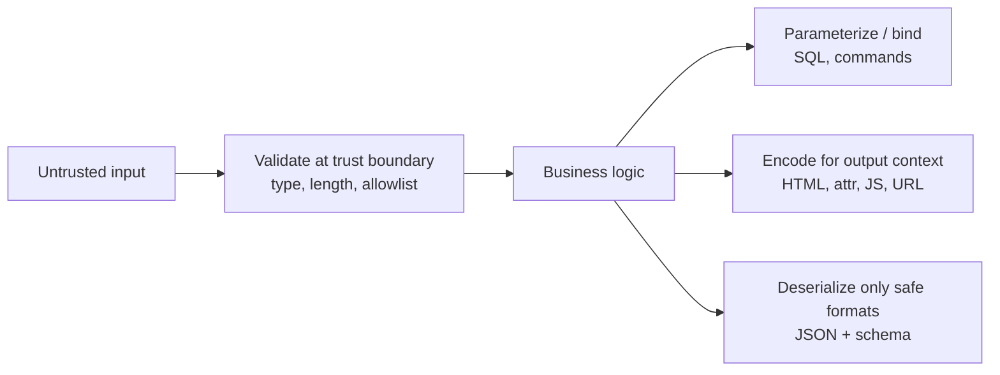

# Secure Coding

Hub: [[Security-Engineering-OS]]

## Mechanism

Most injection-class bugs share one root cause: **untrusted data crosses into an interpreter as code** (SQL, HTML/JS, shell, a deserializer). Secure coding keeps data and code in separate channels.



## 1. Input validation

- Validate at every trust boundary (HTTP, queue, file upload, IPC), server-side.
- Prefer **allowlists** (expected type, range, regex, enum) over denylists.
- Canonicalize before validating (decode, normalize Unicode, resolve paths).
- Validation reduces attack surface; it is **not** a substitute for encoding/parameterization.

```python
# Fixed: schema validation with pydantic
from pydantic import BaseModel, Field, conint

class Transfer(BaseModel):
    to_account: str = Field(pattern=r"^[A-Z0-9]{10}$")
    amount_cents: conint(gt=0, le=1_000_000)
```

Path traversal fix (Python):

```python
from pathlib import Path
BASE = Path("/srv/uploads").resolve()

def safe_open(name: str):
    p = (BASE / name).resolve()
    if not p.is_relative_to(BASE):   # Python 3.9+
        raise ValueError("path escapes base dir")
    return p.open("rb")
```

## 2. Output encoding (XSS prevention)

Encode for the **context** the data lands in: HTML body, HTML attribute, JavaScript, URL, CSS. Use auto-escaping templates (Jinja2 autoescape, Thymeleaf `th:text`, React JSX) and avoid raw sinks (`innerHTML`, `|safe`, `th:utext`, `dangerouslySetInnerHTML`).

```python
# Vulnerable
return f"<p>Hello {request.args['name']}</p>"
# Fixed: autoescaping template
return render_template_string("<p>Hello {{ name }}</p>", name=request.args["name"])
```

```java
// Fixed: OWASP Java Encoder
import org.owasp.encoder.Encode;
out.write("<p>Hello " + Encode.forHtml(name) + "</p>");
```

Defense in depth: a strict Content-Security-Policy (nonce-based), `HttpOnly` cookies, and HTML sanitization (e.g. DOMPurify, OWASP Java HTML Sanitizer) only when rich HTML is a real requirement.

## 3. Parameterized queries

```python
# Vulnerable: string concatenation
cur.execute(f"SELECT * FROM users WHERE email = '{email}'")
# Fixed: bound parameter
cur.execute("SELECT * FROM users WHERE email = %s", (email,))
```

```java
// Vulnerable
stmt.executeQuery("SELECT * FROM users WHERE email = '" + email + "'");
// Fixed
PreparedStatement ps = conn.prepareStatement("SELECT * FROM users WHERE email = ?");
ps.setString(1, email);
ResultSet rs = ps.executeQuery();
```

Identifiers (table/column names, `ORDER BY`) cannot be bound: map them through an allowlist.

```python
SORTABLE = {"name": "name", "created": "created_at"}
col = SORTABLE.get(sort_key, "created_at")
```

Same idea for OS commands: pass an argument list, never a shell string.

```python
subprocess.run(["convert", src, dst], check=True)  # no shell=True
```

## 4. Safe deserialization

Native object deserializers (`pickle`, Java `ObjectInputStream`, `yaml.load` with full loader) can instantiate arbitrary types and trigger code paths ("gadget chains") during deserialization.

```python
# Vulnerable
obj = pickle.loads(request.data)
# Fixed: data-only format + schema
data = Transfer.model_validate_json(request.data)
# YAML: yaml.safe_load, never yaml.load with an unsafe Loader
```

```java
// Fixed option A: use JSON (Jackson) with default typing disabled, bind to concrete DTOs
ObjectMapper m = new ObjectMapper();   // do NOT call activateDefaultTyping for untrusted input
TransferDto dto = m.readValue(body, TransferDto.class);

// Fixed option B: if Java serialization is unavoidable, allowlist classes (JEP 290)
ObjectInputFilter filter = ObjectInputFilter.Config.createFilter(
    "com.example.dto.*;java.base/*;!*");
ois.setObjectInputFilter(filter);
```

## Prevention checklist

- [ ] All SQL goes through parameterized queries / ORM bindings
- [ ] Templates auto-escape; raw HTML sinks are flagged in review
- [ ] No `pickle`, `ObjectInputStream`, unsafe YAML on untrusted data
- [ ] No `shell=True` / `Runtime.exec(String)` with user input
- [ ] Input schemas at every API boundary
- [ ] CSP header deployed
- [ ] SAST rules for these sinks run in CI ([[SAST-DAST-SCA]])

## Detection

- **Code review:** grep for sinks (`execute(f"`, `+ "' "`, `innerHTML`, `pickle.loads`, `readObject`, `shell=True`).
- **SAST** taint rules source -> sink; **DAST** to confirm exploitability.
- **Runtime:** WAF/log alerts on SQL errors returned to clients, CSP violation reports, unusual child processes spawned by app servers.

## Tradeoffs

| Control | Cost / limitation |
|---|---|
| Strict validation | Can reject legitimate edge-case input (names, i18n) |
| Autoescape everywhere | Needs explicit, reviewed escape hatches for rich text |
| CSP | Breaks inline scripts; rollout needs report-only phase |
| Banning native serialization | Migration effort for legacy RPC/caches |

## Interview Q&A

**Q: Is input validation enough to stop SQL injection?**
A: No. Validation narrows input, but parameterized queries are the actual fix because they keep data out of the query parser.

**Q: Why is output encoding context-dependent?**
A: Each context has different metacharacters. HTML-entity encoding does not make data safe inside a `<script>` block or a `javascript:` URL.

**Q: Why is `pickle.loads` on user input dangerous?**
A: Pickle can invoke arbitrary callables during load (`__reduce__`), so the attacker controls code execution. Use JSON plus schema validation.

**Q: How do you safely support user-chosen sort columns?**
A: Map user keys to a fixed allowlist of column names; identifiers cannot be bound as parameters.

See also: [[OWASP-Top-10]], [[Web-Security-Checklist-OWASP]].
