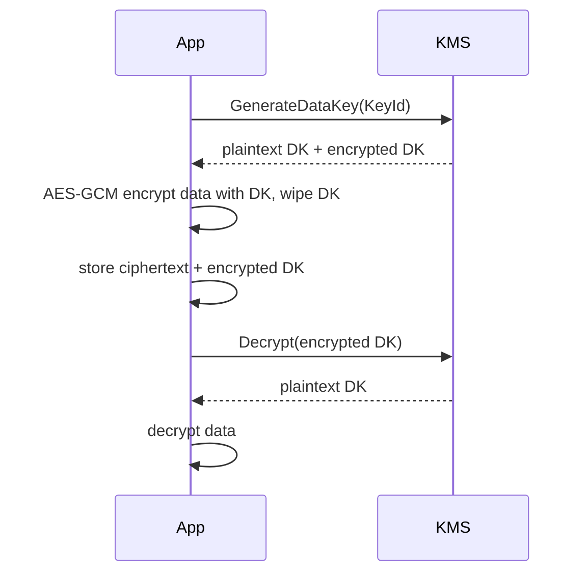

# AWS KMS and Encryption

Hub: [[Security-Engineering-OS]]

## Envelope encryption

KMS keys never leave KMS unencrypted and can directly encrypt only small payloads (up to 4 KB). For real data:

1. Call `GenerateDataKey` -> KMS returns a **plaintext data key** and the same key **encrypted under the KMS key**.
2. Encrypt the data locally with the plaintext data key (e.g., AES-256-GCM), then discard the plaintext key from memory.
3. Store the ciphertext alongside the **encrypted data key**.
4. To decrypt: send the encrypted data key to `Decrypt`, get the plaintext data key back, decrypt locally.

Why: bulk crypto is fast and local; only small key operations hit KMS; access to data is controlled by who may call `kms:Decrypt` on the key, and every call is logged in CloudTrail.

## Key types

- **AWS owned keys**: used by services internally, not visible to you.
- **AWS managed keys** (`aws/s3`, `aws/ebs`): created per service, you cannot change their key policy.
- **Customer managed keys (CMKs)**: you control key policy, grants, rotation, deletion. Required for fine-grained access and cross-account use.
- Symmetric (AES-256, default) vs asymmetric (RSA / ECC for sign/verify or public-key encryption) vs HMAC keys.
- Key material origin: AWS KMS, imported (BYOK), or custom key store (CloudHSM / external).

## Access control

- Every KMS key has a **key policy**. Unlike most resources, IAM policies only take effect if the key policy allows the account (the default key policy statement enabling IAM does this).
- **Grants** give temporary, programmatic delegation (used by services like EBS).
- **Encryption context**: non-secret key/value pairs bound as AAD; must match on decrypt, appear in CloudTrail, and can be used in policy conditions.

## Rotation and deletion

- Automatic rotation for symmetric CMKs creates new backing key material; old material is retained so old ciphertexts still decrypt. Key ID stays the same.
- Deletion requires a waiting period (7-30 days). Deleting a key makes data encrypted under it unrecoverable; prefer disabling first and alarming on `ScheduleKeyDeletion`.

## Service integration notes

- S3: SSE-S3, SSE-KMS (per-request KMS calls; S3 Bucket Keys reduce them), DSSE-KMS, client-side encryption.
- EBS/RDS: encryption at rest via KMS; enable account-level default EBS encryption.
- Secrets Manager / Parameter Store SecureString use KMS underneath.

## Defensive checks

- Alert on `DisableKey`, `ScheduleKeyDeletion`, `PutKeyPolicy` in CloudTrail.
- Separate key administrators from key users in key policies.
- Use encryption context to bind ciphertext to tenant or resource.

See also: [[Applied-Cryptography]], [[Cloud-Logging]].

## Interview questions

**Q: Why envelope encryption instead of calling KMS Encrypt on the data?**
A: KMS Encrypt is capped at 4 KB and every call is a network round trip; a local data key encrypts bulk data fast while the KMS key stays inside the HSM boundary. Rotating the KMS key does not require re-encrypting data.

**Q: Who can decrypt with a customer managed key?**
A: Only principals allowed by the key policy (and IAM, if the key policy delegates to the account via the root principal) plus any grants. The key policy is mandatory and is the primary control.

**Q: What does automatic rotation actually do?**
A: Creates new backing key material under the same key ID; old material is kept so existing ciphertext still decrypts. It does not re-encrypt data.
