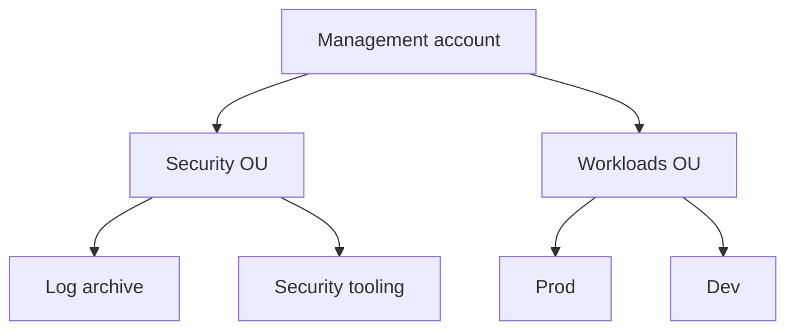

# AWS Security Fundamentals

> Scope: AWS-specific services and baseline controls. Provider-neutral concepts are in [[Cloud-Security]].

Hub: [[Security-Engineering-OS]]

## Shared responsibility model

AWS secures the cloud (hardware, hypervisor, physical facilities, managed-service internals). You secure what you put *in* the cloud: identities, data, network configuration, OS patching on EC2, application code. The boundary moves with the service: on EC2 you own the guest OS; on Lambda or S3 you do not, but you still own IAM, data classification, and resource policies.

## Account structure

- **AWS Organizations** groups accounts under a management account. Use separate accounts as the strongest blast-radius boundary (prod, dev, security/log-archive, shared services).
- **Service Control Policies (SCPs)** set permission guardrails on member accounts (they never grant, only limit). They do not apply to the management account.
- **Root user**: lock it down (MFA, no access keys, used only for the few tasks that require it).
- **IAM Identity Center** for human access with short-lived credentials instead of long-lived IAM users.

## Core services map

| Area | Services |
|---|---|
| Identity | IAM, IAM Identity Center, STS, Organizations/SCPs |
| Detection | CloudTrail, GuardDuty, Security Hub, Config, VPC Flow Logs, Detective |
| Data protection | KMS, CloudHSM, Secrets Manager, Macie, S3 Block Public Access |
| Network | VPC, security groups, NACLs, WAF, Shield, Network Firewall, PrivateLink |
| Governance | Config rules, Control Tower, Audit Manager |

## Top misconfigurations to know

- Public S3 buckets or overly broad bucket policies.
- Long-lived access keys committed to code or left on laptops.
- `"Action": "*"` / `"Resource": "*"` policies.
- Security groups open to `0.0.0.0/0` on admin ports (22, 3389, databases).
- IMDSv1 left enabled on EC2 (SSRF can reach instance credentials); prefer IMDSv2.
- CloudTrail disabled or not organization-wide.

## Interview questions

- Explain the shared responsibility model for EC2 vs Lambda.
- Why use multiple AWS accounts instead of one account with many VPCs?
- What does an SCP do and not do?

See also: [[IAM-Deep-Dive]], [[Cloud-Logging]], [[Least-Privilege]].
