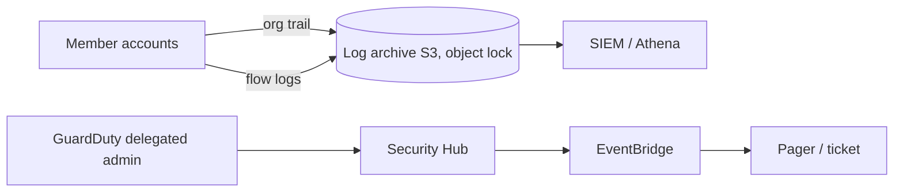

# Cloud Logging and Detection

Hub: [[Security-Engineering-OS]]

## The main sources

| Source | Records | Use it for |
|---|---|---|
| **CloudTrail management events** | Control-plane API calls (who, what, when, from where, result) | Who changed IAM, disabled logging, created keys |
| **CloudTrail data events** | Object/function-level calls (S3 GetObject, Lambda Invoke) - opt-in, extra cost | Data exfiltration investigation |
| **VPC Flow Logs** | Network flow metadata (src/dst IP, ports, protocol, bytes, accept/reject) - no payloads | Lateral movement, exfil volume, C2 beacons |
| **GuardDuty** | Managed threat detection over CloudTrail, VPC Flow Logs, DNS logs, plus optional S3/EKS/RDS/Lambda/runtime protection | Findings like credential exfiltration, crypto mining, recon |
| **AWS Config** | Resource configuration history and compliance rules | "When did this SG open 22 to the world?" |
| **Security Hub** | Aggregates findings, runs standards checks (CIS, AWS FSBP) | Single pane for posture |
| **Route 53 Resolver query logs** | DNS queries from VPCs | Malicious domain lookups |
| **ELB / CloudFront / WAF / S3 access logs** | Request-level app logs | Web attacks |

## Reference architecture



- Organization trail, all regions, log file validation on.
- Log archive in a separate account; restrict deletes; consider S3 Object Lock.
- GuardDuty and Security Hub enabled org-wide with a delegated admin.

## High-value alerts

- `StopLogging`, `DeleteTrail`, `UpdateTrail`, `PutEventSelectors` (defense evasion).
- Root user activity; console login without MFA.
- `CreateAccessKey` on another user; `AttachUserPolicy` with AdministratorAccess.
- `GetSecretValue` spikes; unusual `AssumeRole` chains.
- Security group ingress opened to `0.0.0.0/0`.
- GuardDuty findings of type `UnauthorizedAccess:IAMUser/InstanceCredentialExfiltration.*`.

## Reading a CloudTrail event

Key fields: `eventTime`, `eventSource`, `eventName`, `userIdentity` (type, arn, accessKeyId, sessionContext), `sourceIPAddress`, `userAgent`, `errorCode`, `requestParameters`, `responseElements`.

## Example Athena query

```sql
SELECT eventtime, useridentity.arn, sourceipaddress, eventname
FROM cloudtrail_logs
WHERE eventname IN ('StopLogging','DeleteTrail','CreateAccessKey')
  AND eventtime > '2026-09-01'
ORDER BY eventtime DESC;
```

See also: [[Cloud-Account-Compromise-Playbook]], [[SOC-Analyst-Playbook]].

## Interview questions

**Q: Which AWS logs matter first in an incident?**
A: CloudTrail management events (org trail, all regions), then data events for sensitive S3/Lambda, VPC Flow Logs, and GuardDuty findings.

**Q: How do you protect the logs themselves?**
A: Central log-archive account, S3 Object Lock or restrictive bucket policy, CloudTrail log file validation, and alerts on StopLogging/DeleteTrail/PutEventSelectors.
