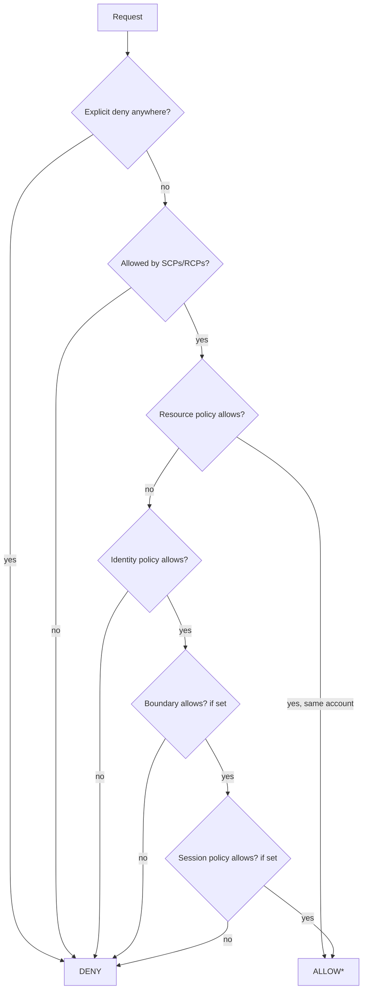

# IAM Deep Dive

Hub: [[Security-Engineering-OS]]

## Principals and credentials

- **IAM users**: long-lived identity; avoid for humans, avoid access keys where possible.
- **IAM roles**: assumed via STS for temporary credentials. Used by services (EC2 instance profiles, Lambda execution roles), federation, and cross-account access.
- **Trust policy**: the resource policy on a role saying *who* may assume it.

## Policy types

| Type | Attached to | Grants? | Notes |
|---|---|---|---|
| Identity-based (managed / inline) | user, group, role | Yes | Most common |
| Resource-based | resource (S3 bucket, KMS key, SQS, role trust) | Yes | Has a `Principal` element; can grant cross-account |
| Permissions boundary | user or role | No, only limits | Max permissions an identity policy can give |
| SCP (Organizations) | OU / account | No, only limits | Applies to all principals in member accounts, including the account root user |
| RCP (resource control policy) | OU / account | No, only limits | Org-level ceiling on resource-side access for supported services |
| Session policy | passed at AssumeRole / federation | No, only limits | Scopes down one session |
| ACLs | S3, some others | Yes (legacy) | Prefer disabling (S3 Object Ownership: bucket owner enforced) |

## Evaluation logic (single account)

Default is **implicit deny**. Then:

1. **Explicit deny** in any applicable policy -> request denied. Nothing overrides it.
2. **Organizations SCPs / RCPs**: if the account is in an org and the action is not allowed by the SCPs at every level down to the account -> deny.
3. **Resource-based policy**: in the same account, an allow here can grant access to an IAM user or role session named in it even without an identity-policy allow (with nuance for role sessions vs role ARN as principal).
4. **Identity-based policy**: must allow the action (unless the resource policy already allowed as above).
5. **Permissions boundary**: if set, action must be allowed by the boundary too.
6. **Session policy**: if present, action must be allowed by it too.

Effective permissions of an identity = intersection of identity policy, boundary, SCPs, and session policy, with explicit deny winning everywhere.



*Simplified: the precise interaction of resource policies with boundaries and session policies depends on whether the principal in the resource policy is the role ARN or the session ARN. Read the AWS "Policy evaluation logic" docs before relying on edge cases.

## Cross-account access

Both sides must allow: the **resource policy** (or role trust policy) in account B must trust the principal in account A, **and** the identity policy in account A must allow the call. SCPs of both accounts apply to their respective sides.

## Conditions worth knowing

- `aws:PrincipalOrgID` - restrict resource access to your organization.
- `aws:SourceIp`, `aws:SourceVpce` - network-based restriction.
- `aws:MultiFactorAuthPresent` - require MFA for sensitive actions.
- `sts:ExternalId` - confused-deputy protection for third-party role assumption.
- `aws:SourceArn` / `aws:SourceAccount` - confused-deputy protection for service principals.

## Example: deny outside region (SCP)

```json
{
  "Version": "2012-10-17",
  "Statement": [{
    "Sid": "DenyOutsideApprovedRegions",
    "Effect": "Deny",
    "NotAction": ["iam:*", "organizations:*", "sts:*", "support:*"],
    "Resource": "*",
    "Condition": {"StringNotEquals": {"aws:RequestedRegion": ["us-east-1", "eu-west-1"]}}
  }]
}
```

## Privilege escalation paths to defend against

- `iam:PassRole` + ability to create compute (EC2, Lambda) -> run code as a more privileged role.
- `iam:CreatePolicyVersion` / `iam:AttachUserPolicy` / `iam:PutRolePolicy` on self.
- `iam:UpdateAssumeRolePolicy` to trust yourself.
- Mitigate with permission boundaries on delegated admins, scoped `PassRole` resources, and IAM Access Analyzer.

## Tooling

IAM Access Analyzer (external access and unused access findings, policy validation), IAM policy simulator, credential reports, last-accessed data for right-sizing.

## Interview questions

- A user has `s3:*` in their identity policy but gets AccessDenied. List every place that could cause it.
- Difference between a permissions boundary and an SCP?
- How does cross-account role assumption work end to end?
