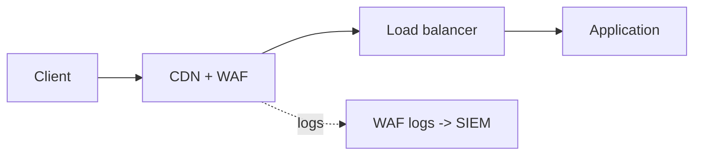

# Web Application Firewall (WAF)

Hub: [[Security-Engineering-OS]]

## What it is

A WAF inspects HTTP(S) requests at layer 7 and blocks, allows, counts, or challenges them based on rules. It sits in front of the app: CDN edge (CloudFront), load balancer (ALB), API gateway, or as a reverse proxy (e.g., ModSecurity with the OWASP Core Rule Set).

## What it helps with

- Known attack signatures (common SQLi / XSS payloads, path traversal patterns).
- Rate limiting and basic bot control.
- Geo / IP reputation blocking.
- Virtual patching: buy time while a real code fix ships.

## What it does NOT fix

- Broken access control and business logic flaws (IDOR, privilege escalation).
- Vulnerabilities reachable via encodings or channels the WAF does not parse.
- It is a compensating control, not a substitute for secure code, input validation, and parameterized queries.

## Rule types (AWS WAF terms)

- **Managed rule groups**: AWS Core rule set, Known bad inputs, SQL database, IP reputation, Bot Control.
- **Rate-based rules**: block an aggregation key (e.g., IP) exceeding N requests in a window.
- **Custom rules**: match on headers, URI, query string, body, labels; actions Allow / Block / Count / CAPTCHA / Challenge.
- Web ACL is evaluated by rule priority; first terminating action wins.

## Rollout practice

1. Deploy new rules in **Count** mode.
2. Log to a destination (S3 / CloudWatch Logs / Firehose) and review matches for false positives.
3. Add scoped exclusions for legitimate traffic.
4. Switch to Block; keep monitoring.

## Pitfalls

- Origin reachable directly, bypassing the WAF: restrict origin to CDN only.
- Body inspection size limits: large bodies may be only partially inspected; decide how to handle oversize requests.
- Rules left in Count forever.

See also: [[OWASP-Top-10]], [[Web-Security-Checklist-OWASP]].

## Interview questions

**Q: Does a WAF fix SQL injection?**
A: No. It is a compensating control that raises attacker cost and buys patch time; parameterized queries fix the root cause.

**Q: How do you roll out new WAF rules safely?**
A: Count/log-only mode first, review false positives against real traffic, then block, with per-rule exclusions documented.
