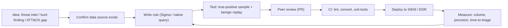

# Detection Engineering

Hub: [[Security-Engineering-OS]]

## Overview

Detection engineering treats detections like software: version-controlled, reviewed, tested and measured. The goal is high-fidelity alerts that map to real attacker behaviour, not a pile of noisy signatures.

## Mechanism



**Detection-as-code**: rules live in Git with metadata (ATT&CK technique, severity, owner, data source, known false positives). CI converts Sigma to the SIEM's query language and runs tests.

## Sigma rule example

Office application spawning a command interpreter (ATT&CK T1204 / T1059):

```yaml
title: Office Application Spawning Shell
id: 00000000-0000-0000-0000-000000000000   # generate a real UUID
status: experimental
description: Detects Microsoft Office processes spawning cmd or PowerShell, common after malicious document execution.
logsource:
  category: process_creation
  product: windows
detection:
  selection_parent:
    ParentImage|endswith:
      - '\WINWORD.EXE'
      - '\EXCEL.EXE'
      - '\POWERPNT.EXE'
  selection_child:
    Image|endswith:
      - '\cmd.exe'
      - '\powershell.exe'
      - '\pwsh.exe'
      - '\wscript.exe'
      - '\mshta.exe'
  condition: selection_parent and selection_child
falsepositives:
  - Legitimate macros or add-ins that call scripts
level: high
tags:
  - attack.execution
  - attack.t1059
```

## Testing

- **True positive**: reproduce the behaviour safely in a lab (e.g. an emulation framework like Atomic Red Team) and confirm the alert fires.
- **Negative**: replay a week of production data to estimate volume before enabling.
- **Unit tests**: store sample events alongside the rule; CI asserts match / no-match.
- **Regression**: re-run tests when parsers or schemas change.

## False-positive tuning

- Add narrow exclusions (specific signed binary + path + parent) instead of broad ones; document why and set a review date.
- Enrich instead of suppress: raise severity for critical assets, lower for lab machines.
- Track precision (true positives / total alerts) per rule; rules consistently below target get reworked or retired.

## Defender View

- Prefer behaviour (parent/child, sequence) over brittle indicators (hashes, IPs).
- Layer: some rules for alerting, others for hunting/correlation only.

## Hardening

- Protect the rule repo and deployment pipeline like production code (review, branch protection).
- Monitor for detection drift: rules that silently stop matching due to data changes.

## Tradeoffs

- Broad rules catch more variants but cost analyst time; narrow rules are precise but evadable.
- Sigma portability vs using native features (e.g. joins) that Sigma cannot express.

## Interview Questions

1. **What is detection-as-code?** Managing detections in version control with review, CI tests and automated deployment.
2. **How do you test a detection?** Emulate the technique in a lab for a TP, replay production data for FP volume, keep sample events as unit tests.
3. **How do you reduce false positives without creating blind spots?** Narrow, documented, expiring exclusions; enrichment-based scoring; measure precision.
4. **Why prefer TTP-based detections over IOCs?** Behaviours are costlier for attackers to change than hashes or IPs (Pyramid of Pain).

## Related

- [[SIEM-Fundamentals]]
- [[Threat-Hunting]]
- [[Log-Analysis]]
- [[Security-Monitoring]]
