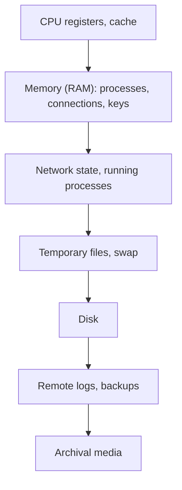

# Digital Forensics

Hub: [[Security-Engineering-OS]]

## Overview

Digital forensics is the collection, preservation and analysis of digital evidence to reconstruct what happened. In incident response it answers: how did they get in, what did they touch, and are they still here. Process discipline matters as much as tools, because evidence may be used legally.

## Mechanism

**Order of volatility** (RFC 3227): collect most volatile evidence first. Powering off a machine destroys memory evidence.

**Workflow**: identify -> preserve -> acquire -> analyze -> report.
- Acquire memory (e.g. with a trusted memory-acquisition tool) before disk when possible.
- Disk images: bit-for-bit copies, write-blocked, hashed (SHA-256) at acquisition and verification.
- Work on copies, never originals.

**Chain of custody**: a record of who collected each item, when, how, where it was stored and every transfer. Breaks in the chain can make evidence inadmissible.

## Key artifacts

| Windows | What it shows |
|---|---|
| Event logs (`.evtx`) | logons, process creation, services, log clearing |
| Prefetch | program execution and run times (when enabled) |
| Amcache / Shimcache | evidence of program presence/execution (interpret carefully) |
| Registry (Run keys, UserAssist, ShellBags) | persistence, user activity, folder access |
| `$MFT`, `$UsnJrnl`, `$LogFile` | file creation/modification timeline |
| SRUM | per-app resource and network usage |
| Browser history | downloads, visited URLs |

| Linux | What it shows |
|---|---|
| `auth.log` / `secure`, journal | logins, sudo |
| `wtmp`, `btmp`, `lastlog` | login history, failed logins |
| Shell history | commands (easily cleared) |
| cron, systemd units | persistence |
| `/proc` (live) | running process details |

## Defender View

- Build a **super-timeline** combining filesystem, logs and registry to see the attack sequence.
- Distinguish evidence of existence vs evidence of execution.
- Prepare before incidents: logging, retention, acquisition tooling, legal contacts.

## Detections

Forensic findings feed detections: persistence locations, attacker tools and command lines become hunt queries and rules ([[Threat-Hunting]], [[Detection-Engineering]]).

## Hardening

- Centralized, tamper-resistant logs extend what can be reconstructed.
- Time sync (NTP) across systems so timelines correlate.
- Enable Prefetch, command-line logging and PowerShell logging ahead of time.

## Tradeoffs

- Live response is fast but modifies the system; full imaging is thorough but slow at scale.
- Containment (isolating a host) vs observing the attacker to learn scope.

## Interview Questions

1. **What is order of volatility?** Collect the most short-lived evidence (memory, network state) before persistent evidence (disk, logs).
2. **Why hash evidence?** To prove the copy is identical to the original and unchanged since acquisition.
3. **What is chain of custody?** Documentation of evidence handling from collection to presentation.
4. **Should you power off a compromised machine?** Usually not first - you lose memory. Isolate from the network, capture memory, then decide.
5. **Artifacts proving execution on Windows?** Prefetch, 4688/Sysmon 1, Amcache (with caveats), UserAssist.

## Related

- [[Incident-Response-Lifecycle]]
- [[Incident-Response-Playbook]]
- [[Log-Analysis]]
- [[Malware-Analysis-Workflow]]
- [[Filesystems-and-Permissions]]
