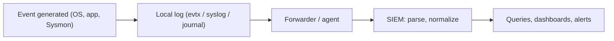

# Log Analysis

Hub: [[Security-Engineering-OS]]

## Overview

Most investigations are answered from logs. Knowing which events exist, what their fields mean, and which ones require extra audit configuration is a core SOC skill.

## Mechanism



## Windows Security log

| ID | Meaning | Notes |
|---|---|---|
| 4624 | Successful logon | check Logon Type, source IP, account |
| 4625 | Failed logon | Status/SubStatus give reason |
| 4634 / 4647 | Logoff / user-initiated logoff | |
| 4648 | Logon with explicit credentials | e.g. `runas` |
| 4672 | Special privileges assigned to new logon | admin-equivalent logons |
| 4688 | Process created | enable "include command line" policy |
| 4697 | Service installed (Security log) | |
| 4698 | Scheduled task created | |
| 4720 | User account created | |
| 4722 | User account enabled | |
| 4724 | Password reset attempt | |
| 4728 / 4732 / 4756 | Member added to global / local / universal security group | |
| 4740 | Account locked out | |
| 4768 / 4769 | Kerberos TGT / service ticket requested | on DCs |
| 4771 | Kerberos pre-authentication failed | |
| 4776 | NTLM credential validation | |
| 1102 | Security audit log cleared | |

Other channels: System **7045** (service installed); PowerShell Operational **4104** (script block logging).

**Logon types (4624/4625)**: 2 interactive, 3 network, 4 batch, 5 service, 7 unlock, 8 network cleartext, 9 new credentials, 10 remote interactive (RDP), 11 cached interactive.

## Sysmon

| ID | Event |
|---|---|
| 1 | Process creation (with hashes, command line, parent) |
| 3 | Network connection |
| 7 | Image (DLL) loaded |
| 8 | CreateRemoteThread |
| 10 | ProcessAccess |
| 11 | File created |
| 12 / 13 / 14 | Registry create/delete, value set, rename |
| 22 | DNS query |
| 23 | File delete (archived) |

Sysmon coverage depends entirely on its configuration file.

## Linux

- Debian/Ubuntu: `/var/log/auth.log`; RHEL/Fedora: `/var/log/secure`; systemd: `journalctl -u ssh` / `-u sshd`.
- Common sshd lines: `Failed password for`, `Accepted password for`, `Accepted publickey for`, `Invalid user`.
- `last` (wtmp), `lastb` (btmp), `sudo` entries in auth logs, auditd in `/var/log/audit/audit.log` (`ausearch -k <key>`).

```bash
grep "Failed password" /var/log/auth.log | awk '{print $(NF-3)}' | sort | uniq -c | sort -nr | head
journalctl -u ssh --since "1 hour ago" | grep Accepted
```

## Example queries

Password spraying (many users, one source):

```text
index=wineventlog EventCode=4625
| stats dc(TargetUserName) as users count by IpAddress
| where users > 10
```

New local admin:

```text
index=wineventlog EventCode=4732 TargetUserName="Administrators"
```

RDP logons:

```text
index=wineventlog EventCode=4624 LogonType=10
| stats count by TargetUserName, IpAddress, host
```

> TODO: adapt field names to your SIEM's schema; the above uses common Splunk Windows add-on style fields.

## Defender View

- Correlate across sources: 4625 bursts then 4624 from the same IP; 4720 followed by 4732 for the same account.
- Watch for absence of logs (1102, agent silence) as a signal.

## Detections

See [[Detection-Engineering]] for turning these queries into tested rules.

## Hardening

- Configure Advanced Audit Policy (logon, process creation, account management, Kerberos on DCs).
- Deploy Sysmon with a maintained configuration.
- Increase log sizes and forward off-host; sync time.

## Tradeoffs

- More auditing = more storage and noise; prioritize by threat model.
- Command-line logging can capture secrets; restrict SIEM access accordingly.

## Interview Questions

1. **4624 vs 4625?** Successful vs failed logon.
2. **What does logon type 3 vs 10 mean?** Network logon (e.g. SMB share) vs RDP.
3. **Which event shows process creation?** Security 4688 (with command-line auditing enabled) or Sysmon 1.
4. **How do you detect a new admin account?** 4720 then 4728/4732/4756 adding it to a privileged group.
5. **Where are SSH logins on Ubuntu?** `/var/log/auth.log` or the journal for the ssh unit.

## Related

- [[SIEM-Fundamentals]]
- [[Windows-Security-Cheat-Sheet]]
- [[Linux-Security-Cheat-Sheet]]
- [[Threat-Hunting]]
- [[Digital-Forensics]]
