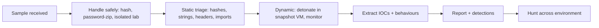

# Malware Analysis Workflow

Hub: [[Security-Engineering-OS]]

## Overview

The defender's goal in malware triage is fast answers: what does it do, how do we detect it, and what is affected. This workflow assumes an isolated analysis lab (see [[Home-Lab-Setup-Guide]]) and builds on [[Malware-Analysis-Basics]].

## Mechanism

## Safe handling

- Analyze only in isolated VMs with snapshots; no shared folders or clipboard; host-only or simulated network (e.g. INetSim/FakeNet-style tooling).
- Store samples in password-protected archives (convention: `infected`) with defanged names.
- Never run samples on a host with access to production credentials or networks.
- Check organizational policy before uploading samples to public services - uploads can alert the attacker or leak data.

## Static triage

- Hashes (SHA-256) and lookup in internal intel.
- File type (magic bytes, not extension); PE/ELF headers, compile timestamp, sections and entropy (packing).
- Strings: URLs, IPs, registry keys, commands, mutex names.
- Imports that hint at capability (networking, process injection, crypto).
- YARA rules for known families.

## Dynamic analysis

- Snapshot, start monitoring (process tree, file, registry, network - e.g. Procmon, Sysmon, packet capture), detonate, wait, collect, revert.
- Watch for: child processes, persistence writes, dropped files, DNS/HTTP to C2, anti-analysis behaviour (VM checks, sleeps).

## IOC extraction

| Type | Examples |
|---|---|
| Host | file hashes, dropped paths, registry keys, mutexes, service/task names |
| Network | domains, IPs, URLs, user-agents, JA3/JA4-style TLS fingerprints |
| Behavioural | parent/child chains, persistence method, ATT&CK techniques |

Defang network indicators in reports (`hxxp://example[.]com`).

## Reporting

Summary (verdict, family if known, confidence), capabilities, IOCs, ATT&CK mapping, detection opportunities, affected hosts, recommended actions.

## Defender View and Detections

- Turn behaviours into Sigma/EDR rules ([[Detection-Engineering]]) and IOCs into blocklists and hunts.
- Behavioural detections outlive hash-based ones.

## Hardening

- Lab: keep analysis VMs patched separately, reset often, and segregate from home/corporate networks.
- Enterprise: use findings to block delivery vectors (macros, script hosts, attachment types).

## Tradeoffs

- Static is safe and fast but defeated by packing/obfuscation; dynamic reveals behaviour but malware may detect the sandbox.
- Deep reverse engineering is slow; triage depth should match the incident's needs.

## Interview Questions

1. **Static vs dynamic analysis?** Static examines without executing; dynamic observes behaviour when run in a controlled environment.
2. **How do you tell a file is packed?** High section entropy, few imports, unusual section names, small code with a large data blob.
3. **Why not upload every sample to a public sandbox?** Could leak sensitive data or tip off the attacker.
4. **Which IOCs are most durable?** Behavioural/TTP indicators, then network infrastructure patterns; hashes are the most brittle.

## Related

- [[Malware-Analysis-Basics]]
- [[Digital-Forensics]]
- [[Detection-Engineering]]
- [[Incident-Response-Playbook]]
