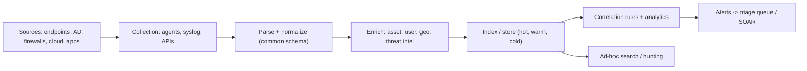

# SIEM Fundamentals

Hub: [[Security-Engineering-OS]]

## Overview

A Security Information and Event Management (SIEM) platform centralizes logs from endpoints, servers, network devices, identity providers and cloud services, then lets analysts search, correlate and alert on them. It is the backbone of most SOCs.

## Mechanism



- **Collection**: agents (Windows Event Forwarding, Beats, vendor agents), syslog, cloud API pulls.
- **Normalization**: map fields into a common schema (e.g. Elastic ECS, Splunk CIM, OCSF) so one rule works across vendors.
- **Enrichment**: asset criticality, user department, IP reputation.
- **Correlation**: single-event rules, thresholds (N failures in M minutes), sequences (fail then success), and aggregation.
- **Retention**: driven by investigation needs and compliance requirements.

## Defender View

- A SIEM is only as good as its data: know which sources are onboarded, their parse health and their latency.
- Track coverage against MITRE ATT&CK techniques rather than rule counts.

## Detections

Example correlation (pseudo-SPL): brute force followed by success.

```text
index=wineventlog (EventCode=4625 OR EventCode=4624)
| stats count(eval(EventCode=4625)) as fails, count(eval(EventCode=4624)) as success by src_ip, user
| where fails > 20 AND success > 0
```

## Hardening

- Monitor the SIEM itself: alert on sources that go silent.
- Restrict who can edit rules and delete data; audit SIEM admin actions.
- Protect ingestion paths with TLS and authentication.

## Tradeoffs

- Cost scales with ingest volume; filtering saves money but can drop evidence you later need.
- Real-time correlation vs scheduled searches: latency vs compute.
- Build vs buy vs managed (MSSP / cloud-native SIEM).

## Interview Questions

1. **What is log normalization and why does it matter?** Mapping vendor fields to a common schema so detections and searches are portable.
2. **How do you handle alert fatigue?** Tune thresholds, add allow-lists with expiry, enrich with context, retire low-value rules, measure precision.
3. **What would you onboard first?** Identity (AD/IdP), endpoint (EDR/Sysmon), perimeter/VPN, cloud control-plane logs.
4. **How do you know a log source broke?** Heartbeat/volume baselines with alerts on drops.

## Related

- [[Detection-Engineering]]
- [[Security-Monitoring]]
- [[Log-Analysis]]
- [[SOC-Analyst-Playbook]]
