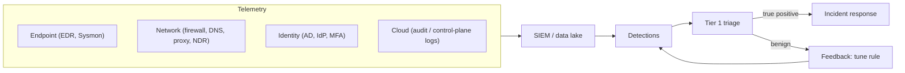

# Security Monitoring

Hub: [[Security-Engineering-OS]]

## Overview

Security monitoring is the continuous process of collecting telemetry, detecting suspicious activity and routing it to people who can respond. It spans data sources, detection logic, triage process and metrics.

## Mechanism

## Coverage design

- Start from the threat model and crown-jewel assets.
- Map data sources and detections to MITRE ATT&CK to find gaps.
- Minimum viable set: identity logs, EDR on endpoints and servers, DNS, perimeter/VPN, cloud audit logs, critical application logs.

## Triage flow

1. Validate: is the data correct and the alert logic matched as intended?
2. Scope: which user, host, time window; related alerts?
3. Enrich: asset owner, user role, threat intel, recent changes.
4. Decide: benign, benign-but-suspicious (tune), or incident (escalate per [[Incident-Response-Playbook]]).
5. Document the reasoning.

## Defender View

- Useful metrics: mean time to detect/respond, alert precision per rule, coverage by ATT&CK tactic, log source health.
- Avoid vanity metrics (raw alert counts).

## Detections

Detection content is covered in [[Detection-Engineering]]; proactive search in [[Threat-Hunting]].

## Hardening

- Monitor the monitors: alert on agent uninstall, log source silence, and audit policy changes.
- Protect SOC tooling accounts with MFA and least privilege.

## Tradeoffs

- In-house SOC vs managed detection (MDR): control and context vs cost and 24x7 coverage.
- Coverage breadth vs depth: many shallow sources vs fewer well-tuned ones.
- Automation (SOAR) speeds response but can amplify mistakes (e.g. auto-isolating a critical server).

## Interview Questions

1. **What would you monitor first in a new environment?** Identity, endpoints, internet egress (DNS/proxy), cloud control plane.
2. **How do you measure SOC effectiveness?** MTTD/MTTR, precision, coverage against ATT&CK, missed-incident reviews.
3. **Walk through triaging an alert.** Validate, scope, enrich, decide, document; escalate with evidence.
4. **What is monitoring the monitors?** Detecting failures or tampering in the logging and detection pipeline itself.

## Related

- [[SIEM-Fundamentals]]
- [[Detection-Engineering]]
- [[Threat-Hunting]]
- [[SOC-Analyst-Playbook]]
- [[Log-Analysis]]
