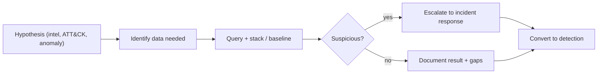

# Threat Hunting

Hub: [[Security-Engineering-OS]]

## Overview

Threat hunting assumes compromise and searches for evidence that alerts missed. Good hunts start from a testable hypothesis, and every hunt should end in either a finding, a new detection, or a documented data gap.

## Mechanism



Hunt types:
- **Hypothesis-driven**: "An attacker is using scheduled tasks for persistence on servers."
- **Intel-driven**: IOCs/TTPs from a report about a relevant actor.
- **Analytics/anomaly-driven**: stack counting, rare values, outliers.

## Example hunts

**1. Rare parent-child processes**
Stack `ParentImage -> Image` pairs across endpoints (Sysmon 1 / 4688) and review the least frequent ones.

```text
index=sysmon EventCode=1
| stats count dc(host) as hosts by ParentImage, Image
| where hosts < 3
| sort count
```

**2. Persistence via services and tasks**
Pull 7045 and 4698 events for 30 days; flag image paths in `\Users\`, `\ProgramData\`, `\Temp\` or with encoded PowerShell.

**3. Beaconing**
Group outbound connections by source/destination and look for regular intervals with low jitter and small, consistent byte counts (proxy or Zeek `conn.log`).

**4. Linux SSH anomalies**
Accepted logins from new source IPs or at unusual hours per user from `auth.log`/`secure`.

## Defender View

- Baselines are the core tool: you cannot spot "rare" without knowing "normal".
- Time-box hunts and record queries so they can be reused.

## Detections

Every repeatable hunt query that produces manageable volume is a candidate for [[Detection-Engineering]].

## Hardening

Hunts often reveal hygiene problems (stale admin accounts, unmanaged hosts, missing logs). Feed these to the owners as hardening tickets.

## Tradeoffs

- Hunting is analyst-time intensive; prioritize by threat model and crown-jewel assets.
- Results are only as good as log coverage and retention.

## Interview Questions

1. **Hunting vs monitoring?** Monitoring reacts to alerts; hunting proactively searches for what alerts missed.
2. **Give an example hypothesis.** "Adversaries are using WMI event subscriptions for persistence on workstations" - test with WMI activity logs / Sysmon 19-21.
3. **What is stacking?** Counting occurrences of an attribute across the fleet and reviewing the rare tail.
4. **How do you measure a hunt program?** Detections created, data gaps closed, incidents found, dwell time reduction - not just hunts run.

## Related

- [[Detection-Engineering]]
- [[Log-Analysis]]
- [[Digital-Forensics]]
- [[SIEM-Fundamentals]]
