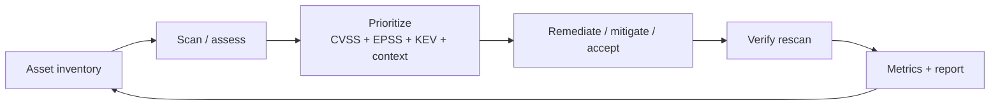

# Vulnerability Assessment

Hub: [[Security-Engineering-OS]]

## Mechanism

Vulnerability management is a loop: know your assets, find weaknesses, decide what matters, fix, verify.

You cannot protect assets you do not know about; inventory (including cloud and SaaS) is step zero.

## Prioritization signals

| Signal | What it tells you | Limitation |
|---|---|---|
| **CVSS** (base score 0-10) | Technical severity if exploited | Not likelihood; many "criticals" never exploited |
| **EPSS** (0-1 probability) | Estimated probability of exploitation activity in the next 30 days (FIRST) | Model output; changes daily |
| **CISA KEV** catalog | Confirmed exploited in the wild | Only covers what CISA has confirmed |
| **Asset context** | Internet-facing? Holds sensitive data? Compensating controls? | Needs good inventory |

Practical rule of thumb: **KEV or high EPSS on an internet-facing asset goes first**, regardless of whether CVSS is 7.5 or 9.8. CVSS alone produces too long a "critical" list to act on.

## Scanning cadence (example policy)

> TODO: Adjust to your org's compliance obligations; values below are an illustrative starting point, not a standard.

- External attack surface: continuous or daily.
- Internal hosts: at least weekly authenticated scans.
- Containers/images: on build and on registry re-scan when new CVEs publish.
- Dependencies (SCA): every PR plus nightly.
- Penetration test / manual assessment: periodically and on major changes.

Authenticated scans find far more than unauthenticated ones (missing patches, local config).

## Remediation SLAs (example)

| Priority | Example criteria | Example target |
|---|---|---|
| P0 | KEV-listed or active exploitation, internet-facing | Days, or immediate mitigation |
| P1 | Critical/high, exposed, high EPSS | ~2 weeks |
| P2 | High/medium, internal | ~30-60 days |
| P3 | Low | Next maintenance cycle |

For US federal agencies, BOD 22-01 sets KEV deadlines; other orgs set their own. Exceptions need an owner, compensating control, and expiry.

- [ ] Asset inventory covers cloud, containers and SaaS
- [ ] Prioritization uses exploitation signals, not CVSS alone
- [ ] SLAs defined and tracked
- [ ] Rescan verifies fixes
- [ ] Exceptions have expiry dates

## Detection link

When a KEV entry affects you, also hunt for prior exploitation: patching closes the door but does not evict an attacker already inside ([[Incident-Response-Playbook]]).

## Tradeoffs

- Faster SLAs reduce exposure but compete with feature work and change risk.
- Aggressive scanning can disrupt fragile systems (OT, legacy); schedule and throttle.
- Risk-based prioritization needs good context data; without it you fall back to CVSS.

## Metrics

Mean time to remediate by priority, SLA compliance %, count of KEV-listed vulns open, scan coverage % of inventory.

## Interview Q&A

**Q: CVSS 9.8 internal vs CVSS 7.5 on KEV and internet-facing. Which first?**
A: The KEV one: it is known exploited and reachable. Severity without likelihood and exposure misleads.

**Q: What is EPSS?**
A: FIRST's model estimating the probability a CVE sees exploitation activity in the next 30 days.

**Q: Patch is not available. What now?**
A: Mitigate: disable the feature, WAF/virtual patch, network isolation, increased monitoring; document an exception with expiry.
