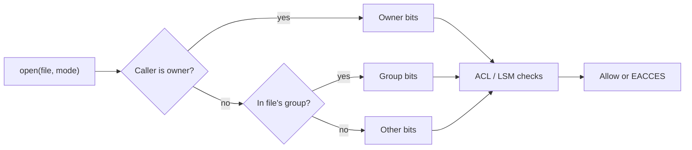

# Filesystems and Permissions

Hub: [[Security-Engineering-OS]]

## Overview

Misconfigured permissions are among the most common causes of privilege escalation and data exposure. Filesystem metadata (timestamps, journals) is also core forensic evidence.

## Mechanism



**Linux / POSIX**
- Mode bits `rwx` for owner/group/other; on directories `x` = traverse, `w` = create/delete entries.
- Special bits: setuid (`4000`), setgid (`2000`), sticky (`1000`, e.g. `/tmp`, so users cannot delete others' files).
- `umask` sets defaults; POSIX ACLs (`getfacl`/`setfacl`) add per-user/group entries.
- Timestamps: mtime (content), ctime (inode change), atime (access, often reduced by `relatime`); some filesystems also record birth time.

**Windows / NTFS**
- Security descriptor: owner, DACL (allow/deny ACEs), SACL (audit ACEs). Explicit deny ACEs are ordered before allows; permissions inherit from parents.
- Over the network, share and NTFS permissions both apply; the more restrictive wins.
- Alternate Data Streams: extra named streams on a file; `Zone.Identifier` stores Mark-of-the-Web.
- `$MFT` records hold `$STANDARD_INFORMATION` and `$FILE_NAME` timestamps; `$UsnJrnl` logs changes.

## Defender View

- Audit for world-writable files in executable paths, writable service binaries, and scripts run by root/SYSTEM that users can edit.
- Timestamp inconsistencies (e.g. `$SI` earlier than `$FN`) can indicate timestomping.

## Detections

```bash
find / -perm -4000 -type f 2>/dev/null          # setuid inventory, diff vs baseline
find / -xdev -type f -perm -0002 2>/dev/null    # world-writable files
```

- Windows: SACL-based object access auditing (Event 4663) on sensitive folders; permission changes (4670).
- File integrity monitoring on config and binary directories.

## Hardening

- Least privilege on shares and folders; no "Everyone: Full Control".
- Remove unnecessary setuid bits; mount untrusted locations `nosuid,noexec`.
- Service binaries and scheduled-task scripts writable only by admins.
- Full-disk encryption (LUKS, BitLocker) for lost-device risk.

## Tradeoffs

- Object access auditing on busy shares produces heavy log volume.
- Overly tight permissions break apps; changes need testing.

## Interview Questions

1. **Sticky bit on a directory?** Only the file owner, directory owner or root can delete or rename entries.
2. **Why is a writable service binary a privesc?** Replacing it runs attacker code as the service account (often SYSTEM/root) on restart.
3. **Share vs NTFS permissions?** Both apply over the network; the most restrictive result wins.
4. **What is timestomping and how is it caught?** Altering timestamps to blend in; compare `$SI` vs `$FN`, the USN journal and other artifacts.

## Related

- [[Linux-Internals-for-Security]]
- [[Windows-Internals-for-Security]]
- [[Digital-Forensics]]
- [[Least-Privilege]]
