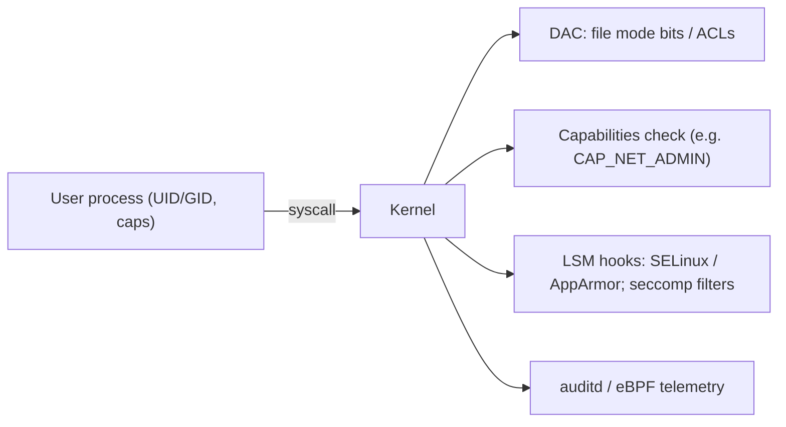

# Linux Internals for Security

Hub: [[Security-Engineering-OS]]

## Overview

Linux security decisions are made by the kernel on every syscall: which identity is asking, what capabilities it holds, and what the object (file, socket, process) allows. Knowing where those decisions happen tells you where to collect telemetry and where to harden.

## Mechanism



- **Identity**: each process has real, effective and saved UIDs/GIDs plus supplementary groups. setuid binaries run with the file owner's effective UID.
- **Capabilities**: root's power split into units (`CAP_SYS_ADMIN`, `CAP_NET_RAW`, `CAP_DAC_OVERRIDE`...). Files can carry capabilities (`getcap -r / 2>/dev/null`).
- **Process tree**: `systemd` (PID 1) -> services -> shells. `/proc/<pid>/` exposes cmdline, environ, maps, fd, exe.
- **Namespaces and cgroups**: isolation primitives behind containers (pid, net, mnt, user, uts, ipc). Not a strong boundary on their own without seccomp, an LSM and dropped capabilities.
- **PAM**: pluggable auth stack (`/etc/pam.d/`) used by login, sshd, sudo.
- **Persistence surfaces**: cron (`/etc/cron*`, user crontabs), systemd units, shell profiles (`~/.bashrc`), `authorized_keys`, `/etc/ld.so.preload`, kernel modules.
- **Logging**: journald, rsyslog (`/var/log/auth.log` on Debian/Ubuntu, `/var/log/secure` on RHEL family), auditd (`/var/log/audit/audit.log`).

## Defender View

- Build a baseline: normal parents for shells, normal listening ports, normal setuid set, normal cron/systemd entries.
- Process lineage matters: a web server (`nginx`, `java`) spawning `sh`/`bash` is a classic web-shell signal.
- Telemetry sources: auditd rules on `execve`, eBPF-based sensors, osquery tables (`processes`, `listening_ports`, `crontab`, `suid_bin`).

## Detections

- New setuid/setgid binaries or new file capabilities outside package installs.
- Writes to `authorized_keys`, `/etc/sudoers`, `/etc/sudoers.d/`, `/etc/ld.so.preload`, systemd unit directories.
- `execve` of interpreters by web-server or database service users.
- Kernel module loads on servers that should never load modules.
- Gaps or truncation in auth logs.

Example auditd rules:

```bash
-w /etc/sudoers -p wa -k priv_change
-w /etc/ssh/sshd_config -p wa -k sshd_config
-a always,exit -F arch=b64 -S execve -F euid=0 -k root_exec
```

## Hardening

- Least privilege: no shared root, `sudo` scoped to specific commands, no direct root SSH.
- SSH: key-only auth, `PermitRootLogin no`, restrict `AllowUsers`/`AllowGroups`.
- Enforce SELinux/AppArmor; apply seccomp profiles and drop capabilities for containers.
- Mount `/tmp` and removable media with `nodev,nosuid,noexec` where compatible.
- Patch the kernel; restrict `ptrace` (`kernel.yama.ptrace_scope`) and `dmesg` (`kernel.dmesg_restrict`).
- Ship logs off-host so an attacker with root cannot silently erase them.

## Tradeoffs

- Full `execve` auditing is noisy and costs CPU/disk; scope rules and filter at the collector.
- SELinux enforcing mode breaks unlabeled custom apps; teams often disable it instead of writing policy.
- Containers share the host kernel; a kernel bug can cross the boundary.

## Interview Questions

1. **Real vs effective UID?** Real UID is who launched the process; effective UID is used for permission checks. setuid binaries change the effective UID.
2. **Why are capabilities useful?** A process can hold only the privileged operation it needs (e.g. binding low ports) instead of full root.
3. **Is a container a security boundary?** Partially. Namespaces isolate views, but the kernel is shared; add seccomp, an LSM, dropped caps and non-root users.
4. **Where do you look for persistence on Linux?** cron, systemd units, shell profiles, `authorized_keys`, `ld.so.preload`, kernel modules, setuid binaries.
5. **How do you protect logs from a root attacker?** Forward them in near real time to a remote collector or SIEM.

## Related

- [[Filesystems-and-Permissions]]
- [[Process-and-Memory-Fundamentals]]
- [[Linux-Security-Cheat-Sheet]]
- [[Log-Analysis]]
- [[Least-Privilege]]
