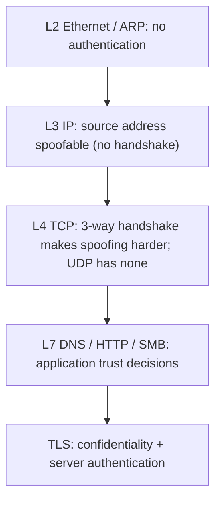
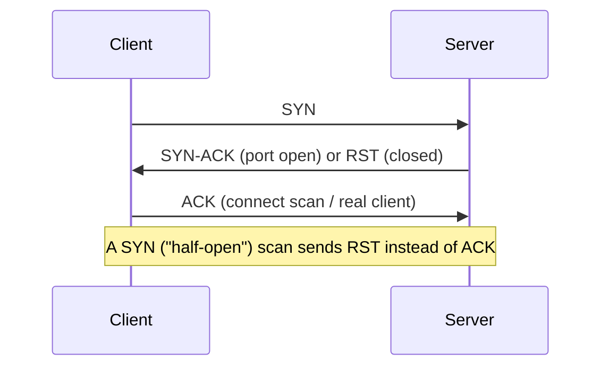

# Networking for Security

Hub: [[Security-Engineering-OS]]

## Overview

Almost every attack crosses a network, and almost every detection relies on network or host telemetry describing that crossing. This note covers the protocol behaviours that matter for security: what is trusted by default, what is spoofable, and what leaves evidence. Architecture-level defenses (segmentation, firewalls, IDS) are in [[Network-Security]].

## Mechanism

| Layer / protocol | Security-relevant property | Typical abuse (lab context) | Evidence |
|---|---|---|---|
| ARP | Unauthenticated, caches accept gratuitous replies | ARP spoofing for MITM on a LAN | Duplicate IP-to-MAC mappings, switch DAI logs |
| IP | Source address is not verified | Reflection/amplification DDoS | NetFlow asymmetry, uRPF drops |
| TCP | Handshake, flags, sequence numbers | Port scanning (SYN, connect) | Many SYNs, few completions, RST storms |
| UDP | Connectionless | Amplification (DNS, NTP, memcached) | Large responses to small requests |
| DNS | Usually plaintext, recursive trust | Tunneling, DGA domains, cache poisoning | Long/high-entropy query names, many NXDOMAIN |
| HTTP(S) | Stateless, headers user-controlled | Web attacks, C2 blending into HTTPS | Proxy logs, JA3/JA4 TLS fingerprints, SNI |
| SMB / RDP | Remote admin protocols | Lateral movement | Windows 4624 logon types 3 and 10 |

### TCP handshake and scan types

### DNS resolution path

Client stub resolver -> recursive resolver -> root -> TLD -> authoritative. Defenders log at the **recursive resolver** (one place sees every lookup). DNSSEC authenticates answers; DoH/DoT encrypt the client-to-resolver hop, which also hides lookups from network monitoring unless you control the resolver.

## Attacker View

- Recon: map live hosts, open ports, service banners, and DNS names (Enumeration, Reconnaissance and OSINT).
- Trust abuse: flat networks let one compromised host reach everything; LLMNR/NBT-NS name-resolution fallbacks on Windows networks can leak credential challenges.
- Blending: C2 over HTTPS or DNS to common-looking destinations.
- Exfiltration: over allowed egress (443, 53).

## Defender View

- Know normal: baseline talkers, ports, and DNS volumes per segment.
- Choke points: egress proxy, internal DNS resolver, firewalls between zones.
- Collect: firewall logs, NetFlow/IPFIX or VPC Flow Logs (Cloud Logging), DNS query logs, Zeek conn/dns/http/ssl logs, full PCAP where affordable.

## Detections

- **Scanning:** one source contacting many ports/hosts with mostly failed connections in a short window.
- **Beaconing:** regular-interval connections from one host to one destination (low jitter), small constant sizes.
- **DNS tunneling:** unusually long subdomains, high query volume to one domain, TXT-heavy traffic.
- **Lateral movement:** workstation-to-workstation SMB/RDP/WinRM, which is rare in most orgs.
- **Egress anomalies:** first-seen destination, large outbound bytes, traffic to ports not normally used.

## Mitigations

- Segmentation and deny-by-default between zones; host firewalls on endpoints.
- Force DNS through internal resolvers; block outbound 53 from clients.
- Disable LLMNR and NBT-NS where not needed; enable SMB signing.
- Dynamic ARP inspection and DHCP snooping on managed switches.
- TLS everywhere; mTLS for service-to-service (Zero Trust).

## Tradeoffs

- Encryption (TLS 1.3, ECH, DoH) protects users but reduces network visibility; the fix is endpoint telemetry or controlled inspection points, not weaker crypto.
- Full PCAP is precise but expensive; flow logs are cheap but lack payload.
- Microsegmentation reduces blast radius but adds rule-management overhead.

## Interview Questions

1. **Why is UDP used for amplification attacks?** No handshake, so the source IP can be spoofed and the reflector sends its large reply to the victim.
2. **Difference between SYN scan and connect scan?** Connect completes the handshake (logged by applications); SYN scan sends RST after SYN-ACK and never completes it.
3. **How would you detect DNS tunneling?** Query length/entropy, volume per domain, record types, and new domains, measured at the recursive resolver.
4. **What does TLS not protect?** Metadata such as destination IP, timing, volume, and (without ECH) the SNI hostname.
5. **Why disable LLMNR?** It lets any host on the segment answer failed name lookups, enabling credential-relay and capture attacks.

## Related

- [[Network-Security]]
- [[Common-Ports-and-Protocols-Cheat-Sheet]]
- [[Network-Traffic-Analysis-Cheat-Sheet]]
- [[TLS-Handshake]]
- [[Computer-Networks]]
