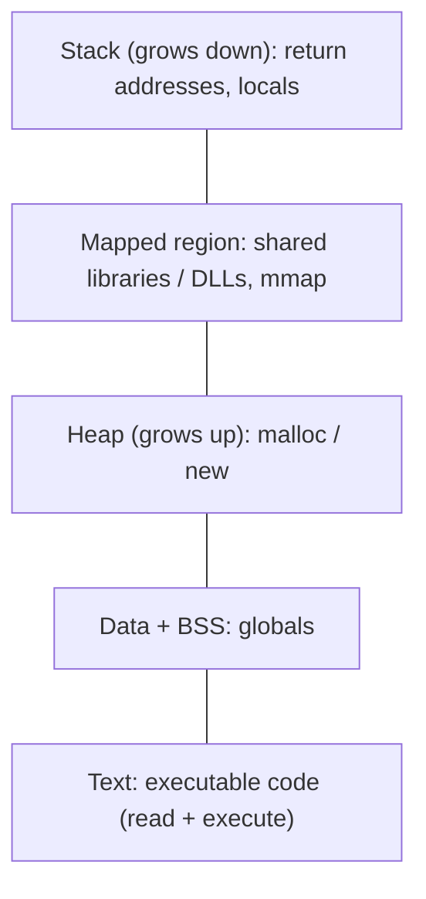

# Process and Memory Fundamentals

Hub: [[Security-Engineering-OS]]

## Overview

A process is an address space plus threads plus handles to kernel objects. Memory-corruption bugs, code injection and in-memory malware all operate on this model, so defenders need it to interpret EDR alerts and memory forensics output.

## Mechanism

- **Virtual memory**: each process sees its own address space; the MMU maps pages to physical frames with R/W/X permissions.
- **Loader**: the ELF (Linux) or PE (Windows) loader maps sections, resolves imports and runs initializers.
- **Mitigations**: DEP/NX (non-executable data), ASLR (randomized bases), stack canaries, CFI/CFG, RELRO, PIE.
- **Injection concepts**: writing code into another process and running it, loading an unexpected library, or replacing a suspended process's image ("hollowing"). All need a handle with sufficient rights to the target.

## Defender View

- Legitimate code is usually image-backed (mapped from a file on disk). Private, executable, non-file-backed memory is a strong anomaly in memory forensics.
- RWX regions are rare in well-behaved software (JIT engines are the main exception).
- Cross-process handle opens with write/thread-creation rights are the choke point for injection.

## Detections

- Sysmon 8 (CreateRemoteThread) and 10 (ProcessAccess) targeting sensitive processes.
- Sysmon 7 (ImageLoad) of unsigned DLLs into signed processes, or loads from user-writable paths.
- Memory scans for private executable regions or PE headers in non-image memory.
- Linux: unexpected `ptrace`, writes to `/proc/<pid>/mem`, `LD_PRELOAD` in service environments.

- `GrantedAccess` masks to know on Sysmon 10 targeting `lsass.exe`: `PROCESS_VM_READ` = `0x0010`, `PROCESS_QUERY_INFORMATION` = `0x0400`, `PROCESS_QUERY_LIMITED_INFORMATION` = `0x1000`, `PROCESS_ALL_ACCESS` = `0x1FFFFF`. Combinations containing `0x0010` (e.g. `0x1010`, `0x1410`) mean memory read and are the credential-dumping signal; baseline legitimate readers (AV/EDR, WerFault) before alerting.

## Hardening

- Keep compiler and OS mitigations on (ASLR, DEP, CFG, stack protectors, full RELRO, PIE).
- Protect sensitive processes (LSA protection on Windows; `ptrace_scope` on Linux).
- Prefer memory-safe languages for parsers and network-facing code; see [[Memory-Safety]].

## Tradeoffs

- Mitigations raise exploit cost but do not remove bugs; an info leak can defeat ASLR.
- Deep memory inspection by EDR costs performance and can conflict with JIT runtimes.

## Interview Questions

1. **What do ASLR and DEP prevent?** ASLR makes addresses unpredictable; DEP stops executing data pages. Together they push attackers toward code reuse plus info leaks.
2. **Why is unbacked executable memory suspicious?** Normal code comes from mapped image files; injected payloads typically live in private allocations.
3. **Stack vs heap?** Stack holds call frames, LIFO and automatically managed; heap holds dynamic allocations with explicit or GC-managed lifetimes.
4. **What does an attacker need to inject into another process?** A handle with memory-write and execution rights, typically meaning same user or higher privilege.

## Related

- [[Memory-Safety]]
- [[Linux-Internals-for-Security]]
- [[Windows-Internals-for-Security]]
- [[Malware-Analysis-Workflow]]
