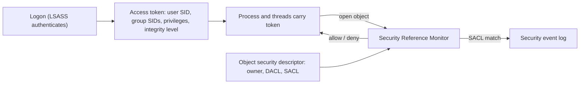

# Windows Internals for Security

Hub: [[Security-Engineering-OS]]

## Overview

Windows access control is built around **security identifiers (SIDs)**, **access tokens** attached to processes, and **security descriptors** attached to objects. Configuration and persistence live in the **registry**; evidence lives in **event logs**.

## Mechanism

- **Processes**: core processes include `System`, `smss.exe`, `csrss.exe`, `wininit.exe`, `services.exe`, `lsass.exe`, `winlogon.exe`, `explorer.exe`. Each has an expected parent, path and instance count; deviations (e.g. `lsass.exe` outside `C:\Windows\System32`) are suspicious.
- **Access tokens**: a primary token per process, optional impersonation tokens per thread. Contain SIDs, privileges (`SeDebugPrivilege`, `SeImpersonatePrivilege`, `SeBackupPrivilege`) and integrity level (Low, Medium, High, System). With UAC, admins run with a filtered Medium token until elevation.
- **LSASS**: performs authentication and holds credential material in memory - a prime credential-theft target.
- **Registry**: hives `HKLM\SYSTEM`, `HKLM\SOFTWARE`, `HKLM\SAM`, `HKLM\SECURITY`, per-user `NTUSER.DAT`. Common autostart keys: `Software\Microsoft\Windows\CurrentVersion\Run` and `RunOnce` (HKLM and HKCU); services under `HKLM\SYSTEM\CurrentControlSet\Services`.
- **Services and scheduled tasks**: often run as SYSTEM; common persistence mechanisms.
- **Event logs**: `Security`, `System`, `Application` plus operational channels (PowerShell, Sysmon, TaskScheduler, Defender), stored as `.evtx` in `C:\Windows\System32\winevt\Logs`.

## Defender View

- Parent/child baselines: `winword.exe` -> `powershell.exe` is a common initial-access pattern.
- Watch handle access to `lsass.exe` (Sysmon Event ID 10) by unexpected processes.
- Enable command-line capture in 4688 and PowerShell Script Block Logging (4104).
- See [[Log-Analysis]] for event IDs and example queries.

## Detections

- Security 4688 / Sysmon 1: Office apps or browsers spawning shells or script hosts.
- Sysmon 13: new values under Run/RunOnce keys.
- System 7045 / Security 4697: new service installed.
- Security 4698: scheduled task created.
- Security 1102: audit log cleared.
- Processes running as SYSTEM whose ancestry starts from a normal user session without an expected elevation path.

## Hardening

- Remove standing local admin rights; unique local admin passwords (LAPS).
- Enable Credential Guard and LSA protection (RunAsPPL) where supported.
- Application control (WDAC / AppLocker) and Attack Surface Reduction rules.
- Advanced audit policy plus event forwarding (WEF or an agent) to a SIEM.
- Constrained Language Mode for PowerShell for non-admin users where feasible.

## Tradeoffs

- Rich auditing (4688 command lines, Sysmon) increases volume and can capture secrets typed on command lines.
- Application control is strong but needs ongoing allow-list maintenance.
- Credential Guard can break some legacy authentication flows.

## Interview Questions

1. **What is an access token?** A kernel object describing a security context (SIDs, privileges, integrity level); access checks compare it with the object's DACL.
2. **Why is SeDebugPrivilege dangerous?** It lets a process open nearly any other process, including LSASS, for memory reads or injection.
3. **Name registry autostart locations.** Run/RunOnce under HKLM and HKCU, the Services key, Winlogon values.
4. **How would you detect a malicious service?** 7045/4697 events, image paths in user-writable directories, unsigned binaries.
5. **Is UAC a security boundary?** Microsoft does not treat it as one; it is a convenience that gives admins a filtered token by default.

## Related

- [[Windows-Security-Cheat-Sheet]]
- [[Log-Analysis]]
- [[Process-and-Memory-Fundamentals]]
- [[Filesystems-and-Permissions]]
