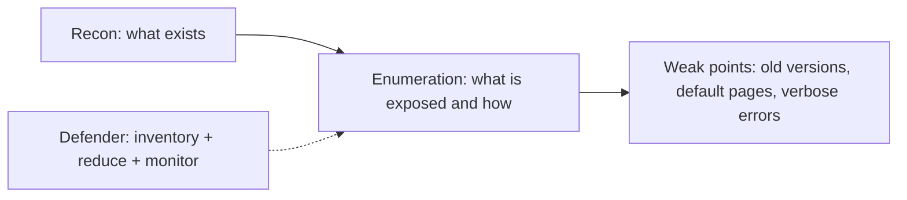

# Enumeration

Hub: [[Security-Engineering-OS]]

## What it means

Enumeration is the step after reconnaissance where someone systematically lists what a target exposes: hosts, open services and versions, web paths, API endpoints, user accounts, subdomains, cloud storage names. Attackers use it to find the weakest entry point; defenders do the same thing to their own estate (attack surface management) to find it first.

## What it looks like in logs

- Many connection attempts across ports from one source in a short window (firewall / flow logs).
- Bursts of 404s on common paths, admin panels and backup-file names (web server / WAF logs).
- Unusual or tool-default User-Agent strings; high request rate from a single IP or ASN.
- Login endpoints returning different responses for valid vs invalid usernames being hit sequentially (user enumeration).
- DNS: many queries for non-existent subdomains, or zone transfer attempts.
- Cloud: `AccessDenied` bursts from one principal listing resources.

Internet-wide background scanning is constant; alert on enumeration that is **targeted** (authenticated, follows up on findings) or originates **internally**.

## Reducing exposed surface

- Maintain an asset inventory and continuously discover your own external footprint (see [[Vulnerability-Assessment]]).
- Close or firewall services that do not need internet exposure; put admin interfaces behind VPN/ZTNA.
- Remove default pages, directory listing, verbose errors, and version banners.
- Uniform responses and timing for login/reset flows so usernames cannot be enumerated; rate-limit.
- Disable DNS zone transfers to untrusted hosts; clean up dangling DNS records (subdomain takeover).
- Private cloud storage by default; block public access at account level.
- Remove unused API versions and debug endpoints.

- [ ] External footprint inventoried and reviewed regularly
- [ ] Admin/management ports not internet-exposed
- [ ] Login and reset responses uniform
- [ ] Alerting on internal scanning

## Tradeoffs

- Hiding banners is obscurity: it slows enumeration but is no substitute for patching.
- Aggressive auto-blocking of scanners can block legitimate monitoring or customers behind shared IPs.

## Interview Q&A

**Q: Recon vs enumeration?**
A: Recon discovers what exists (often passively); enumeration actively interrogates those assets for services, versions and accounts.

**Q: Why is internal scanning a higher-priority alert than internet scanning?**
A: Internet scanning is background noise; internal scanning suggests a compromised host or insider moving laterally.

**Q: How do you prevent username enumeration?**
A: Same response message, status code and timing for valid and invalid users, plus rate limiting.
