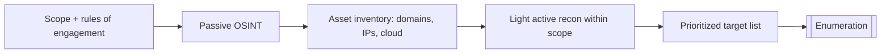

# Reconnaissance and OSINT

Hub: [[Security-Engineering-OS]] | Next: [[Enumeration]]

> Scope: authorized penetration tests, bug bounty programs within their rules, and CTF/home labs ([[Home-Lab-Setup-Guide]]). Recon against targets without written authorization can be illegal even when it is "just looking".

## Mechanism

Reconnaissance is the first phase of an engagement: building a map of what the target owns and exposes before touching anything intrusively. It maps to MITRE ATT&CK tactic **Reconnaissance (TA0043)**.

| Type | What it means | Examples of sources |
|---|---|---|
| Passive | No direct interaction with target systems | Certificate Transparency logs, public DNS datasets, WHOIS/RDAP, job postings, code hosting sites, search engines, breach-disclosure news |
| Active | Target systems receive traffic | DNS queries to target name servers, port scans, web crawling |

Typical outputs:
- Domains, subdomains, IP ranges, cloud assets (buckets, SaaS tenants).
- Technology stack hints (job ads, headers, JS bundles).
- People and email formats (for phishing-awareness assessments).
- Leaked secrets in public repos or paste sites.

## Attacker vs defender view

| Attacker (tester) asks | Defender asks |
|---|---|
| What forgotten assets exist (old subdomains, staging)? | Do we have a complete, current asset inventory? |
| Which people/roles are publicly visible? | What do we disclose in job ads, docs, and social media? |
| Are credentials or keys in public repos? | Do we scan our own public footprint for secrets? |

## Detections

- Passive OSINT is essentially undetectable by the target; this is why **attack surface management (ASM)** is a proactive control, not a detection.
- Active recon shows up as: bursts of DNS queries for non-existent names, sequential port touches in firewall/IDS logs, crawler user agents, high 404 rates in web logs. See [[Security-Logging-and-Detection]].
- Canary tokens / honey-subdomains can reveal someone enumerating.

## Mitigations

- Maintain an asset inventory; decommission and remove DNS records for dead services (prevents subdomain takeover).
- Continuous external attack surface monitoring, including Certificate Transparency for your domains.
- Secret scanning on public and private repos ([[Secrets-Management]]).
- Minimize information leakage: generic error pages, trimmed server banners, security-awareness training.

## Tradeoffs

- Obscurity is not security: reducing footprint lowers noise and opportunistic risk but should never replace patching and access control.
- Transparency (CT logs) helps attackers find subdomains but helps defenders detect mis-issued certificates; the net is positive.

## Interview Q&A

**Q: Passive vs active recon?**
Passive uses third-party data with no packets to the target; active interacts with target systems and can be logged.

**Q: Why is subdomain enumeration valuable?**
Forgotten subdomains often host outdated or unmonitored apps and dangling DNS records that can be taken over.

**Q: As a defender, how do you "do recon on yourself"?**
Run the same OSINT workflow against your org continuously: CT logs, DNS, cloud asset listing, public repo secret scans, and feed findings into the asset inventory.

**Q: What must exist before any recon in a pentest?**
Written authorization and a defined scope/rules of engagement.
