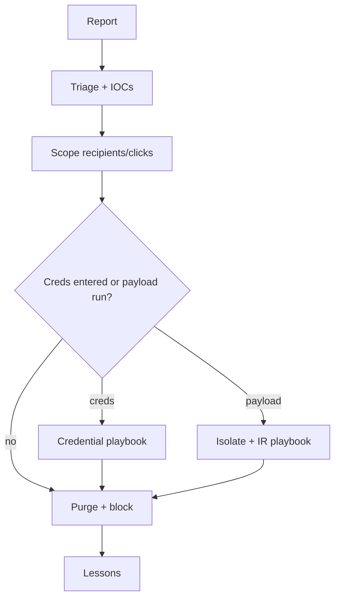

# Phishing Response Playbook

Hub: [[Security-Engineering-OS]]

## Trigger

User report, email security alert, or detection of a malicious URL/attachment delivered.

## 1. Triage (first 15-30 min)

- Get the original email as an attachment (`.eml` / `.msg`) to preserve headers.
- Analyze headers: `From`, `Return-Path`, `Reply-To`, SPF/DKIM/DMARC results, sending IPs.
- Extract IOCs: sender, subject, URLs, domains, attachment hashes.
- Check URLs/attachments in an isolated sandbox or reputation service; never open on your workstation.
- Classify: spam, credential phishing, malware delivery, BEC / payment fraud.

## 2. Scope

- Search the mail platform for the same sender/subject/URL/hash: who received it?
- Proxy / DNS logs: who clicked?
- IdP logs: any logins from unusual locations after click time?
- EDR: any execution from the attachment?

## 3. Contain

- Purge the message from all mailboxes.
- Block sender/domain and URLs at mail gateway, proxy, DNS.
- For users who entered credentials -> run [[Compromised-Credentials-Playbook]].
- For users who executed payloads -> isolate host via EDR, escalate per [[Incident-Response-Playbook]].

## 4. Eradicate and recover

- Remove malicious inbox rules / forwarding and OAuth grants on affected accounts.
- Reimage hosts if malware executed.

## 5. Communicate and learn

- Thank the reporter; notify affected users.
- Share IOCs with the SOC; tune detections.
- Record timeline, decisions, and metrics your team tracks.

