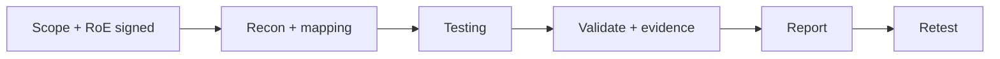

# Web App Pentest Methodology

Hub: [[Security-Engineering-OS]]

> Only test systems you own or have explicit written authorization to test. Practice on intentionally vulnerable apps (OWASP Juice Shop, DVWA) or legal platforms (see [[Security-Labs-Tracker]]).

## 1. Pre-engagement

**Scoping**
- In-scope hosts, URLs, APIs, environments (prefer staging with production-like data that is not real customer data).
- Out-of-scope items (third-party services, payment processors unless they authorize).
- Test accounts per role; test type (black / grey / white box).

**Rules of engagement (signed)**
- Written authorization from the system owner.
- Testing windows, allowed techniques (no DoS, no social engineering unless agreed), rate limits.
- Emergency contacts and stop procedure; what to do if a critical issue or real data is found.
- Data handling: how evidence is stored, retained, destroyed.

## 2. Reconnaissance and mapping

- Enumerate functionality by using the app as each role; proxy traffic (e.g., Burp Suite / OWASP ZAP).
- Identify entry points, parameters, APIs (OpenAPI specs), auth flows, tech stack.

## 3. Testing phases (OWASP WSTG categories)

| Area | Examples of what to verify |
|---|---|
| Configuration | TLS, security headers, verbose errors, default files |
| Authentication | lockout, MFA, reset flow, credential handling |
| Session management | cookie flags, fixation, expiry, logout invalidation |
| Authorization | IDOR, horizontal/vertical privilege checks per role |
| Input validation | injection (SQL, command, template), XSS, SSRF, path traversal |
| Business logic | workflow bypass, race conditions, price/quantity tampering |
| Client side | DOM XSS, CORS, clickjacking |
| APIs | mass assignment, rate limiting, excessive data exposure |

Confirm findings with minimal-impact proof (e.g., reading your own test record via another test account), not by accessing real user data.

## 4. Reporting

- **Executive summary**: overall risk, key themes.
- **Findings**: title, severity (e.g., CVSS plus business context), affected asset, description, reproduction steps, evidence, impact, remediation, references.
- **Methodology and scope** as tested; limitations.
- Offer a retest to verify fixes.

