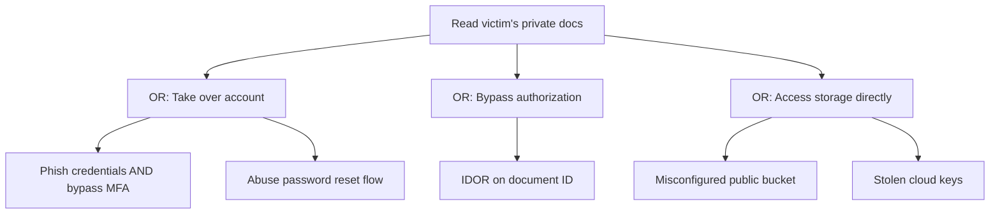

# Attack Trees

Hub: [[Security-Engineering-OS]]

## Idea

Popularized by Bruce Schneier: the root node is the attacker's goal; children are ways to achieve it. **OR** nodes: any child suffices. **AND** nodes: all children needed. Leaves are concrete attack steps you can assign attributes to (cost, skill, detectability, existing mitigations).

## Example: read another user's private documents

## How to use one

1. Define a concrete goal from the attacker's point of view.
2. Decompose until leaves are testable.
3. Annotate leaves (feasibility, impact, mitigations present).
4. Find the cheapest paths; fix controls that cut many paths (chokepoints like strong authz checks).
5. Turn leaves into test cases and detections.

## Tradeoffs

- Pros: forces attacker thinking, explains prioritization to non-security folks.
- Cons: can explode in size; quality depends on the author's knowledge. Pair with STRIDE (see [[Threat-Model-Template]]) and [[MITRE-ATTACK]] for coverage.
