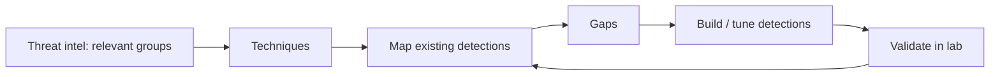

# MITRE ATT&CK

Hub: [[Security-Engineering-OS]]

## What it is

A publicly available, MITRE-curated knowledge base of adversary behavior observed in real intrusions. Matrices exist for Enterprise (Windows, Linux, macOS, cloud, containers, network), Mobile, and ICS.

- **Tactics** = the adversary's goal (the "why"): Reconnaissance, Resource Development, Initial Access, Execution, Persistence, Privilege Escalation, Defense Evasion, Credential Access, Discovery, Lateral Movement, Collection, Command and Control, Exfiltration, Impact.
- **Techniques / sub-techniques** = how (e.g., T1566 Phishing, T1566.001 Spearphishing Attachment; T1078 Valid Accounts).
- **Procedures** = specific observed implementations by groups or software.
- Also: groups, software, mitigations, data sources/components.

## How defenders use it

- **Detection coverage mapping**: tag each detection rule with technique IDs; visualize gaps with ATT&CK Navigator.
- **Threat-informed defense**: pick techniques used by groups relevant to your sector and prioritize those.
- **Incident reporting**: describe what happened in a common vocabulary.
- **Purple teaming / adversary emulation**: run authorized tests (e.g., Atomic Red Team in a lab) and check whether detections fire.

## Cautions

- Coverage is not binary; one rule rarely covers every procedure of a technique.
- Not a maturity score or checklist to "complete".
- Related: MITRE D3FEND (defensive techniques), CAPEC (attack patterns).

See also: [[Cloud-Logging]], [[SOC-Analyst-Playbook]].

## Interview questions

**Q: Tactic vs technique vs procedure?**
A: Tactic is the goal (Persistence), technique is how (T1547 Boot or Logon Autostart), procedure is a specific actor's implementation.

**Q: How do you use ATT&CK for coverage?**
A: Map each detection to techniques, weight by threat intel relevance, and test with emulation; a colored heatmap without tests overstates coverage.
