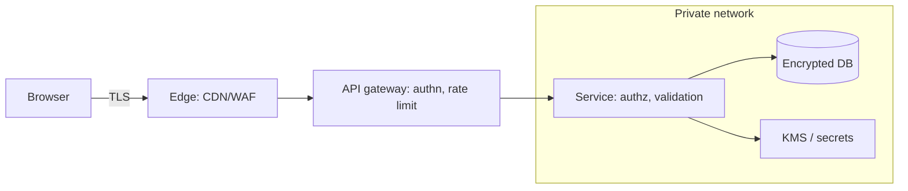

# Security Architecture

Hub: [[Security-Engineering-OS]]

## Principles

- **Least privilege** ([[Least-Privilege]]) and **separation of duties**.
- **Defense in depth**: independent layers so one failure is not a breach.
- **Secure defaults / fail closed**.
- **Minimize attack surface**: fewer exposed endpoints, features, dependencies.
- **Complete mediation**: check authorization on every access, server side.
- **Economy of mechanism**: simple designs are reviewable.
- **Don't roll your own crypto** ([[Applied-Cryptography]]).
- **Assume breach**: design for detection and containment.

## Trust boundaries

Draw a data-flow diagram, mark where data crosses privilege levels (internet -> edge, service -> database, tenant A -> shared infra). Every crossing needs authentication, authorization, validation, and logging.

## Common patterns

| Concern | Pattern |
|---|---|
| Authentication | Central IdP, OIDC/SAML, MFA, short-lived tokens |
| Authorization | Centralized policy (RBAC/ABAC/ReBAC), deny by default |
| Secrets | Secrets manager, rotation, no secrets in code |
| Data | Encryption in transit (TLS) and at rest, tokenization for sensitive fields |
| Tenancy | Tenant ID enforced at data layer, per-tenant keys where needed |
| Egress | Allow-listed outbound, proxy with logging |
| Observability | Audit logs immutable and centralized |

## Secure design review flow

1. Understand the feature and data classification.
2. Draw DFD and trust boundaries.
3. Threat model (STRIDE via [[Threat-Model-Template]], [[Attack-Trees]]).
4. Map mitigations and residual risk; record decisions.
5. Define security test cases and detections.

See also: [[Zero-Trust]], [[Security-Review-Checklist]].
