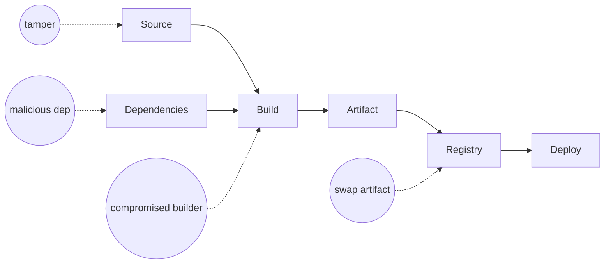

# Software Supply Chain Security

Hub: [[Security-Engineering-OS]]

## Threats

Compromised source repo, malicious or typosquatted dependencies, dependency confusion, compromised build system, tampered artifacts in transit or registry, stolen signing or publish credentials.



## SBOM (Software Bill of Materials)

- Machine-readable inventory of components and versions in an artifact.
- Formats: **SPDX** and **CycloneDX**.
- Generate at build time (e.g., Syft, Trivy), store with the artifact, use it to answer "are we affected by CVE-X?" quickly.
- VEX documents state whether a listed vulnerability is actually exploitable in your product.

## SLSA (Supply-chain Levels for Software Artifacts)

An OpenSSF framework. In v1.0 the **Build track** defines:

- **L0**: no guarantees.
- **L1**: provenance exists showing how the artifact was built.
- **L2**: provenance is signed and generated by a hosted build platform.
- **L3**: hardened build platform; builds isolated from each other and signing material protected from user-defined build steps (provenance is hard to forge).

Provenance is typically expressed as an in-toto attestation.

## Sigstore signing

- **Cosign**: signs and verifies container images and blobs.
- **Fulcio**: CA issuing short-lived certificates bound to an OIDC identity (keyless signing, e.g., a CI workflow identity).
- **Rekor**: public append-only transparency log of signatures.

```bash
# keyless sign in CI (identity from OIDC)
cosign sign registry.example.com/app@sha256:<digest>

# verify: pin the expected signer identity and issuer
cosign verify registry.example.com/app@sha256:<digest> \
  --certificate-identity-regexp '^https://github.com/org/repo/' \
  --certificate-oidc-issuer https://token.actions.githubusercontent.com
```

Enforce verification at deploy with an admission controller (e.g., Sigstore policy-controller, Kyverno).

## Practical controls

- Lockfiles and pinned versions / digests; review dependency updates (Dependabot / Renovate).
- Private registry / proxy; scope internal package names to prevent dependency confusion.
- Branch protection, required reviews, signed commits where feasible.
- Least-privilege, short-lived CI credentials (OIDC federation, no long-lived cloud keys in CI).
- Pin third-party CI actions by commit SHA.
- OpenSSF Scorecard to assess dependencies' hygiene.

See also: [[Container-Security]].

## Interview questions

**Q: What does SLSA Build L3 add over L2?**
A: A hardened build platform: builds are isolated from one another and signing material is inaccessible to user-defined build steps, so a tenant cannot forge provenance.

**Q: SBOM vs VEX?**
A: An SBOM lists components; VEX states whether a known CVE in those components is actually exploitable in this product, cutting false-positive triage.

**Q: How does keyless signing work?**
A: Fulcio issues a short-lived cert bound to an OIDC identity (e.g. CI workflow), the signature is logged in Rekor, and verifiers check identity plus issuer, not a long-lived key.
