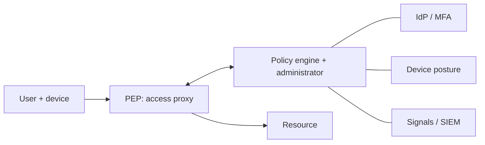

# Zero Trust

Hub: [[Security-Engineering-OS]]

## Core idea

Traditional "castle and moat" trusts anything inside the network. Zero trust (NIST SP 800-207) removes implicit trust based on network location: every access request is authenticated, authorized, and evaluated against policy using identity, device posture, and context, per session, with least privilege.

## Components (NIST terms)

- **Policy Engine (PE)**: decides.
- **Policy Administrator (PA)**: establishes / tears down the session.
- **Policy Enforcement Point (PEP)**: the gateway / proxy / sidecar that enforces.
- Inputs: identity provider, device management, threat intel, activity logs, data classification.

## Pillars (CISA maturity model)

Identity, Devices, Networks, Applications and Workloads, Data; cross-cutting visibility/analytics, automation/orchestration, governance.

## Practical building blocks

- Strong phishing-resistant MFA (FIDO2/WebAuthn) and SSO.
- Identity-aware proxies instead of flat VPN access.
- Micro-segmentation; service-to-service mTLS with workload identity.
- Continuous evaluation (revoke sessions on risk change).
- Least privilege and just-in-time elevated access.

## Misconceptions

- Not a product you buy; it is an architecture and a migration.
- Does not mean "no network controls"; segmentation still matters.

See also: [[Identity-Security]].
