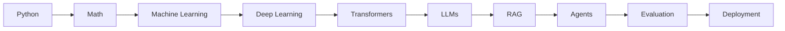

# AI Engineering Index

Hub: [[AI-Engineering-Index]]

Entry point for everything AI in Engineering OS: classical ML foundations, deep learning, LLM engineering, and running AI systems in production. Follow the path top to bottom, or jump to a category. Older vault hub: [[AI-ML-Index]].

## Learning Path

| Stage | Start with |
|---|---|
| Python | [[Python-for-ML]] |
| Math | [[Linear-Algebra-for-ML]], [[Probability-and-Statistics-for-ML]], [[Optimization-and-Gradient-Descent]] |
| Machine Learning | [[Linear-and-Logistic-Regression]], [[Overfitting-and-Regularization]] |
| Deep Learning | [[Neural-Networks-and-Backprop]] |
| Transformers | [[Attention-Mechanism]], [[Transformer-Architecture]] |
| LLMs | [[Tokenization]], [[Prompt-Engineering-Guide]] |
| RAG | [[RAG-Playbook]] |
| Agents | [[AI-Agents]] |
| Evaluation | [[LLM-Evaluation-Framework]] |
| Deployment | [[LLM-Inference-and-Serving]] |

## Foundations

- [[Python-for-ML]] - NumPy, pandas, and the scientific Python habits every ML note assumes.
- [[Python-Stdlib-Cheat-Sheet]] - standard-library quick reference for the glue code around models.
- [[Linear-Algebra-for-ML]] - vectors, matrices, dot products, and decompositions behind embeddings and attention.
- [[Probability-and-Statistics-for-ML]] - distributions, expectation, Bayes, and estimation for reasoning about models and metrics.
- [[Optimization-and-Gradient-Descent]] - loss surfaces, gradient descent variants, learning rates, and convergence.

## Machine Learning

- [[Linear-and-Logistic-Regression]] - the baseline models: least squares, sigmoid, cross-entropy, interpretation.
- [[Classification-Algorithms]] - kNN, trees, ensembles, SVMs, naive Bayes and when each fits.
- [[Clustering]] - k-means, hierarchical, density-based clustering and how to judge clusters.
- [[Feature-Engineering]] - encoding, scaling, leakage-safe pipelines, and feature selection.
- [[Cross-Validation-and-Model-Selection]] - splits, k-fold, hyperparameter search, and honest test sets.
- [[Overfitting-and-Regularization]] - bias-variance, learning curves, L1/L2, dropout, early stopping.
- [[Evaluation-Metrics-ML]] - confusion matrix, precision/recall, ROC/PR, regression and ranking metrics.

## Deep Learning

- [[Neural-Networks-and-Backprop]] - layers, activations, backpropagation, and training loops.
- [[CNNs]] - convolutions, pooling, and architectures for images and grids.
- [[RNNs-and-LSTMs]] - recurrence, vanishing gradients, gating, and why transformers replaced them.
- [[Embeddings]] - dense vectors where similarity becomes geometry; basis of semantic search.
- [[Attention-Mechanism]] - scaled dot-product and multi-head attention, masks, complexity.
- [[Transformer-Architecture]] - blocks, residuals, norms, positions, training vs inference.

## LLM Engineering

- [[Tokenization]] - subword tokenizers, token counting, and their surprising failure modes.
- [[Context-Windows]] - budgeting, position effects, and long-context tradeoffs.
- [[Prompt-Engineering-Guide]] - canonical prompting catalog: framework, few-shot, CoT, schemas, versioning.
- [[LLM-Prompt-Engineering]] - short concept pointer to the prompting guide.
- [[Structured-Output]] - schema-constrained generation, validation, and retries.
- [[Tool-Calling-and-Function-Calling]] - letting models call typed functions safely.
- [[Fine-Tuning-vs-Prompting]] - decision framework for prompting, RAG, tools, and LoRA fine-tuning.
- [[RAG-Playbook]] - canonical end-to-end RAG guide: ingest, retrieve, generate, evaluate, debug.
- [[RAG-Retrieval-Augmented-Generation]] - short concept pointer to the RAG playbook.
- [[Chunking-Strategies]] - how to split documents for retrieval.
- [[Vector-Databases]] - ANN indexes, filtering, and operating a vector store.
- [[Hybrid-Search-and-Reranking]] - BM25 + dense fusion and cross-encoder reranking.
- [[Hallucination-Mitigation]] - grounding, citations, refusals, and verification.
- [[Guardrails]] - input/output checks and policy enforcement around models.
- [[AI-Agents]] - the plan-act-observe loop, tools, and when not to build an agent.
- [[Multi-Agent-Systems]] - orchestration patterns and their coordination costs.
- [[Agent-Memory]] - short-term, long-term, and retrieval-based memory for agents.
- [[MCP-Tool-Integration]] - exposing tools and data to models via the Model Context Protocol.

## Production AI

- [[LLM-Inference-and-Serving]] - prefill vs decode, KV cache, batching, and serving stacks.
- [[Quantization]] - lower-precision weights and activations for memory and speed.
- [[LLM-Latency-Optimization]] - streaming, caching, smaller models, and parallelism to cut latency.
- [[LLM-Evaluation-Framework]] - what to measure: golden sets, scorers, rubrics, judge calibration.
- [[LLM-Evaluation-Pipelines]] - how to run evals: CI gates, regression runs, online sampling.
- [[LLM-Observability]] - tracing, logging, and monitoring LLM calls in production.
- [[LLM-Cost-Optimization]] - token budgets, caching, routing, and batching to control spend.
- [[Prompt-Injection]] - direct and indirect injection attacks and layered defenses.
- [[AI-Data-Leakage-and-Privacy]] - PII, memorization, tenant isolation, and data handling.
- [[Adversarial-Inputs]] - inputs crafted to fool models, and robustness testing.
- [[AI-Architecture-Reference]] - reference architecture tying gateway, retrieval, models, evals, and observability together.

## Checklists

- [[RAG-System-Checklist]] - pre-launch review of a RAG pipeline.
- [[Agent-Design-Checklist]] - tools, permissions, loops, and stop conditions for agents.
- [[AI-Security-Checklist]] - injection, leakage, tool privilege, and abuse controls.
- [[AI-App-Launch-Checklist]] - evals, monitoring, cost, fallback, and rollout before shipping.

## Templates

- [[AI-Project-Template]] - scaffold for planning and documenting an AI project.
- [[AI-Evaluation-Template]] - fill-in eval plan: dataset, scorers, thresholds, results.
- [[Model-Comparison-Template]] - choose a model on your own eval set with cost and latency.

## Security Cross-links

- [[OWASP-Top-10]], [[Threat-Modeling-STRIDE]], [[Least-Privilege]], [[SQL-Injection]] - classic security notes that map directly onto LLM app risks.

## Suggested 8-Week Plan

| Week | Focus | Notes | Output |
|---|---|---|---|
| 1 | Python + math | [[Python-for-ML]], [[Linear-Algebra-for-ML]], [[Probability-and-Statistics-for-ML]], [[Optimization-and-Gradient-Descent]] | Gradient descent from scratch in NumPy |
| 2 | Classical ML | [[Linear-and-Logistic-Regression]], [[Classification-Algorithms]], [[Clustering]], [[Feature-Engineering]] | scikit-learn pipeline on a tabular dataset |
| 3 | Model evaluation | [[Cross-Validation-and-Model-Selection]], [[Overfitting-and-Regularization]], [[Evaluation-Metrics-ML]] | Threshold chosen from error costs, with CV |
| 4 | Deep learning | [[Neural-Networks-and-Backprop]], [[CNNs]], [[RNNs-and-LSTMs]], [[Embeddings]] | Small PyTorch classifier + semantic search demo |
| 5 | Transformers + LLM basics | [[Attention-Mechanism]], [[Transformer-Architecture]], [[Tokenization]], [[Context-Windows]], [[Prompt-Engineering-Guide]], [[Structured-Output]] | Validated JSON extraction tool with retries |
| 6 | RAG | [[RAG-Playbook]], [[Chunking-Strategies]], [[Vector-Databases]], [[Hybrid-Search-and-Reranking]], [[Hallucination-Mitigation]] | RAG over your own notes with citations + hit-rate eval |
| 7 | Agents + security | [[Tool-Calling-and-Function-Calling]], [[AI-Agents]], [[Agent-Memory]], [[MCP-Tool-Integration]], [[Prompt-Injection]], [[Guardrails]] | Tool-using agent with least-privilege tools and injection tests |
| 8 | Evaluation + deployment | [[LLM-Evaluation-Framework]], [[LLM-Evaluation-Pipelines]], [[LLM-Inference-and-Serving]], [[LLM-Observability]], [[LLM-Cost-Optimization]], [[AI-App-Launch-Checklist]] | CI eval gate, tracing, cost dashboard, launch review |

## Canonical Notes

Where overlapping topics live - link to the canonical note instead of duplicating content.

| Topic | Canonical (deep) | Pointer / scoped note |
|---|---|---|
| RAG end to end | [[RAG-Playbook]] | [[RAG-Retrieval-Augmented-Generation]] (short concept) |
| Chunking details | [[Chunking-Strategies]] | Summarized in [[RAG-Playbook]] |
| Vector stores | [[Vector-Databases]] | Summarized in [[RAG-Playbook]] |
| Hybrid search / reranking | [[Hybrid-Search-and-Reranking]] | Summarized in [[RAG-Playbook]] |
| Prompting techniques | [[Prompt-Engineering-Guide]] | [[LLM-Prompt-Engineering]] (short concept) |
| Structured output | [[Structured-Output]] | Summarized in [[Prompt-Engineering-Guide]] |
| What to measure for LLMs | [[LLM-Evaluation-Framework]] | [[AI-Evaluation-Template]] (fill-in) |
| How to run evals | [[LLM-Evaluation-Pipelines]] | Referenced from [[LLM-Evaluation-Framework]] |
| Classical ML metrics | [[Evaluation-Metrics-ML]] | - |
| Adaptation strategy | [[Fine-Tuning-vs-Prompting]] | - |
| Prompt injection | [[Prompt-Injection]] | [[AI-Security-Checklist]] (checklist) |
