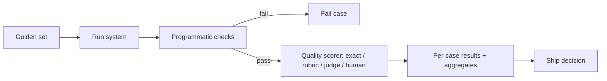

# LLM Evaluation Framework

Hub: [[AI-Engineering-Index]]

How to measure whether an LLM system (prompt + model + retrieval + config) actually works. The core discipline: no prompt or model change ships without a before/after comparison on a fixed eval set.

**Scope:** this note defines *what* to measure - datasets, scorers, rubrics, judges, metrics. *How* to run it continuously (CI gates, regression runs, online eval, sampling, infra) lives in [[LLM-Evaluation-Pipelines]]. A fill-in plan: [[AI-Evaluation-Template]].



---

## Goal

Evaluate quality, reliability, safety, latency, and cost **for your target workload** — public benchmarks tell you almost nothing about your task. The eval set is the spec: it encodes what "good" means for your system in executable form.

## Dataset Design

- **Mirror production distribution.** If 70% of real traffic is short factual lookups, the eval set should not be 70% essay questions. Sample from real logs where possible.
- **Include the hard 20%**: ambiguous inputs, adversarial phrasings, inputs with missing information, inputs that *should* be refused, and past production failures (every incident becomes an eval case — this is how the set grows teeth).
- **Label the expected outcome** per case: an exact expected output, a reference answer, or a rubric (below). Unlabeled eval sets produce vibes, not measurements.
- Size: 30–100 cases is enough to start and small enough to actually run on every change. Grow it from failures, not from bulk generation.

---

## Eval Types

Four ways to score an output, in increasing order of cost. Use the cheapest one that can actually measure the task.

### 1. Exact match / programmatic checks

Compare output to expected value directly, or assert properties in code.

- **Fits**: classification labels, extraction into structured fields, code that must pass tests, math with a single answer, format compliance (valid JSON, schema conformance, citation IDs exist).
- **Variants**: exact string match, normalized match (case/whitespace/number formatting), set match for lists, execution-based (run the generated code against tests).
- **Strengths**: free, deterministic, zero judge bias. **Limits**: any task with many valid phrasings scores false failures; don't force free-text tasks into exact match — you end up rewarding memorization of your reference wording.

### 2. Rubric scoring

A human or model scores the output against explicit written criteria (template below).

- **Fits**: summaries, explanations, drafts, multi-requirement outputs — anything where quality has several independent dimensions.
- The rubric is the whole game: criteria must be concrete enough that two scorers agree. "Is it good?" is not a criterion; "states the null-handling behavior explicitly" is.

### 3. LLM-as-judge

An LLM applies the rubric or compares two outputs. Scales rubric scoring to hundreds of cases cheaply. Trust it only after calibration, because judges have known systematic biases:

| Bias | Effect | Mitigation |
|---|---|---|
| **Position bias** | In A-vs-B comparisons, favors the first (sometimes last) option regardless of content | Run both orderings, count only consistent verdicts; randomize order |
| **Verbosity bias** | Longer answers score higher independent of quality | Rubric criterion penalizing padding; compare length-matched outputs; instruct judge explicitly |
| **Self-preference** | Judges rate output from their own model family higher | Use a different model family as judge than generator, or multiple judges |
| **Sycophancy/anchoring** | Scores drift toward any hint of the "expected" answer or author identity in the prompt | Strip metadata; give the judge only the input, output, and rubric |
| **Leniency drift** | Judges avoid low scores; everything clusters at 4/5 | Force per-criterion binary pass/fail instead of 1–5 scales; require citing evidence from the output for each verdict |

Calibration procedure: have the judge score 20–30 cases that a human has already scored; measure agreement per criterion. Below ~85% agreement, fix the rubric (usually) or the judge prompt, and re-check. Re-calibrate when the rubric or judge model changes. Spot-check 10% of judge verdicts ongoing.

### 4. Human evaluation

The ground truth, and the only trustworthy option for high-stakes correctness (medical/legal/financial), subtle tone, and calibrating the other three types.

- Too expensive to run on every change — reserve it for: building the initial labeled set, calibrating LLM judges, auditing a sample of judge results, and final sign-off on major changes.
- Give humans the same rubric as the judge; free-form human opinion is as inconsistent as free-form judge opinion.

---

### Choosing the eval type

| Task shape | Use | Why |
|---|---|---|
| Single correct answer (label, extraction, math) | Exact match / programmatic | Free and unambiguous |
| Code generation | Execution against tests | The tests *are* the spec |
| Format/structure requirements | Programmatic validators | Run these on every task as a first gate, whatever else you use |
| Free text, few cases or high stakes | Human with rubric | Ground truth |
| Free text, many cases, judge calibrated | LLM-as-judge with rubric | Scales; trust proportional to measured human agreement |
| Two prompts/models, "which is better" | Pairwise judge, both orderings | Comparative judgments are more reliable than absolute scores |

Stack them: programmatic format checks first (reject before scoring), then the quality scorer. A perfectly faithful answer in broken JSON is still a failing case.

---

## Rubric Template

Per-criterion binary pass/fail beats 1–5 scales: it forces concrete criteria and eliminates scale-interpretation drift between scorers.

```markdown
# Rubric: <task name>  v<version>
Input given to model: <the eval case input>
Reference material: <source docs / expected answer, if any>

For each criterion answer PASS or FAIL, quoting the part of the output that decides it.

| # | Criterion (concrete, independently checkable)                         | Pass/Fail | Evidence |
|---|-----------------------------------------------------------------------|-----------|----------|
| 1 | Every factual claim is supported by the reference material            |           |          |
| 2 | Directly answers the question asked (not an adjacent question)        |           |          |
| 3 | Follows required output format exactly                                |           |          |
| 4 | States assumptions / missing info instead of guessing                 |           |          |
| 5 | No content outside the requested scope                                |           |          |

Overall: PASS only if criteria 1–3 all pass (blocking) — 4–5 are quality signals.
Score reported as: fraction of criteria passed + overall pass/fail.
```

Adapt criteria per task; keep them independently checkable and mark which are blocking. Version the rubric — a rubric change makes scores incomparable to previous runs, same as a prompt change.

---

## Regression Eval Workflow for Prompt Changes

The workflow that prevents "improved one case, silently broke four":

1. **Freeze the eval set and rubric** before touching the prompt. The set must not change in the same step as the prompt, or you can't attribute the delta.
2. **Record the baseline**: run current prompt on all cases (2–3 runs if temperature > 0; score the variance too). Store per-case results, model ID, and prompt version — not just the aggregate.
3. **Make one change** to the prompt, targeted at specific failing cases. Note which cases it is supposed to fix. Multiple simultaneous changes = unattributable results.
4. **Re-run the full set**, same model, same parameters, same scorer.
5. **Compare per-case, not just aggregate.** Build the delta table:
   - Fixed (fail → pass): is it the cases you targeted?
   - Regressed (pass → fail): read every one of these outputs. This is the step everyone skips and the whole reason the workflow exists.
   - Flapping (inconsistent across runs): mark as unstable; don't count as fixed or regressed.
6. **Decide**: ship if targeted cases fixed and regressions are zero or understood-and-accepted (documented). Otherwise iterate at step 3.
7. **Commit together**: prompt version + eval results + delta summary (see [[Prompt-Engineering-Guide]] on prompt versioning; automation in [[LLM-Evaluation-Pipelines]]). Add any new production failures to the set for next time.

Same workflow applies to model upgrades and RAG pipeline changes — anything upstream of the output is a "prompt change" as far as the eval is concerned.

### Delta report format

```
Change: v4 → v5 (added null-handling rules)   Model: <id>   Cases: 48
Pass: 39 → 43   Fixed: 6 (cases 7,11,12,19,30,41 — 5 of 6 were targeted)
Regressed: 2 (cases 3, 22 — both now over-refuse on partial data)  ← investigated: real regression
Flapping: 1 (case 35)
Decision: fix over-refusal before shipping; v5 not deployed.
```

---

## Operational Metrics

Quality metrics above; also track per variant, because they gate deployment decisions:

- **Latency**: p50 and p95 end-to-end (including retrieval, if RAG). p95 is what users feel.
- **Cost**: per request and per 1k requests at expected traffic, using real token counts from eval runs — input and output priced separately.
- **Refusal behavior**: false-refusal rate on benign eval cases, and refusal rate on the should-refuse cases (both directions matter).
- **Format failure rate**: % of outputs failing programmatic validation (broken JSON, missing citations) — cheap to measure, strongly correlated with downstream breakage.

## Reporting Template

| Variant (prompt+model) | Pass rate | Faithfulness | False refusals | Format fails | Latency p95 | Cost/1k req | Notes |
|---|---:|---:|---:|---:|---:|---:|---|
| v4 + model-A (illustrative) | 39/48 | 0.92 | 1/48 | 0 | 2.1s | $4.10 | baseline |
| v5 + model-A (illustrative) | 43/48 | 0.94 | 3/48 | 0 | 2.2s | $4.30 | over-refuses; not shipped |

One row per variant, per-case detail linked separately. A single aggregate number is never sufficient to make a ship decision — the per-case delta is.

## Minimum Viable Start

Day one, before any tooling: 20 real inputs in a spreadsheet, expected outcome per row, run the prompt, mark pass/fail by hand. That already beats eyeballing chat outputs, and every practice above is an incremental upgrade from there.

---

## What to Measure by System Type

| System | Core metrics | Notes |
|---|---|---|
| Classification / extraction | Accuracy, per-field exact match, precision/recall per label | Programmatic; see [[Evaluation-Metrics-ML]] |
| Structured output | Schema-valid rate, field-level correctness | Gate before quality scoring ([[Structured-Output]]) |
| RAG | Retrieval hit rate@k, MRR; faithfulness, answer relevance, correct refusal rate | Score retrieval and generation separately ([[RAG-Playbook]]) |
| Agents | Task success rate, steps/tool calls per task, invalid tool-call rate, unsafe-action rate, cost per task | Evaluate trajectories, not just final answers ([[AI-Agents]]) |
| Chat / assistants | Rubric pass rate, false-refusal rate, safety-violation rate | Pairwise judges for "which is better" |
| Security | Injection success rate on an attack set, data-leak probes | [[Prompt-Injection]], [[AI-Security-Checklist]] |

## Python: Judge Calibration and Pass-Rate Confidence

```python
import math
from collections import Counter

def agreement(human: list[str], judge: list[str]) -> float:
    """Raw agreement between human and judge PASS/FAIL labels."""
    return sum(h == j for h, j in zip(human, judge)) / len(human)

def cohens_kappa(human: list[str], judge: list[str]) -> float:
    """Agreement corrected for chance; more honest when one label dominates."""
    n = len(human)
    po = agreement(human, judge)
    ch, cj = Counter(human), Counter(judge)
    pe = sum((ch[k] / n) * (cj[k] / n) for k in set(ch) | set(cj))
    return (po - pe) / (1 - pe) if pe < 1 else 1.0

def wilson_interval(passes: int, n: int, z: float = 1.96) -> tuple[float, float]:
    """95% interval for a pass rate - small eval sets have wide intervals."""
    if n == 0:
        return (0.0, 1.0)
    p = passes / n
    denom = 1 + z**2 / n
    center = (p + z**2 / (2 * n)) / denom
    half = z * math.sqrt(p * (1 - p) / n + z**2 / (4 * n**2)) / denom
    return (center - half, center + half)

human = ["PASS", "PASS", "FAIL", "PASS", "FAIL", "PASS"]
judge = ["PASS", "PASS", "FAIL", "PASS", "PASS", "PASS"]
print(round(agreement(human, judge), 2), round(cohens_kappa(human, judge), 2))
print([round(x, 2) for x in wilson_interval(43, 48)])
```

The interval matters: on a 48-case set, a few cases of difference between two variants can be within noise. Read per-case deltas instead of trusting small aggregate moves.

## Failure Modes of Evaluation Itself

- **Eval set drift from production**: the set stops representing real traffic; refresh from sampled logs ([[LLM-Observability]]).
- **Overfitting to the eval set**: prompt tuned until the golden set passes; keep a held-out slice you rarely look at.
- **Uncalibrated judges**: judge scores trusted without human agreement checks.
- **Aggregate-only reporting**: equal fixes and regressions cancel out in the mean.
- **Temperature mismatch**: evaluated at 0, deployed higher - run multiple samples.
- **Contamination**: public benchmark items may appear in training data; prefer private task-specific sets.
- **Missing negative cases**: no should-refuse or unanswerable cases, so over-answering is never penalized.
- **Rubric or judge change mid-comparison**: scores become incomparable; version both.

## Interview Questions

1. **How do you evaluate an LLM feature before launch?** Build a golden set from real inputs including hard and should-refuse cases, pick the cheapest scorer that measures the task, gate on format checks, compare per case against baseline, track latency/cost.
2. **What are the known biases of LLM-as-judge?** Position, verbosity, self-preference, anchoring, leniency; mitigate with both orderings, binary per-criterion rubrics, different-family judges, and human calibration.
3. **Binary criteria vs 1-5 scale?** Binary per criterion is more consistent between scorers and forces concrete criteria.
4. **How big should the eval set be?** Start small (tens of cases) so it runs on every change; grow from production failures; use confidence intervals to know what differences are meaningful.
5. **How do you evaluate a RAG system?** Separately: retrieval hit rate@k/MRR and generation faithfulness/relevance/refusal.
6. **Public benchmarks vs your eval?** Benchmarks indicate general capability; only a task-specific set tells you if your system works.
7. **What is the difference between this framework and an eval pipeline?** Framework = what and how to score; pipeline = automation, CI gates, online sampling ([[LLM-Evaluation-Pipelines]]).

## Related

- [[LLM-Evaluation-Pipelines]]
- [[AI-Evaluation-Template]]
- [[Model-Comparison-Template]]
- [[Evaluation-Metrics-ML]]
- [[RAG-Playbook]]
- [[Hallucination-Mitigation]]
- [[LLM-Observability]]
