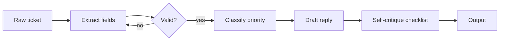

# Prompt Engineering Guide

Hub: [[AI-Engineering-Index]]

A working catalog of techniques that reliably improve LLM output quality. Every technique includes a concrete before/after example. Use the core framework for every serious prompt; layer the other techniques on when the task demands them. Short concept version: [[LLM-Prompt-Engineering]].

## Why prompting works

A decoder-only LLM predicts the next token conditioned on everything in its context. A prompt is therefore a program written in the model's input: every instruction, example, and delimiter shifts the output distribution. Two consequences:

- **Demonstrations beat descriptions.** The model imitates patterns in context more reliably than it follows abstract rules.
- **Position and clarity matter.** Everything competes for a finite window; long contexts show position effects, so put key instructions early and restate hard constraints near the end ([[Context-Windows]]).

## Core Framework

Structure every non-trivial prompt with these parts, in order (instructions early, data late, data clearly delimited):

1. **Role** - who the model should act as (sets vocabulary, priorities, depth)
2. **Objective** - the single concrete outcome
3. **Context** - everything the model needs and cannot infer (inputs, background, audience)
4. **Constraints** - must / must not (length, scope, tone)
5. **Output format** - exact structure (headings, table, JSON, code-only)
6. **Quality checks** - what to verify before answering
7. **Input** - the data, inside delimiters such as `<document>...</document>`

**Before:**
> Explain database indexing.

**After:**
> Role: You are a database instructor teaching second-year CS students.
> Objective: Explain how B-tree indexes speed up SELECT queries.
> Context: Students know SQL basics and binary search trees, but not disk I/O.
> Constraints: Under 400 words. No syntax tutorials. Use one running example (a `users` table with 10M rows).
> Format: 3 sections - the problem without an index, how the B-tree changes the lookup, when an index hurts.
> Quality check: Verify every claim about complexity is stated in terms of disk pages, not just big-O.

Why it works: each part removes one class of failure. Role fixes depth; objective fixes deliverable; context fixes assumptions; constraints fix scope creep; format fixes structure; quality checks catch likely errors.

## Few-Shot Examples

Show 2-5 input/output pairs before the real input.

**Before:**
> Classify these support tickets by urgency: "My invoice PDF won't download."

**After:**
> Classify each support ticket as P1 (outage/data loss), P2 (feature broken, workaround exists), or P3 (cosmetic/question). Output: `LABEL - one-line reason`.
>
> Ticket: "Site is down for all our users since 9am."
> P1 - total outage affecting all users.
>
> Ticket: "Export to CSV gives a 500 error, but copy-paste still works."
> P2 - feature broken but a workaround exists.
>
> Ticket: "Where do I change my avatar?"
> P3 - usage question, nothing broken.
>
> Ticket: "My invoice PDF won't download."

Guidelines:
- Cover **boundary** cases - examples are where judgment calls are encoded.
- Keep examples in the exact output format; the model copies formatting strongly.
- Vary examples; if all share one label or length, the model over-imitates that feature.
- If outputs drift, fix the example before lengthening the instruction.

## Chain-of-Thought (Reasoning Before Answering)

Ask the model to work through the problem before committing. Intermediate tokens give it more sequential computation and a scratchpad before the final answer. Helps math, logic, multi-constraint planning; costs tokens and latency - skip for lookups. Reasoning-oriented models do much of this internally; explicit CoT still helps many standard calls.

**Before:**
> A batch job processes 12,000 records/hour and slows 10% for each concurrent job added. With 3 jobs running, how long to process 50,000 records? Give the answer.

**After:**
> (same problem) First, work through it step by step: state your interpretation of "slows 10% per job" (compounding or additive?), compute the effective rate, then the time. After the reasoning, give the final answer on its own line as `ANSWER: <value>`.

Guidelines:
- Reasoning **before** the answer; answer-then-justify produces rationalization.
- Ask the model to surface ambiguities.
- Use a parseable delimiter (`ANSWER:`); do not show raw reasoning to end users if it may contain unvetted content.

## Structured Output / JSON Schema

When output feeds code, specify the exact schema and rules for every field. Full treatment: [[Structured-Output]].

**Before:**
> Extract the key info from this job posting as JSON.

**After:**
> Extract from the job posting below. Return ONLY a JSON object matching this schema - no markdown fences, no commentary:
> ```json
> {
>   "title": "string",
>   "company": "string",
>   "location": "string | null  (null if not stated; never guess)",
>   "salary_min": "integer | null  (annual, in the posting's currency)",
>   "salary_max": "integer | null",
>   "remote": "\"remote\" | \"hybrid\" | \"onsite\" | \"unspecified\"",
>   "skills": "string[]  (max 8, as written in the posting, lowercase)"
> }
> ```
> Rules: use `null` for missing values, never invent them. If a single salary number is given, set min and max to it.

Guidelines:
- Enumerate allowed values for categorical fields.
- State what to do with missing data - unspecified absence handling is a top source of hallucinated fields.
- Use the API's structured-output / tool-schema mode when available *and* keep the schema in the prompt: the prompt controls semantics, the API mode controls syntax.
- **Always validate in code** and retry on failure:

```python
import json

REQUIRED = {"title", "company", "location", "salary_min", "salary_max", "remote", "skills"}
REMOTE = {"remote", "hybrid", "onsite", "unspecified"}

def parse_posting(raw: str) -> dict:
    data = json.loads(raw)                       # raises on invalid JSON
    missing = REQUIRED - data.keys()
    if missing:
        raise ValueError(f"missing fields: {missing}")
    if data["remote"] not in REMOTE:
        raise ValueError(f"bad remote value: {data['remote']}")
    if not isinstance(data["skills"], list) or len(data["skills"]) > 8:
        raise ValueError("skills must be a list of at most 8")
    return data

def extract_with_retry(call_llm, prompt: str, retries: int = 2) -> dict:
    last_err = None
    for _ in range(retries + 1):
        raw = call_llm(prompt if last_err is None
                       else f"{prompt}\n\nPrevious output was invalid: {last_err}. Return corrected JSON only.")
        try:
            return parse_posting(raw)
        except (ValueError, json.JSONDecodeError) as e:
            last_err = str(e)
    raise RuntimeError(f"extraction failed after retries: {last_err}")
```

## Decomposition and Prompt Chaining

Split one mega-prompt into small single-purpose steps (extract -> classify -> summarize). Each step is testable like a function, can use a cheaper model, and fails visibly.



## Self-Critique (Generate -> Review -> Revise)

**Before:**
> Write a migration script to rename the `users.email` column to `email_address` in Postgres.

**After:**
> Write the migration. Then review it against this checklist and fix failures before giving the final version:
> 1. Is it reversible (down migration included)?
> 2. Does it handle dependent objects - indexes, constraints, views?
> 3. Would it lock the table long enough to matter at 10M rows? If yes, note it.
> 4. Any statement that fails if run twice?
> Output the final script, then a "Review notes" section listing what the checklist caught.

Guidelines:
- A checklist, not "check your work".
- For high-stakes output, run the critique as a **second call** with fresh context.

## Handling Untrusted Input

Any user text, retrieved document, web page, or tool output can contain instructions. Full treatment: [[Prompt-Injection]].

- Wrap untrusted content in delimiters and state that it is data, never instructions.
- Do not concatenate user input into the system prompt.
- Enforce hard rules (never reveal X, never call tool Y without approval) **in code**, not only via "never" instructions - negative instructions are followed probabilistically.
- Give tools least privilege; require confirmation for side effects ([[Tool-Calling-and-Function-Calling]], [[Guardrails]]).

## Reliability Additions

- **Ask for assumptions** - surfaces silent guesses.
- **Ask for edge cases / failure modes** - the model becomes its own adversarial tester.
- **Ask for a test plan** - makes claims falsifiable.
- **Ask for a reusable artifact** - template, checklist, or script.

## Cost and Latency

- Tokens cost linearly in price and prefill time; trim redundant instructions and examples.
- Put the static part (system prompt, examples, reference docs) first and keep it byte-identical across calls so provider-side prompt caching can reuse it ([[LLM-Cost-Optimization]]).
- Cap output length explicitly; output tokens are usually the slower and pricier part.

## Prompt Versioning

- **Store prompts in files**, in version control, with marked variables (`{{input}}`).
- **Version explicitly**: header with version, date, what changed, and which failure it fixed.
- **Keep an eval set per prompt** (5-20 cases to start) and re-run after every edit ([[LLM-Evaluation-Framework]]).
- **Never edit and deploy in one step.**
- **Pin the model version**: behavior = prompt x model.

```text
# extract-invoice v3 (2026-07-14)
# Model: validated on <model-id + version>
# v3: added null-handling rules - v2 hallucinated vendor addresses (eval cases 7, 11)
# v2: switched to JSON schema output
# Eval: evals/extract-invoice/ - 14/15 passing
```

## Prompt Iteration Loop

1. **Baseline** with the core framework. Run the eval set.
2. **Cluster failures**: format, facts, scope, reasoning, judgment.
3. **Targeted fix**: format -> schema + few-shot; reasoning -> CoT; scope -> constraints; judgment -> boundary examples; missing knowledge -> RAG ([[RAG-Playbook]]).
4. **Re-run and compare per case** - a fix that helps 3 and breaks 2 is not a fix.
5. **Version and commit.** Stop when edits stop moving the score; next gains come from better retrieval, a better model, or fine-tuning ([[Fine-Tuning-vs-Prompting]]).

## Failure Modes

| Failure | Cause | Fix |
|---|---|---|
| Generic, bland output | Vague objective | Concrete objective, audience, examples |
| Format drift | Description without demonstration | Few-shot in exact format + schema mode + validation |
| Contradictory behavior | Accumulated, conflicting system-prompt rules | Prune and consolidate; version the prompt |
| Ignored mid-prompt instruction | Buried in long context | Move up front; restate near the end |
| Hallucinated fields | No rule for missing data | Explicit `null` rules |
| Follows injected text | Untrusted input not delimited | Delimit, privilege-separate, check output |
| Regression after model upgrade | Prompt tuned to old model | Pin versions; re-run eval on upgrade |

## Technique Selection Cheat Sheet

| Symptom | Reach for |
|---|---|
| Output right but unusable structure | Structured output / few-shot format examples |
| Wrong depth or tone | Role + audience in context |
| Correct-looking but wrong answers | Chain-of-thought + ask for assumptions |
| Misses edge cases | Self-critique checklist + boundary examples |
| Inconsistent across similar inputs | Few-shot + explicit rules for the varying dimension |
| Needs facts it does not have | RAG or tools, not more prompt |
| Worked last week, broken now | Prompt versioning + regression eval |

## Interview Questions

1. **How do you get reliable structured output?** Schema in prompt, a few-shot example in the exact format, API structured-output or tool mode, then code-side validation with retry. The validation step is what interviewers listen for.
2. **Why does chain-of-thought help?** More generated tokens = more sequential computation and working memory before the answer; forcing reasoning first avoids rationalization.
3. **Zero-shot vs few-shot - when?** Few-shot when format or judgment is hard to describe; zero-shot when the task is simple and tokens are expensive.
4. **How do you treat prompts as engineering artifacts?** Version-controlled files, eval sets, per-case regression comparison, pinned model versions.
5. **Prompting has plateaued - what next?** Better examples -> decomposition -> RAG for knowledge gaps -> fine-tuning for form.
6. **What is prompt injection and how do you mitigate it?** Untrusted text read as instructions; delimit data, least-privilege tools, human approval for side effects, output checks - no single prompt fully prevents it.
7. **How do you reduce prompt cost?** Trim, cache static prefixes, cap output length, route easy requests to smaller models.

## Related

- [[LLM-Prompt-Engineering]]
- [[Structured-Output]]
- [[Context-Windows]]
- [[Prompt-Injection]]
- [[LLM-Evaluation-Framework]]
- [[Fine-Tuning-vs-Prompting]]
- [[RAG-Playbook]]
