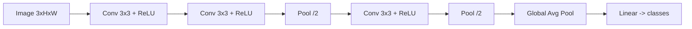

# CNNs

Hub: [[AI-Engineering-Index]]

## Core Idea

A convolutional layer slides a small learned filter over the input and computes dot products at each position. Two inductive biases make this efficient for grid data (images, audio spectrograms):

- **Local connectivity**: each output depends on a small neighbourhood.
- **Weight sharing**: the same filter is used everywhere, giving translation equivariance and far fewer parameters than a dense layer.

## How it works

For input $X$ with $C_{in}$ channels and kernel $K$ of size $k \times k$:

$$Y[c_o, i, j] = b[c_o] + \sum_{c_i}\sum_{u,v} K[c_o, c_i, u, v]\, X[c_i, i\cdot s + u, j\cdot s + v]$$

(Deep learning "convolution" is technically cross-correlation; the kernel is not flipped.)

Output spatial size: $\lfloor (n + 2p - k)/s \rfloor + 1$ for input size $n$, padding $p$, stride $s$.

Parameters per conv layer: $C_{out}\cdot(C_{in}\cdot k^2 + 1)$, independent of image size.

**Receptive field** grows with depth: stacking two 3x3 convs sees 5x5; three see 7x7, with fewer parameters and more nonlinearities than a single 7x7.

**Pooling** (max/average) downsamples, adding small translation invariance. Modern nets often use strided conv instead, plus global average pooling before the classifier.



## Python code

Naive NumPy conv (for understanding; use im2col or a framework in practice):

```python
import numpy as np

def conv2d(x, w, b, stride=1, pad=0):
    """x: (C_in, H, W), w: (C_out, C_in, k, k), b: (C_out,)"""
    x = np.pad(x, ((0, 0), (pad, pad), (pad, pad)))
    c_out, _, k, _ = w.shape
    H = (x.shape[1] - k) // stride + 1
    W = (x.shape[2] - k) // stride + 1
    y = np.empty((c_out, H, W))
    for i in range(H):
        for j in range(W):
            patch = x[:, i*stride:i*stride+k, j*stride:j*stride+k]
            y[:, i, j] = np.tensordot(w, patch, axes=([1, 2, 3], [0, 1, 2])) + b
    return y

x = np.random.randn(3, 8, 8)
w = np.random.randn(4, 3, 3, 3)
print(conv2d(x, w, np.zeros(4), stride=1, pad=1).shape)  # (4, 8, 8)
```

PyTorch small classifier:

```python
import torch.nn as nn

class SmallCNN(nn.Module):
    def __init__(self, num_classes=10):
        super().__init__()
        self.features = nn.Sequential(
            nn.Conv2d(3, 32, 3, padding=1), nn.BatchNorm2d(32), nn.ReLU(),
            nn.Conv2d(32, 64, 3, padding=1), nn.BatchNorm2d(64), nn.ReLU(),
            nn.MaxPool2d(2),
            nn.Conv2d(64, 128, 3, padding=1), nn.BatchNorm2d(128), nn.ReLU(),
            nn.AdaptiveAvgPool2d(1),
        )
        self.head = nn.Linear(128, num_classes)

    def forward(self, x):
        return self.head(self.features(x).flatten(1))
```

Residual block (the key idea behind ResNet):

```python
class ResidualBlock(nn.Module):
    def __init__(self, c):
        super().__init__()
        self.body = nn.Sequential(
            nn.Conv2d(c, c, 3, padding=1, bias=False), nn.BatchNorm2d(c), nn.ReLU(),
            nn.Conv2d(c, c, 3, padding=1, bias=False), nn.BatchNorm2d(c),
        )
        self.act = nn.ReLU()

    def forward(self, x):
        return self.act(x + self.body(x))
```

## Architecture milestones

| Idea | Contribution |
|---|---|
| LeNet | conv + pool + dense for digits |
| AlexNet | deep CNN on GPUs, ReLU, dropout |
| VGG | stacks of 3x3 convs |
| Inception | parallel multi-scale branches, 1x1 bottlenecks |
| ResNet | residual connections enable very deep nets |
| MobileNet | depthwise separable convs for mobile efficiency |
| Vision Transformer | patches + attention; see [[Transformer-Architecture]] |

**1x1 convolution**: mixes channels per pixel; cheap way to change channel count.
**Depthwise separable conv**: per-channel $k\times k$ conv followed by 1x1 conv; parameters drop from $C_{in}C_{out}k^2$ to $C_{in}k^2 + C_{in}C_{out}$.

## Tradeoffs

- CNNs have strong priors so they are data-efficient; ViTs need more data or pretraining but scale well.
- Larger kernels see more context but cost quadratically in $k$.
- Aggressive downsampling saves compute but hurts dense tasks (segmentation, detection).

## Failure modes

- Shortcut learning: model uses backgrounds, watermarks, or scanner artifacts instead of the object.
- Distribution shift: lighting, camera, or domain changes break accuracy.
- Augmentations that change the label (e.g. horizontal flip for text or left/right-sensitive medical images).
- Shape bugs: channels-first vs channels-last mismatch.

## Production notes

- Transfer learning: start from a pretrained backbone, fine-tune the head first, then unfreeze.
- Data augmentation (crop, flip, color jitter, mixup/cutmix) is the main regularizer.
- Export via ONNX/TorchScript; quantize for edge; see [[Quantization]].
- Normalize inputs exactly as done in training (mean/std per channel).

## Interview questions

1. **Why convolutions instead of dense layers for images?** Weight sharing and locality: far fewer parameters and translation equivariance.
2. **Output size of a 32x32 input, 5x5 kernel, stride 1, padding 2?** $(32+4-5)/1+1 = 32$.
3. **Why stack 3x3 convs instead of one 7x7?** Same receptive field, fewer parameters ($3\cdot 9C^2$ vs $49C^2$), more nonlinearity.
4. **What does a 1x1 conv do?** Linear channel mixing per pixel; bottlenecks and channel projection.
5. **Why do residual connections help?** Identity path eases gradient flow and makes learning a near-identity mapping easy.
6. **Equivariance vs invariance?** Conv is translation equivariant (shifted input gives shifted output); pooling adds approximate invariance.
7. **How would you handle a small labeled dataset?** Pretrained backbone, strong augmentation, freeze early layers, careful validation.

## Related

[[Neural-Networks-and-Backprop]] - [[RNNs-and-LSTMs]] - [[Transformer-Architecture]] - [[Overfitting-and-Regularization]] - [[Quantization]]
