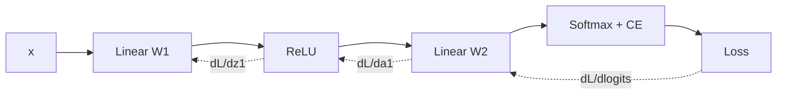

# Neural Networks and Backprop

Hub: [[AI-Engineering-Index]]

## Core Idea

A multilayer perceptron (MLP) is a stack of affine maps and elementwise nonlinearities: $h_{l} = \phi(W_l h_{l-1} + b_l)$. Without the nonlinearity $\phi$, any stack collapses to one linear map. Training minimizes a loss $L$ by gradient descent; **backpropagation** is just the chain rule applied in reverse topological order, reusing intermediate values cached during the forward pass so the full gradient costs roughly the same as one or two forward passes.

## How it works

For a layer $z = W x + b$, $a = \phi(z)$, given upstream gradient $\delta_a = \partial L / \partial a$:

- $\delta_z = \delta_a \odot \phi'(z)$
- $\partial L/\partial W = \delta_z x^\top$ (summed over the batch)
- $\partial L/\partial b = \sum_{\text{batch}} \delta_z$
- $\delta_x = W^\top \delta_z$ (passed to the previous layer)

For softmax + cross-entropy combined, the gradient w.r.t. logits simplifies to $\hat{y} - y$ (divided by batch size for a mean loss). This is why frameworks fuse the two.



## Python code: MLP with manual backprop

```python
import numpy as np

rng = np.random.default_rng(0)

def he_init(fan_in, fan_out):
    return rng.normal(0.0, np.sqrt(2.0 / fan_in), size=(fan_in, fan_out))

class MLP:
    def __init__(self, sizes):
        self.W = [he_init(a, b) for a, b in zip(sizes[:-1], sizes[1:])]
        self.b = [np.zeros(b) for b in sizes[1:]]

    def forward(self, X):
        self.cache = [X]
        h = X
        for i, (W, b) in enumerate(zip(self.W, self.b)):
            z = h @ W + b
            h = np.maximum(z, 0) if i < len(self.W) - 1 else z  # last layer = logits
            self.cache.append((z, h))
        return h

    def loss_and_grad(self, X, y):
        logits = self.forward(X)
        logits = logits - logits.max(axis=1, keepdims=True)      # numerical stability
        p = np.exp(logits); p /= p.sum(axis=1, keepdims=True)
        n = X.shape[0]
        loss = -np.log(p[np.arange(n), y] + 1e-12).mean()

        d = p.copy(); d[np.arange(n), y] -= 1; d /= n              # dL/dlogits
        gW, gb = [None] * len(self.W), [None] * len(self.b)
        for i in reversed(range(len(self.W))):
            h_prev = self.cache[i] if i == 0 else self.cache[i][1]
            gW[i] = h_prev.T @ d
            gb[i] = d.sum(axis=0)
            if i > 0:
                d = d @ self.W[i].T
                z_prev = self.cache[i][0]
                d = d * (z_prev > 0)                                # ReLU'
        return loss, gW, gb

    def step(self, gW, gb, lr):
        for i in range(len(self.W)):
            self.W[i] -= lr * gW[i]
            self.b[i] -= lr * gb[i]

# toy data: 3 Gaussian blobs
X = np.concatenate([rng.normal(c, 0.5, (100, 2)) for c in ([0, 0], [3, 3], [0, 3])])
y = np.repeat([0, 1, 2], 100)
net = MLP([2, 32, 32, 3])
for epoch in range(500):
    loss, gW, gb = net.loss_and_grad(X, y)
    net.step(gW, gb, lr=0.1)
print("final loss", round(loss, 4))
```

Note: `self.cache[0]` is the raw input; `self.cache[i]` for `i >= 1` is `(z, h)` of layer `i-1`. Always verify manual gradients with a finite-difference check:

```python
def grad_check(net, X, y, eps=1e-5):
    _, gW, _ = net.loss_and_grad(X, y)
    W = net.W[0]; i, j = 0, 0
    W[i, j] += eps; lp, _, _ = net.loss_and_grad(X, y)
    W[i, j] -= 2 * eps; lm, _, _ = net.loss_and_grad(X, y)
    W[i, j] += eps
    num = (lp - lm) / (2 * eps)
    return abs(num - gW[0][i, j]) / max(1e-8, abs(num) + abs(gW[0][i, j]))
```

## Initialization

| Scheme | Variance of $W$ | Use with |
|---|---|---|
| Xavier/Glorot | $2/(n_{in}+n_{out})$ | tanh, sigmoid |
| He/Kaiming | $2/n_{in}$ | ReLU family |
| Zero | 0 | never for weights (symmetry: all units learn the same thing); fine for biases |

Goal: keep activation and gradient variance roughly constant across depth.

## Activations

| Activation | Formula | Notes |
|---|---|---|
| Sigmoid | $1/(1+e^{-x})$ | saturates, max derivative 0.25, not zero-centered |
| Tanh | $\tanh x$ | zero-centered, still saturates |
| ReLU | $\max(0,x)$ | cheap, no saturation for $x>0$; "dead" units if always negative |
| Leaky ReLU | $\max(\alpha x, x)$ | fixes dead units |
| GELU / SiLU | $x\Phi(x)$ / $x\sigma(x)$ | smooth; common in Transformers |

## Vanishing and exploding gradients

Backprop multiplies Jacobians across layers. If their norms are consistently < 1, gradients shrink exponentially with depth (vanishing); > 1, they blow up (exploding). Sigmoid derivatives (at most 0.25) make vanishing likely.

Mitigations: ReLU-family activations, proper init, residual connections ($h + f(h)$ gives an identity path for gradients), normalization layers, gradient clipping (for exploding), shorter paths (LSTM gating in [[RNNs-and-LSTMs]]).

## BatchNorm vs LayerNorm

Both compute $\hat{x} = (x-\mu)/\sqrt{\sigma^2+\epsilon}$, then $y = \gamma \hat{x} + \beta$ with learned $\gamma, \beta$.

| | BatchNorm | LayerNorm |
|---|---|---|
| Statistics over | batch (per feature) | features (per example) |
| Train vs inference | differs: uses running mean/var at inference | identical |
| Batch size sensitivity | poor with small batches | none |
| Typical use | CNNs | Transformers, RNNs |

```python
def layernorm(x, gamma, beta, eps=1e-5):
    mu = x.mean(axis=-1, keepdims=True)
    var = x.var(axis=-1, keepdims=True)
    return gamma * (x - mu) / np.sqrt(var + eps) + beta
```

## Tradeoffs

- Wider vs deeper: depth gives compositional features but is harder to optimize without residuals/normalization.
- BatchNorm adds a train/eval discrepancy; forgetting `model.eval()` is a classic bug.
- Larger learning rates speed training but risk divergence; normalization widens the stable range.

## Failure modes

- Loss is NaN: exploding gradients, log(0), too high LR. Clip, use stable log-softmax, lower LR.
- Loss flat from step 0: dead ReLUs, zero init, wrong gradient sign, data/labels misaligned.
- Can't overfit a single small batch: bug in model or loss. Always do this sanity check first.
- Train good, eval bad after BatchNorm: eval-mode not set or running statistics corrupted.

## Production notes

- Use autograd frameworks in practice; hand-written backprop is for understanding and interviews.
- Mixed precision needs loss scaling to avoid fp16 gradient underflow.
- Log gradient norms per layer; they diagnose vanishing/exploding early.

## Interview questions

1. **Why do we need nonlinearities?** Without them, composed linear layers equal a single linear layer.
2. **Derive the gradient of softmax + cross-entropy w.r.t. logits.** $\hat{y} - y$.
3. **Why not initialize weights to zero?** All hidden units receive identical gradients and stay identical (symmetry is never broken).
4. **Why does He init use $2/n_{in}$?** ReLU zeroes half the inputs on average, halving variance; the factor 2 compensates.
5. **What causes vanishing gradients and how do residuals help?** Repeated multiplication of small Jacobians; residuals add an identity term so the gradient has a direct path.
6. **BatchNorm vs LayerNorm?** Normalize across batch per feature vs across features per example; LayerNorm has no train/inference difference and works with batch size 1.
7. **How do you verify a backprop implementation?** Finite-difference gradient check with centered differences and relative error.
8. **Cost of backprop relative to forward?** Same order (about 2x forward), because it reuses cached activations.

## Related

[[Optimization-and-Gradient-Descent]] - [[Linear-Algebra-for-ML]] - [[CNNs]] - [[RNNs-and-LSTMs]] - [[Transformer-Architecture]] - [[Overfitting-and-Regularization]]
