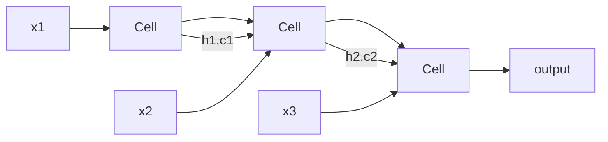

# RNNs and LSTMs

Hub: [[AI-Engineering-Index]]

## Core Idea

A recurrent neural network processes a sequence one step at a time, carrying a hidden state that summarizes the past:

$$h_t = \tanh(W_{xh} x_t + W_{hh} h_{t-1} + b)$$

The same weights are reused at every step (weight sharing over time). Outputs can be produced per step (tagging), at the end (classification), or via an encoder-decoder (translation).

## How it works

**Backpropagation through time (BPTT)**: unroll the network over $T$ steps and apply ordinary backprop. The gradient from step $t$ back to step $k$ contains the product

$$\prod_{i=k+1}^{t} \frac{\partial h_i}{\partial h_{i-1}} = \prod_{i} \operatorname{diag}(1 - h_i^2)\, W_{hh}$$

If the spectral norm of these Jacobians is below 1, gradients vanish exponentially in $t-k$; above 1, they explode. Vanilla RNNs therefore struggle with long-range dependencies.

**LSTM** adds a cell state $c_t$ with additive updates controlled by gates:

- forget $f_t = \sigma(W_f[h_{t-1}, x_t] + b_f)$
- input $i_t = \sigma(W_i[h_{t-1}, x_t] + b_i)$
- candidate $\tilde{c}_t = \tanh(W_c[h_{t-1}, x_t] + b_c)$
- output $o_t = \sigma(W_o[h_{t-1}, x_t] + b_o)$
- $c_t = f_t \odot c_{t-1} + i_t \odot \tilde{c}_t$, $\quad h_t = o_t \odot \tanh(c_t)$

Because $c_t$ is updated additively, $\partial c_t / \partial c_{t-1} = f_t$; when the forget gate stays near 1, gradient flows across many steps (similar in spirit to residual connections).

**GRU** merges forget/input into an update gate $z_t$ and uses a reset gate $r_t$; fewer parameters, often similar quality.



## Python code

Single LSTM step in NumPy:

```python
import numpy as np

def sigmoid(z):
    return 1.0 / (1.0 + np.exp(-z))

def lstm_step(x, h, c, W, b):
    """x: (D,), h,c: (H,), W: (4H, D+H), b: (4H,). Gate order: i, f, g, o."""
    H = h.shape[0]
    z = W @ np.concatenate([x, h]) + b
    i = sigmoid(z[0:H])
    f = sigmoid(z[H:2*H])
    g = np.tanh(z[2*H:3*H])
    o = sigmoid(z[3*H:4*H])
    c_new = f * c + i * g
    h_new = o * np.tanh(c_new)
    return h_new, c_new

D, H, T = 5, 8, 10
rng = np.random.default_rng(0)
W = rng.normal(0, 0.1, (4 * H, D + H))
b = np.zeros(4 * H); b[H:2*H] = 1.0        # forget-gate bias 1: remember by default
h = c = np.zeros(H)
for t in range(T):
    h, c = lstm_step(rng.normal(size=D), h, c, W, b)
print(h.shape)
```

PyTorch sequence classifier with padding handled correctly:

```python
import torch
import torch.nn as nn
from torch.nn.utils.rnn import pack_padded_sequence

class SeqClassifier(nn.Module):
    def __init__(self, vocab, emb=64, hidden=128, classes=2):
        super().__init__()
        self.emb = nn.Embedding(vocab, emb, padding_idx=0)
        self.lstm = nn.LSTM(emb, hidden, batch_first=True, bidirectional=True)
        self.head = nn.Linear(2 * hidden, classes)

    def forward(self, tokens, lengths):
        packed = pack_padded_sequence(self.emb(tokens), lengths.cpu(),
                                      batch_first=True, enforce_sorted=False)
        _, (h_n, _) = self.lstm(packed)          # h_n: (2, B, hidden)
        h = torch.cat([h_n[0], h_n[1]], dim=-1)
        return self.head(h)
```

Gradient clipping during training: `torch.nn.utils.clip_grad_norm_(model.parameters(), 1.0)`.

## RNN vs LSTM vs Transformer

| | Vanilla RNN | LSTM/GRU | Transformer |
|---|---|---|---|
| Long-range memory | poor | better | direct via attention |
| Training parallelism over time | none | none | full |
| Inference cost per new token | $O(1)$ state | $O(1)$ state | grows with context (KV cache) |
| Path length between distant tokens | $O(T)$ | $O(T)$ | $O(1)$ |

Transformers ([[Transformer-Architecture]]) won mostly because they parallelize across sequence positions during training. Recurrent-style ideas persist in state-space and linear-attention models that aim for constant-memory inference.

## Tradeoffs

- Recurrence gives constant memory at inference and naturally streams data.
- Sequential dependency makes training slow on long sequences.
- Truncated BPTT limits compute but also limits learnable dependency length.

## Failure modes

- Exploding gradients: loss spikes/NaN; fix with clipping.
- Padding tokens leaking into final state: use packing or masks.
- Using the last timestep of a padded batch instead of each sequence's true last step.
- Teacher forcing mismatch (exposure bias): model trained on gold prefixes fails on its own errors at generation time.

## Production notes

- Still reasonable for small on-device streaming tasks (keyword spotting, simple time series) where memory is tight.
- For NLP, prefer pretrained Transformers; see [[Fine-Tuning-vs-Prompting]].
- Time-series forecasting: compare against simple baselines (seasonal naive, gradient boosting) before adopting RNNs.

## Interview questions

1. **Why do vanilla RNNs have vanishing gradients?** BPTT multiplies many Jacobians $\operatorname{diag}(\tanh')W_{hh}$; norms below 1 shrink gradients exponentially.
2. **How does an LSTM mitigate it?** Additive cell-state update; gradient through $c$ is scaled by the forget gate, which can stay near 1.
3. **Why initialize the forget-gate bias to 1?** Model starts by remembering, helping gradient flow early in training.
4. **GRU vs LSTM?** GRU has 2 gates and no separate cell state, fewer parameters; performance is task-dependent.
5. **What is teacher forcing?** Feeding ground-truth previous tokens during training; causes exposure bias at inference.
6. **Why did Transformers replace RNNs?** Parallel training across positions and constant path length between tokens.
7. **What does gradient clipping fix, and what doesn't it fix?** It controls exploding gradients; it does nothing for vanishing gradients.

## Related

[[Neural-Networks-and-Backprop]] - [[Attention-Mechanism]] - [[Transformer-Architecture]] - [[CNNs]] - [[Embeddings]]
