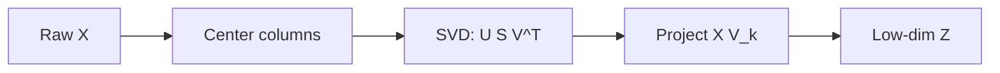

# Linear Algebra for ML

Hub: [[AI-Engineering-Index]]

## Core Idea

Data is a matrix $X \in \mathbb{R}^{n \times d}$ (rows = examples, columns = features). Models are compositions of linear maps plus nonlinearities. Embeddings are vectors, similarity is a dot product, attention is a batched matrix product, and PCA is an SVD.

## How it works

### Vectors, dot products, norms

- $x \cdot y = \sum_i x_i y_i = \|x\|\|y\|\cos\theta$.
- Cosine similarity $= \frac{x\cdot y}{\|x\|\|y\|}$; on L2-normalized vectors it equals the dot product. See [[Embeddings]].
- Norms: $\|x\|_1 = \sum|x_i|$ (L1, sparsity), $\|x\|_2 = \sqrt{\sum x_i^2}$ (L2), $\|x\|_\infty = \max|x_i|$.

### Matrix multiplication

- $(AB)_{ij} = \sum_k A_{ik}B_{kj}$; shapes $(n\times k)(k\times m) \to (n\times m)$.
- A dense layer is $XW + b$. Attention scores are $QK^\top/\sqrt{d_k}$ -- see [[Attention-Mechanism]].
- Not commutative; $(AB)^\top = B^\top A^\top$.

### Rank, inverse, solving systems

- Rank = number of linearly independent columns. Collinear features $\Rightarrow$ $X^\top X$ singular or ill-conditioned.
- Never compute `inv(A) @ b`; use `np.linalg.solve` or `lstsq` (more stable and faster).
- Condition number $\kappa(A) = \sigma_{\max}/\sigma_{\min}$: large $\kappa$ means small input noise causes large output change.

### Eigendecomposition

For square $A$: $Av = \lambda v$. For symmetric $A$ (e.g. covariance): $A = Q\Lambda Q^\top$ with orthonormal $Q$ and real $\lambda$. Positive semidefinite (all $\lambda \ge 0$) matrices include covariance matrices and kernel matrices.

### SVD

Any $X = U\Sigma V^\top$. Columns of $V$ are principal directions; $\Sigma$ holds singular values. Truncated SVD gives the best rank-$k$ approximation in Frobenius norm (Eckart-Young). Used in PCA, LSA, low-rank adapters, compression.

### PCA

1. Center $X$ (subtract column means).
2. SVD of centered $X$; project onto top-$k$ columns of $V$.
3. Explained variance of component $i$ $\propto \sigma_i^2$.



### Gradients in matrix form

- $\nabla_w \|Xw - y\|^2 = 2X^\top(Xw - y)$.
- $\nabla_x (x^\top A x) = (A + A^\top)x$.
- Jacobian: matrix of partial derivatives of a vector function; backprop is chained Jacobian-vector products. See [[Neural-Networks-and-Backprop]].

## Python code

```python
import numpy as np

rng = np.random.default_rng(0)
X = rng.normal(size=(200, 5))
X[:, 4] = X[:, 0] * 2 + 0.01 * rng.normal(size=200)  # near-collinear column
y = X @ np.array([1.0, -2.0, 0.5, 0.0, 0.0]) + 0.1 * rng.normal(size=200)

# Least squares: stable
w, *_ = np.linalg.lstsq(X, y, rcond=None)

# Condition number reveals collinearity
print("cond(X):", np.linalg.cond(X))

# PCA via SVD
Xc = X - X.mean(axis=0)
U, S, Vt = np.linalg.svd(Xc, full_matrices=False)
explained = S**2 / (S**2).sum()
Z = Xc @ Vt[:2].T                  # (200, 2) projection
print("explained variance ratio:", explained.round(3))

# Same with sklearn
from sklearn.decomposition import PCA
pca = PCA(n_components=2).fit(X)
print(pca.explained_variance_ratio_.round(3))

# Cosine similarity matrix for embeddings
E = rng.normal(size=(10, 64))
En = E / np.linalg.norm(E, axis=1, keepdims=True)
sim = En @ En.T                    # (10, 10), diag == 1

# Batched matmul (e.g., attention): (batch, n, d) @ (batch, d, m)
Q = rng.normal(size=(4, 8, 16)); K = rng.normal(size=(4, 8, 16))
scores = Q @ K.transpose(0, 2, 1) / np.sqrt(16)   # (4, 8, 8)
scores2 = np.einsum("bnd,bmd->bnm", Q, K) / np.sqrt(16)
assert np.allclose(scores, scores2)
```

## Tradeoffs

- PCA is linear and variance-driven; high-variance directions are not necessarily predictive. Nonlinear alternatives (UMAP, t-SNE) are for visualization, not features in most pipelines.
- Full SVD is $O(nd\min(n,d))$; use randomized/truncated SVD for large sparse data.

## Failure modes

- Forgetting to center (and usually scale) before PCA -- first component just tracks the mean or the largest-unit feature.
- Fitting PCA on the full dataset before splitting -- leakage. Fit inside a pipeline; see [[Cross-Validation-and-Model-Selection]].
- Using `np.linalg.inv` on ill-conditioned matrices.
- Mixing up row-vector ($xW$) and column-vector ($Wx$) conventions.

## Production notes

- Normalize embeddings once at index time so similarity is a plain dot product.
- float32 is standard for training/inference; accumulate sums in higher precision where precision matters.
- Watch memory: an $n \times n$ similarity matrix grows quadratically -- use approximate nearest neighbor search ([[Vector-Databases]]).

## Interview questions

1. **Why avoid explicit matrix inverse?** Numerically unstable and slower; `solve`/`lstsq`/QR/Cholesky are preferred.
2. **What does SVD give you?** Orthonormal bases $U, V$ and singular values; best low-rank approximation.
3. **How is PCA related to SVD?** PCA directions are the right singular vectors of the centered data matrix.
4. **What does a high condition number imply?** Near-singular system; coefficients sensitive to noise; often collinear features.
5. **When are dot product and cosine similarity equal?** When vectors are unit-normalized.
6. **Gradient of least squares?** $2X^\top(Xw-y)$; setting to zero gives normal equations $X^\top X w = X^\top y$.
7. **Why are covariance matrices PSD?** $v^\top \Sigma v = \mathrm{Var}(v^\top x) \ge 0$.

## Related

- [[Optimization-and-Gradient-Descent]]
- [[Linear-and-Logistic-Regression]]
- [[Embeddings]]
- [[Attention-Mechanism]]
- [[Feature-Engineering]]
