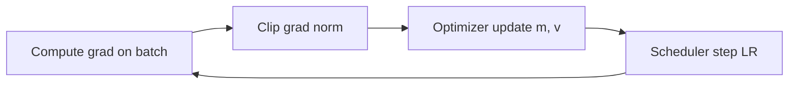

# Optimization and Gradient Descent

Hub: [[AI-Engineering-Index]]

## Core Idea

Training minimizes an empirical loss $L(\theta) = \frac{1}{n}\sum_i \ell(f_\theta(x_i), y_i)$. Gradient methods step against the gradient. The optimizer, the learning rate, and its schedule usually matter more than exotic tricks.

## How it works

### Convexity

$f$ is convex if $f(\lambda a + (1-\lambda) b) \le \lambda f(a) + (1-\lambda) f(b)$. Every local minimum is global. Linear regression (MSE), logistic regression (log-loss), and SVMs (hinge) are convex in their parameters; neural networks are not. In deep nets saddle points and flat regions matter more than bad local minima.

### Gradient descent

$$\theta_{t+1} = \theta_t - \eta \nabla L(\theta_t)$$

- $\eta$ too large: divergence/oscillation. Too small: slow, stuck on plateaus.
- For an $L$-smooth convex function, $\eta \le 1/L$ guarantees descent.
- Ill-conditioning (elongated loss contours) makes GD zig-zag -- feature scaling helps.

### Stochastic and mini-batch GD

Use a mini-batch $B$ to estimate the gradient: $g_t = \frac{1}{|B|}\sum_{i\in B}\nabla \ell_i$. Cheaper per step, noisy; noise can help escape sharp regions. Larger batches reduce noise; a common heuristic is to scale LR with batch size, with warmup.

### Momentum

$$v_{t+1} = \beta v_t + g_t,\quad \theta_{t+1} = \theta_t - \eta v_{t+1}$$

Accumulates velocity along consistent directions, damps oscillation. Nesterov evaluates the gradient at the look-ahead point.

### Adaptive methods

- **AdaGrad:** per-parameter LR scaled by $1/\sqrt{\sum g^2}$; LR decays too aggressively for deep nets.
- **RMSProp:** exponential moving average of $g^2$ instead of sum.
- **Adam:**
  $m_t = \beta_1 m_{t-1} + (1-\beta_1) g_t$, $v_t = \beta_2 v_{t-1} + (1-\beta_2) g_t^2$,
  $\hat m_t = m_t/(1-\beta_1^t)$, $\hat v_t = v_t/(1-\beta_2^t)$,
  $\theta_{t+1} = \theta_t - \eta\,\hat m_t/(\sqrt{\hat v_t}+\epsilon)$.
  Typical defaults $\beta_1=0.9, \beta_2=0.999, \epsilon=10^{-8}$.
- **AdamW:** decouples weight decay from the adaptive update ($\theta \leftarrow \theta - \eta\lambda\theta$ separately). Standard for transformers.

### Learning-rate schedules

| Schedule | Notes |
|---|---|
| Constant | baseline; rarely best |
| Step decay | drop by factor at fixed epochs |
| Cosine decay | smooth decay to a floor; common default |
| Linear warmup + decay | warmup stabilizes early Adam statistics and large-batch training |
| One-cycle | ramp up then down; fast convergence for CNNs |
| ReduceLROnPlateau | decays when validation stalls |



## Python code

```python
import numpy as np

# Mini-batch SGD with momentum for linear regression, from scratch
rng = np.random.default_rng(0)
X = rng.normal(size=(1000, 3)); w_true = np.array([2.0, -1.0, 0.5])
y = X @ w_true + 0.1 * rng.normal(size=1000)

w = np.zeros(3); v = np.zeros(3); lr, beta, bs = 0.05, 0.9, 32
for epoch in range(20):
    perm = rng.permutation(len(X))
    for s in range(0, len(X), bs):
        idx = perm[s:s + bs]
        grad = 2 * X[idx].T @ (X[idx] @ w - y[idx]) / len(idx)
        v = beta * v + grad
        w -= lr * v
print(w.round(3))

# Adam from scratch
def adam(grad_fn, theta, lr=1e-2, b1=0.9, b2=0.999, eps=1e-8, steps=500):
    m = np.zeros_like(theta); v = np.zeros_like(theta)
    for t in range(1, steps + 1):
        g = grad_fn(theta)
        m = b1 * m + (1 - b1) * g
        v = b2 * v + (1 - b2) * g * g
        mh = m / (1 - b1**t); vh = v / (1 - b2**t)
        theta = theta - lr * mh / (np.sqrt(vh) + eps)
    return theta

print(adam(lambda t: 2 * X.T @ (X @ t - y) / len(X), np.zeros(3)).round(3))
```

PyTorch idiom with warmup + cosine and gradient clipping:

```python
import math, torch

model = torch.nn.Linear(10, 1)
opt = torch.optim.AdamW(model.parameters(), lr=3e-4, weight_decay=0.01)
total, warmup = 1000, 50
sched = torch.optim.lr_scheduler.LambdaLR(
    opt,
    lambda s: (s + 1) / warmup if s < warmup
    else 0.5 * (1 + math.cos(math.pi * (s - warmup) / (total - warmup))),
)
for step in range(total):
    x = torch.randn(32, 10); y = torch.randn(32, 1)
    loss = torch.nn.functional.mse_loss(model(x), y)
    opt.zero_grad(set_to_none=True)
    loss.backward()
    torch.nn.utils.clip_grad_norm_(model.parameters(), 1.0)
    opt.step(); sched.step()
```

## Tradeoffs

- SGD+momentum often generalizes well in vision but needs more LR tuning; Adam/AdamW converge faster with less tuning and dominate for transformers.
- Larger batches improve hardware utilization but may need LR retuning and can hurt generalization.
- Second-order methods (Newton, L-BFGS) converge in fewer steps on small convex problems but are too expensive per step for large nets.

## Failure modes

- Loss is NaN: LR too high, log(0), exploding gradients -- lower LR, clip grads, check inputs.
- Loss flat from step 0: LR too low, dead activations, labels misaligned, forgot `zero_grad` (grads accumulate).
- Train loss down, val up: overfitting -- see [[Overfitting-and-Regularization]].
- Using Adam with L2 in the loss instead of AdamW decoupled decay (different, usually worse, effect).
- Unscaled features making GD crawl.

## Production notes

- Always first overfit a tiny batch; if you cannot, there is a bug.
- Run an LR range test (increase LR exponentially, watch loss) to pick a starting LR.
- Log LR, grad norm, and loss per step; save optimizer and scheduler state in checkpoints for resumable training.
- Fix seeds but report variance across a few seeds.

## Interview questions

1. **Why is convexity useful?** Any local minimum is global; GD with suitable LR converges.
2. **SGD vs batch GD?** SGD uses noisy mini-batch gradients: cheaper per step, more updates, noise can aid generalization.
3. **What does momentum fix?** Oscillation in ill-conditioned valleys and slow progress along shallow directions.
4. **Explain Adam's bias correction.** $m, v$ start at zero so early estimates are biased low; divide by $1-\beta^t$.
5. **Adam vs AdamW?** AdamW applies weight decay directly to weights, not via the gradient, so decay is not rescaled by the adaptive denominator.
6. **Why warmup?** Early Adam variance estimates are unreliable and large initial updates can destabilize training.
7. **Loss goes NaN, what do you check?** LR, gradient norms, invalid inputs/log of zero, mixed-precision overflow.

## Related

- [[Linear-Algebra-for-ML]]
- [[Linear-and-Logistic-Regression]]
- [[Neural-Networks-and-Backprop]]
- [[Overfitting-and-Regularization]]
