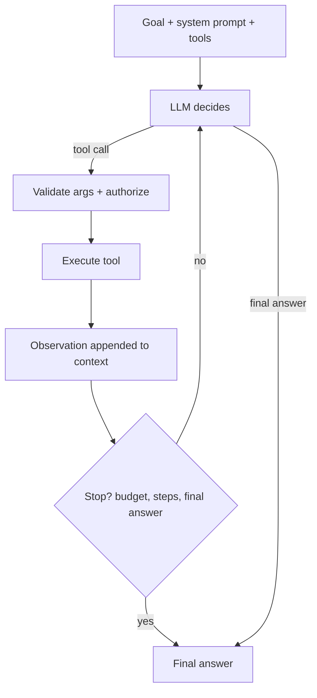

# AI Agents

Hub: [[AI-Engineering-Index]]

## Core Idea

An agent is an LLM in a loop: it decides the next action (usually a tool call), the runtime executes it, the result is appended to context, and the loop continues until the model produces a final answer or a limit is hit. The difference from a fixed pipeline ("workflow") is that the **model chooses the control flow**. Use an agent only when the steps genuinely cannot be known in advance; otherwise a deterministic workflow is cheaper, faster, and easier to test.

## How it works



Common patterns:

- **ReAct:** interleave reasoning and actions; observe each result before choosing the next step.
- **Plan-and-execute:** produce a plan first, then execute steps (optionally re-plan on failure). More predictable, less adaptive.
- **Reflection:** a critique step reviews output and triggers revision.
- **Router:** LLM picks one of N fixed workflows; lowest autonomy, often sufficient.

## Python code: minimal agent loop

```python
import json

TOOLS = {}

def tool(fn):
    TOOLS[fn.__name__] = fn
    return fn

@tool
def search_orders(customer_id: str) -> list[dict]:
    return [{"id": "o1", "status": "shipped"}]  # stub

def run_agent(llm, goal: str, max_steps: int = 8) -> str:
    """llm(messages, tools) -> {"type": "tool", "name", "args"} | {"type": "final", "text"}"""
    messages = [{"role": "system", "content": "You are a support agent. Use tools; do not guess."},
                {"role": "user", "content": goal}]
    for step in range(max_steps):
        decision = llm(messages, tools=list(TOOLS))
        if decision["type"] == "final":
            return decision["text"]
        name, args = decision["name"], decision["args"]
        if name not in TOOLS:
            observation = {"error": f"unknown tool {name}"}
        else:
            try:
                observation = TOOLS[name](**args)
            except Exception as e:           # surface errors to the model, don't crash
                observation = {"error": str(e)}
        messages.append({"role": "assistant", "content": json.dumps(decision)})
        messages.append({"role": "tool", "name": name,
                         "content": json.dumps(observation)[:4000]})  # truncate large results
    return "Stopped: step limit reached."
```

## Tradeoffs

| Autonomy | Predictability | Cost/latency | Use when |
|---|---|---|---|
| Fixed workflow | high | low | steps known |
| Router | high | low | a few known paths |
| Plan-and-execute | medium | medium | multi-step, mostly stable plans |
| Open ReAct loop | low | high, variable | exploratory tasks, unknown steps |

## Failure modes

- Infinite or repetitive loops (same tool, same args). Detect repeats; cap steps, tokens, wall time.
- Error compounding: a small early mistake propagates through later steps.
- Context bloat from raw tool output; summarize or truncate observations.
- Tool misuse: wrong args, hallucinated tool names. Validate with schemas.
- Premature "done" without verifying the goal.

## Security implications

Agents turn text into actions, so [[Prompt-Injection]] becomes remote code execution-by-proxy. Controls: [[Least-Privilege]] tool scopes, act with the end user's identity, human approval for irreversible or external side effects, egress restrictions, and treat every observation as untrusted. The "lethal trifecta" to avoid in one agent: private data access + untrusted content + an exfiltration channel.

## Production notes

- Trace every step (prompt, tool call, args, result, tokens) - see [[LLM-Observability]].
- Evaluate on task success rate and on trajectories (did it take a safe path?), not just final text.
- Make tools idempotent where possible so retries are safe.

## Interview questions

1. **Agent vs workflow?** In a workflow code decides control flow; in an agent the model does. Prefer workflows when steps are known.
2. **How do you stop runaway agents?** Step/token/time budgets, repeat detection, and explicit stop criteria.
3. **What is ReAct?** A prompting pattern that alternates reasoning with tool actions and observations.
4. **How do you evaluate an agent?** Task completion on a scenario suite, trajectory checks, cost/latency per task, and safety violations.
5. **Biggest security risk?** Indirect prompt injection via tool outputs causing unauthorized actions; mitigate with least privilege and approval gates.
6. **Why feed tool errors back instead of raising?** The model can often recover (fix args, try another tool); crashing loses the run.

## Related

[[Tool-Calling-and-Function-Calling]] · [[Multi-Agent-Systems]] · [[Agent-Memory]] · [[MCP-Tool-Integration]] · [[Agent-Design-Checklist]]
