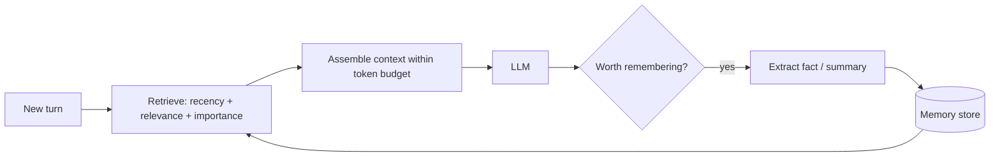

# Agent Memory

Hub: [[AI-Engineering-Index]]

## Core Idea

LLMs are stateless: the only thing the model "remembers" is what is in the current context window. Agent memory is an external system that decides **what to store, how to retrieve it, and what to put back into context**. It is retrieval engineering applied to the agent's own history.

## Types

| Type | Holds | Storage | Lifetime |
|---|---|---|---|
| Short-term | current conversation turns | context window | one session |
| Working | plan, scratchpad, todo list | context or file/KV | one task |
| Episodic | past interactions/events | vector DB + timestamps | long |
| Semantic | facts about user/domain | KV/relational/vector | long |
| Procedural | learned instructions, skills | prompt files, tool code | long |

## How it works



**Context management for short-term memory:**
- Sliding window: keep last N turns.
- Summarization: compress older turns into a running summary.
- Compaction: when near the limit, replace history with a structured state summary.

**Retrieval scoring** for long-term memory often combines $\text{score} = w_r\cdot\text{recency} + w_s\cdot\text{similarity} + w_i\cdot\text{importance}$, with recency decaying exponentially over time.

## Python code

```python
import math, time
from dataclasses import dataclass, field

@dataclass
class Memory:
    text: str
    embedding: list[float]
    importance: float           # 0..1, set at write time
    user_id: str
    created: float = field(default_factory=time.time)

def cosine(a, b):
    dot = sum(x * y for x, y in zip(a, b))
    na, nb = math.sqrt(sum(x * x for x in a)), math.sqrt(sum(y * y for y in b))
    return dot / (na * nb) if na and nb else 0.0

class MemoryStore:
    def __init__(self, half_life_s=7 * 24 * 3600):
        self.items: list[Memory] = []
        self.decay = math.log(2) / half_life_s

    def write(self, m: Memory):
        self.items.append(m)

    def retrieve(self, user_id, q_emb, k=5, w=(0.3, 0.5, 0.2)):
        now = time.time()
        scored = []
        for m in self.items:
            if m.user_id != user_id:          # tenant isolation first
                continue
            recency = math.exp(-self.decay * (now - m.created))
            s = w[0] * recency + w[1] * cosine(q_emb, m.embedding) + w[2] * m.importance
            scored.append((s, m))
        return [m for _, m in sorted(scored, key=lambda x: x[0], reverse=True)[:k]]

    def forget(self, user_id):                # right-to-erasure
        self.items = [m for m in self.items if m.user_id != user_id]
```

## Tradeoffs

- Storing everything is cheap but retrieval quality drops (noise). Store extracted facts, not raw transcripts, where possible.
- Summaries lose detail; raw logs are expensive to retrieve over.
- Updating facts (user moved city) needs conflict resolution: overwrite, version, or timestamp-prefer-latest.

## Failure modes

- Stale or contradicted memories retrieved as truth.
- Memory poisoning: a malicious input gets stored and influences future sessions.
- Cross-user leakage from missing tenant filters.
- Summaries drift, compounding errors over many compactions.

## Security implications

Persistent memory turns a one-time [[Prompt-Injection]] into a persistent one. Validate what gets written, tag provenance, allow users to view and delete memories, and never store secrets or unnecessary PII ([[AI-Data-Leakage-and-Privacy]]).

## Interview questions

1. **Why do agents need external memory?** The model is stateless and context windows are finite and costly.
2. **Summarization vs retrieval?** Summaries keep a compact always-present state; retrieval pulls specific past items on demand. Most systems use both.
3. **How do you rank memories?** Weighted recency, relevance, and importance.
4. **How do you handle contradictory facts?** Timestamp and version facts; prefer the latest, or ask the user.
5. **Memory-specific attack?** Memory poisoning - injected instructions persisted and replayed later.
6. **Privacy requirement?** User-visible, deletable memory with per-user isolation.

## Related

[[AI-Agents]] · [[Context-Windows]] · [[Vector-Databases]] · [[AI-Data-Leakage-and-Privacy]]
