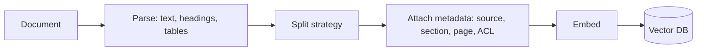

# Chunking Strategies

Hub: [[AI-Engineering-Index]]

## Core Idea

Retrieval works on chunks, not documents. A chunk must be small enough to embed precisely and fit the context budget, yet large enough to be self-contained and answer a question. Chunking is often the highest-leverage and least-glamorous knob in a RAG system ([[RAG-Playbook]]).

## How it works

Two competing forces:

- **Precision**: small chunks give focused embeddings; a long chunk's embedding averages many topics and matches weakly.
- **Context**: large chunks keep the surrounding explanation, definitions, and references the generator needs.

Most strategies decouple these: retrieve with small units, return larger context.



## Strategies

| Strategy | How | Pros | Cons |
|---|---|---|---|
| Fixed-size tokens + overlap | every N tokens, overlap M | simple, predictable | cuts sentences/tables |
| Recursive character/token | split on paragraphs, then sentences, then words until under size | respects natural boundaries | still structure-blind |
| Structure-aware | split on headings, sections, code blocks, table rows; prepend heading path | coherent, good citations | needs a good parser per format |
| Semantic | split where embedding similarity between adjacent sentences drops | topic-coherent | extra compute, variable sizes |
| Parent-child (small-to-big) | index small children, return parent section | precise retrieval + rich context | more storage, dedupe logic |
| Sentence window | index single sentences, return +/- k neighbors | very precise | many vectors |
| Contextual chunk headers | prepend doc title/section summary to each chunk before embedding | disambiguates "it", "this policy" | more tokens per chunk |
| Propositions / LLM-extracted facts | LLM rewrites into atomic statements | good for fact QA | expensive, can distort |

Code: split by functions/classes (AST), not by characters. Tables: keep header with each row group. PDFs: fix extraction first (columns, headers/footers), because bad parsing breaks every strategy.

## Python code: recursive token chunker with heading context

```python
import re

def count_tokens(s: str) -> int:
    return len(s.split())          # replace with the embedding model's tokenizer

SEPARATORS = ["\n\n", "\n", ". ", " "]

def recursive_split(text, max_tokens, seps=SEPARATORS):
    if count_tokens(text) <= max_tokens:
        return [text]
    if not seps:                                   # hard split on words
        words = text.split()
        return [" ".join(words[i:i + max_tokens]) for i in range(0, len(words), max_tokens)]
    sep, rest = seps[0], seps[1:]
    parts, out, buf = text.split(sep), [], ""
    for p in parts:
        cand = p if not buf else buf + sep + p
        if count_tokens(cand) <= max_tokens:
            buf = cand
        else:
            if buf:
                out.append(buf)
            if count_tokens(p) > max_tokens:
                out.extend(recursive_split(p, max_tokens, rest)); buf = ""
            else:
                buf = p
    if buf:
        out.append(buf)
    return out

def add_overlap(chunks, overlap_tokens):
    out = []
    for i, c in enumerate(chunks):
        prev_tail = " ".join(chunks[i - 1].split()[-overlap_tokens:]) if i and overlap_tokens else ""
        out.append((prev_tail + " " + c).strip())
    return out

def chunk_markdown(md: str, source: str, max_tokens=300, overlap=40):
    """Split on headings, keep heading path as context, then size-limit."""
    chunks, path = [], []
    for block in re.split(r"(?m)^(?=#{1,6} )", md):
        if not block.strip():
            continue
        m = re.match(r"(#{1,6}) (.*)", block)
        if m:
            level = len(m.group(1))
            path = path[:level - 1] + [m.group(2).strip()]
        header = " > ".join(path)
        for i, piece in enumerate(add_overlap(recursive_split(block, max_tokens), overlap)):
            chunks.append({"text": f"[{header}]\n{piece}", "source": source,
                           "section": header, "part": i})
    return chunks
```

## Choosing size and overlap

There is no universal best size; it depends on the embedding model, document type, and question style.

- Start with a moderate size (a few hundred tokens) and small overlap, then tune.
- Build a retrieval eval set (question -> expected chunk/doc) and measure recall@k and MRR across sizes ([[LLM-Evaluation-Framework]]).
- Respect the embedding model's max input length; text beyond it is silently truncated by many libraries.
- Overlap helps when answers straddle boundaries but duplicates content and inflates index size.

> TODO: record the sizes that performed best on this repo's own eval set once measured.

## Tradeoffs

- Small chunks: higher precision, more vectors, fragmented context.
- Large chunks: fewer vectors, better context, diluted embeddings, more tokens per retrieved hit.
- Smart chunking (semantic/LLM) costs ingestion compute; structure-aware usually gives most of the gain cheaply.

## Failure modes

- Answer split across two chunks, neither retrieved alone.
- Pronouns and references without antecedents ("the above limit").
- Tables flattened into unreadable text.
- Headers/footers/boilerplate repeated in every chunk dominate similarity.
- Metadata (ACLs, version, date) lost, causing permission leaks or stale answers ([[AI-Data-Leakage-and-Privacy]]).
- Re-chunking without re-embedding everything, mixing incompatible chunk versions.

## Production notes

- Store chunker version and parameters with each chunk; re-index when they change.
- Keep stable chunk IDs (hash of source + section + content) for incremental updates and dedupe.
- Carry access-control metadata on every chunk and filter at query time ([[Vector-Databases]]).
- Combine with [[Hybrid-Search-and-Reranking]]; reranking can compensate for imperfect chunk boundaries.

## Interview questions

1. **Why chunk at all?** Embedding precision, embedding model input limits, and context budget.
2. **Small vs large chunks?** Precision vs context; parent-child retrieval gets both.
3. **What does overlap buy you?** Robustness to boundary splits at the cost of duplication and index size.
4. **How would you chunk code?** By syntax units (functions/classes) with file path and signature as context.
5. **How do you pick chunk size?** Empirically, with a labeled retrieval eval measuring recall@k.
6. **What metadata should each chunk carry?** Source, section path, position, version/date, ACL, chunker version.
7. **What is contextual chunk enrichment?** Prepending document/section context to each chunk before embedding to resolve ambiguity.

## Related

[[RAG-Playbook]] - [[Vector-Databases]] - [[Hybrid-Search-and-Reranking]] - [[Embeddings]] - [[Context-Windows]] - [[RAG-System-Checklist]]
