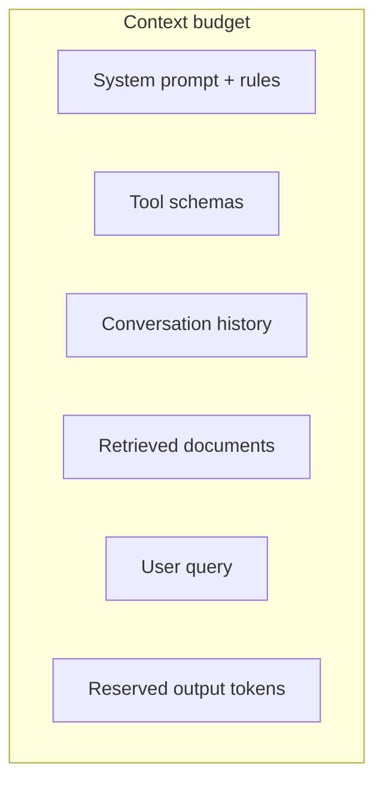

# Context Windows

Hub: [[AI-Engineering-Index]]

## Core Idea

The context window is the maximum number of tokens (input plus generated output) a model can attend to in one call. It is a hard limit, but the practical limit is lower: cost, latency, and quality all degrade as you fill it. Treat context as a scarce budget you allocate deliberately.

## How it works

**Quadratic attention.** Self-attention computes $\text{softmax}(QK^\top/\sqrt{d})V$. For $n$ tokens, $QK^\top$ is $n \times n$, so naive compute and memory are $O(n^2 d)$ and $O(n^2)$. Kernels like FlashAttention avoid materializing the full matrix (memory closer to linear) but compute stays quadratic.

**KV cache.** During generation, keys and values of past tokens are cached so each new token costs $O(n)$ attention. Cache memory per sequence is about

$$2 \times \text{layers} \times \text{kv\_heads} \times d_{head} \times n \times \text{bytes per value}$$

so long contexts reduce how many requests fit on a GPU ([[LLM-Inference-and-Serving]]).

**Position handling.** Models are trained up to some length with a positional scheme (e.g. rotary embeddings). Extending beyond trained length needs techniques such as position interpolation plus fine-tuning; quality is not guaranteed just because the API accepts the tokens.

**Lost in the middle.** Empirically, many models use information at the beginning and end of a long context more reliably than information in the middle. Retrieval accuracy in long contexts varies by model and task; test it on your data rather than trusting the advertised window.



## Budgeting

Allocate explicit token budgets per section and enforce them in code:

```python
from dataclasses import dataclass

@dataclass
class Budget:
    window: int
    reserve_output: int
    system: int
    tools: int
    history: int      # max; leftover goes to retrieval

def assemble(budget, count, system, tools, history, docs, query):
    """count: fn(str)->int using the target model's tokenizer.
    history: list of turns (oldest first). docs: list of chunks sorted by relevance."""
    used = count(system) + count(tools) + count(query) + budget.reserve_output
    if used > budget.window:
        raise ValueError("fixed sections exceed window")

    kept_hist, h_used = [], 0
    for turn in reversed(history):                     # keep most recent turns
        c = count(turn)
        if h_used + c > budget.history:
            break
        kept_hist.insert(0, turn); h_used += c
    used += h_used

    kept_docs = []
    for d in docs:                                     # highest relevance first
        c = count(d)
        if used + c > budget.window:
            break
        kept_docs.append(d); used += c

    # place most relevant docs at the edges to reduce lost-in-the-middle effects
    ordered = kept_docs[0::2] + kept_docs[1::2][::-1]
    return system, tools, kept_hist, ordered, query
```

## Truncation and compression strategies

| Strategy | How | Good for | Risk |
|---|---|---|---|
| Keep-recent (sliding window) | drop oldest turns | chat | loses early constraints |
| Pin + recent | always keep system prompt, first user goal, and recent turns | agents | pinned block grows |
| Summarize old history | LLM summary replaces old turns | long sessions | summary drift, lost details |
| Retrieve instead of include | store history/docs, retrieve relevant pieces | large corpora | retrieval misses ([[RAG-Playbook]]) |
| Head + tail truncation of documents | keep start and end | logs, reports | middle lost |
| Extractive compression | keep only relevant sentences | RAG | removes context needed for reasoning |
| Map-reduce | process chunks separately, combine | summarization of huge docs | cross-chunk reasoning weak |

See [[Agent-Memory]] for long-lived memory designs.

## Tradeoffs

- Long context vs RAG: long context is simpler and avoids retrieval misses, but costs more per call, adds latency, and may reduce precision. RAG is cheaper and scales to unbounded corpora but can miss evidence.
- Prompt caching makes a stable long prefix cheaper; put static content first and variable content last.
- More context is not free accuracy: irrelevant or conflicting text can distract the model.

## Failure modes

- Silent truncation by an SDK or server, dropping the system prompt or the question itself.
- Forgetting to reserve output tokens; responses cut off mid-JSON.
- Conversation history growing unbounded until requests fail or costs spike.
- Instructions buried in the middle of long retrieved text get ignored.
- Untrusted retrieved content in context enabling [[Prompt-Injection]].

## Production notes

- Count tokens before sending; log per-section token usage ([[LLM-Observability]]).
- Build a "needle" test set from your own documents to measure retrieval accuracy at different positions and lengths.
- Latency: time-to-first-token grows with input length (prefill); see [[LLM-Latency-Optimization]].
- Cost: input tokens dominate for RAG and agent workloads; see [[LLM-Cost-Optimization]].

## Interview questions

1. **Why is attention quadratic?** Every token attends to every other token: an $n \times n$ score matrix.
2. **What does the KV cache store and why does it matter?** Past keys/values per layer; avoids recomputation but its memory grows linearly with context and limits batch size.
3. **What is lost-in-the-middle?** Models tend to use information at the start and end of long contexts more reliably than in the middle.
4. **Long context or RAG?** Depends on corpus size, cost, latency, and freshness; often RAG plus moderate context wins in production.
5. **How do you handle chat history beyond the window?** Pin key instructions, keep recent turns, summarize or retrieve older ones.
6. **Why reserve output tokens?** The window includes generated tokens; without a reserve the output is truncated.
7. **How would you verify a model actually uses 100k tokens well?** Position-varied needle and multi-hop tests on in-domain data.

## Related

[[Tokenization]] - [[Attention-Mechanism]] - [[Chunking-Strategies]] - [[RAG-Playbook]] - [[Agent-Memory]] - [[LLM-Inference-and-Serving]]
