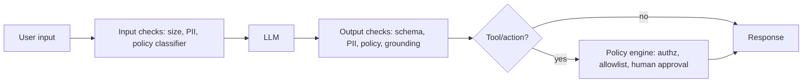

# Guardrails

Hub: [[AI-Engineering-Index]]

## Core Idea

Guardrails are deterministic or model-based checks placed **outside** the LLM, on inputs, outputs, and actions. The system prompt is a request; a guardrail is enforcement. Because every individual check can be bypassed, guardrails are layered and the most important ones are deterministic (schema validation, allowlists, permission checks).

## How it works



| Layer | Examples | Kind |
|---|---|---|
| Input | length limits, rate limits, PII redaction, topic classifier, jailbreak detector | deterministic + ML |
| Context | mark untrusted content, strip hidden text/markup | deterministic |
| Output | JSON schema validation, regex for secrets, toxicity classifier, groundedness check | deterministic + ML |
| Action | tool allowlist, argument validation, per-user authz, human-in-the-loop for irreversible ops | deterministic |

## Python code

```python
import json, re
from pydantic import BaseModel, ValidationError, field_validator

SECRET_PATTERNS = [re.compile(p) for p in (
    r"AKIA[0-9A-Z]{16}",                 # AWS access key id shape
    r"-----BEGIN [A-Z ]*PRIVATE KEY-----",
)]
EMAIL = re.compile(r"[\w.+-]+@[\w-]+\.[\w.]+")

class Refund(BaseModel):
    order_id: str
    amount: float
    @field_validator("amount")
    @classmethod
    def cap(cls, v):
        if not 0 < v <= 500:
            raise ValueError("amount out of policy range")
        return v

def check_input(text: str, max_chars=8000) -> str:
    if len(text) > max_chars:
        raise ValueError("input too long")
    return EMAIL.sub("[EMAIL]", text)

def check_output(raw: str) -> Refund:
    if any(p.search(raw) for p in SECRET_PATTERNS):
        raise ValueError("possible secret in output")
    try:
        return Refund.model_validate(json.loads(raw))
    except (json.JSONDecodeError, ValidationError) as e:
        raise ValueError(f"schema violation: {e}")

def authorize(user, action: Refund) -> bool:
    # enforce with the *user's* permissions, never the model's
    return user.can_refund(action.order_id)
```

## Tradeoffs

- Each ML-based check adds latency and false positives. Run cheap deterministic checks first, and run classifiers in parallel with generation where possible.
- Streaming output conflicts with output checks: either buffer, check incrementally, or accept that partial unsafe text may be shown and retracted.
- Over-blocking hurts usefulness; measure false-positive rate on real traffic.

## Failure modes

- Relying on the system prompt ("never reveal X") as the only control.
- Classifier trained on English; bypassed via other languages or encodings (base64, leetspeak).
- Output validated, but tool arguments not validated before execution.
- Guardrail fails open on timeout without anyone noticing.

## Security implications

Guardrails are one layer in a threat model ([[Threat-Modeling-STRIDE]]). Design as if the model is compromised: constrain what it can reach ([[Least-Privilege]]), validate what it emits, and log decisions. Prefer fail-closed for high-risk actions.

## Production notes

- Log every guardrail decision with a reason code; review blocked samples weekly.
- Version guardrail configs and evaluate them like models ([[LLM-Evaluation-Pipelines]]).
- Keep a red-team set of bypass attempts as a regression suite.

## Interview questions

1. **Why not just put rules in the system prompt?** Prompts are probabilistic and can be overridden by injected content; enforcement must be outside the model.
2. **Which guardrails are most reliable?** Deterministic ones: schema validation, allowlists, authz checks, rate limits.
3. **How do you guard a streaming response?** Buffer by sentence/chunk and check incrementally, or restrict streaming to low-risk routes.
4. **Fail open or closed?** Closed for actions and sensitive data, open with logging for low-risk content checks if availability matters more.
5. **How do you evaluate a guardrail?** Precision/recall on labeled benign and attack sets, plus latency overhead.

## Related

[[Prompt-Injection]] · [[AI-Data-Leakage-and-Privacy]] · [[Structured-Output]] · [[AI-Security-Checklist]] · [[OWASP-Top-10]]
