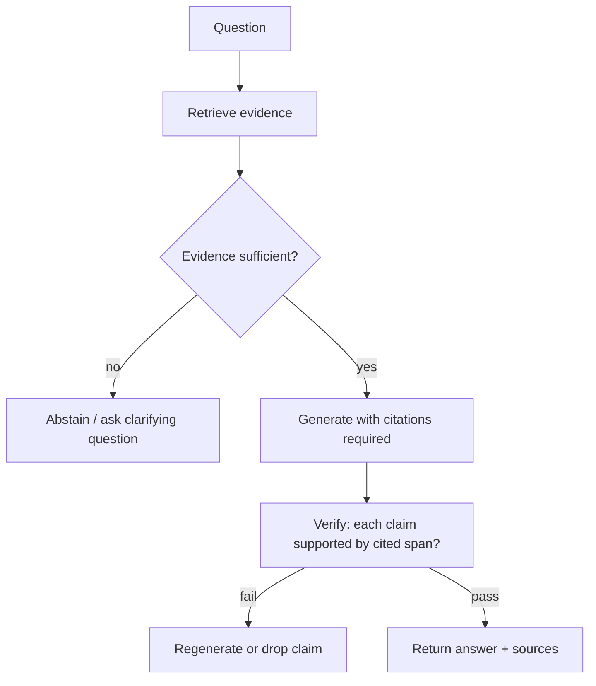

# Hallucination Mitigation

Hub: [[AI-Engineering-Index]]

## Core Idea

A language model is trained to produce likely continuations, not true ones. When the answer is not well represented in its weights or context, it still produces fluent text. "Hallucination" covers two distinct problems:

- **Factuality error:** output contradicts world knowledge.
- **Faithfulness error:** output is not supported by (or contradicts) the provided context.

Faithfulness is the one you can actually engineer against in a product, because you control the context.

## How it works: causes

| Cause | Example |
|---|---|
| Missing knowledge | Question about private or post-cutoff data |
| Bad retrieval | Right answer exists but wrong chunk retrieved |
| Pressure to answer | Prompt implies an answer must exist |
| Long/noisy context | Relevant fact buried among distractors |
| Decoding | High temperature sampling low-probability tokens |
| Ambiguous question | Model picks one interpretation silently |

## Mitigation layers



1. **Grounding:** supply evidence via RAG; instruct "answer only from the context".
2. **Explicit abstention:** give the model a legitimate way out ("If the context does not contain the answer, say you don't know").
3. **Citations:** require claim-level references to chunk IDs; validate IDs exist.
4. **Post-hoc verification:** an NLI model or LLM judge checks each claim against its cited span.
5. **Constrained output:** [[Structured-Output]] with enums reduces free-form invention for extraction tasks.
6. **Decoding:** lower temperature for factual tasks (reduces variance, does not guarantee truth).
7. **Self-consistency:** sample multiple answers; disagreement is a signal of uncertainty.
8. **Tools:** use calculators, databases, and APIs for facts rather than model memory.

## Python code: citation validation + support check

```python
import re

CITE = re.compile(r"\[(\w+)\]")

def split_claims(answer: str) -> list[str]:
    return [s.strip() for s in re.split(r"(?<=[.!?])\s+", answer) if s.strip()]

def verify(answer: str, chunks: dict[str, str], judge) -> dict:
    """judge(claim, evidence) -> bool, e.g. NLI entailment or LLM grader."""
    report = {"unsupported": [], "bad_citations": [], "uncited": []}
    for claim in split_claims(answer):
        ids = CITE.findall(claim)
        if not ids:
            report["uncited"].append(claim)
            continue
        missing = [i for i in ids if i not in chunks]
        if missing:
            report["bad_citations"].append((claim, missing))
            continue
        evidence = "\n".join(chunks[i] for i in ids)
        if not judge(CITE.sub("", claim), evidence):
            report["unsupported"].append(claim)
    report["ok"] = not any(report[k] for k in ("unsupported", "bad_citations"))
    return report
```

## Tradeoffs

- Stricter grounding increases abstentions; users may see "I don't know" more often. Tune on a labeled set.
- Verification doubles (or more) latency and cost; apply it to high-stakes routes only.
- LLM judges hallucinate too; calibrate them against human labels.

## Failure modes

- Model cites a real chunk that does not support the claim (citation laundering).
- Retrieval returns outdated documents; answer is faithful but wrong.
- Prompt says "only use context" but the model blends in parametric knowledge anyway.
- Abstention instruction over-triggers on paraphrased questions.

## Security implications

Hallucinated package names, URLs or commands are an attack surface: attackers can register names that models commonly invent. Validate any generated identifier against an allowlist before executing or linking. Poisoned documents can also induce "faithful" but malicious answers; see [[Prompt-Injection]].

## Production notes

- Track faithfulness and abstention rate as separate metrics ([[LLM-Evaluation-Framework]]).
- Show sources in the UI so users can check.
- Maintain a regression set of known-hallucination questions ([[LLM-Evaluation-Pipelines]]).

## Interview questions

1. **Factuality vs faithfulness?** Factuality is agreement with the world; faithfulness is agreement with the provided context.
2. **Does RAG eliminate hallucination?** No. It reduces missing-knowledge errors but adds retrieval errors and the model can still ignore context.
3. **Does temperature 0 fix it?** It makes output deterministic-ish, not correct. A confident wrong answer stays wrong.
4. **How do you detect it automatically?** Claim extraction + entailment check against sources; self-consistency; judge models calibrated on human labels.
5. **How do you let the model say "I don't know"?** Explicit instruction, few-shot examples of abstention, and evaluating abstention on unanswerable questions.
6. **Why are hallucinated package names a security risk?** Attackers can publish malicious packages under commonly hallucinated names.

## Related

[[RAG-Playbook]] · [[Guardrails]] · [[Hybrid-Search-and-Reranking]] · [[LLM-Evaluation-Framework]]
