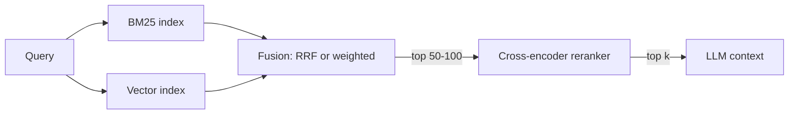

# Hybrid Search and Reranking

Hub: [[AI-Engineering-Index]]

## Core Idea

Dense retrieval (embeddings) captures meaning and paraphrase; lexical retrieval (BM25) captures exact tokens such as error codes, SKUs, names and rare terms. Each fails where the other succeeds. Hybrid search runs both, fuses the ranked lists, and a reranker (usually a cross-encoder) re-scores a small candidate set with full query-document attention.

## How it works



**BM25** scores term $t$ in doc $d$:
$\text{score}(q,d)=\sum_{t\in q} \text{IDF}(t)\cdot\frac{f(t,d)(k_1+1)}{f(t,d)+k_1(1-b+b\frac{|d|}{\text{avgdl}})}$

**Reciprocal Rank Fusion (RRF)** ignores raw scores (which are on incompatible scales) and uses ranks only:
$\text{RRF}(d)=\sum_{r\in R}\frac{1}{k+\text{rank}_r(d)}$, commonly $k=60$.

**Weighted score fusion** normalizes each list (min-max or z-score) then computes $\alpha\cdot s_{dense}+(1-\alpha)\cdot s_{bm25}$. It needs tuning and is sensitive to score distribution drift.

**Bi-encoder vs cross-encoder:** a bi-encoder embeds query and document separately (fast, precomputable, used for retrieval). A cross-encoder feeds `[query, doc]` together through a transformer and outputs one relevance score (slow, cannot be precomputed, much more precise). Hence: retrieve broadly with cheap methods, rerank narrowly with the expensive one.

## Python code

```python
from collections import defaultdict

def rrf(rankings: list[list[str]], k: int = 60) -> list[tuple[str, float]]:
    """rankings: each list is doc ids ordered best-first."""
    scores: dict[str, float] = defaultdict(float)
    for ranking in rankings:
        for rank, doc_id in enumerate(ranking, start=1):
            scores[doc_id] += 1.0 / (k + rank)
    return sorted(scores.items(), key=lambda x: x[1], reverse=True)

def hybrid_search(query, bm25_search, vector_search, rerank, top_k=5, pool=50):
    lexical = bm25_search(query, limit=pool)      # -> list[str] ids
    dense = vector_search(query, limit=pool)      # -> list[str] ids
    fused = [doc_id for doc_id, _ in rrf([lexical, dense])][:pool]
    # rerank: (query, ids) -> list[(id, score)] using a cross-encoder
    reranked = sorted(rerank(query, fused), key=lambda x: x[1], reverse=True)
    return reranked[:top_k]

# Example with sentence-transformers (model name is a placeholder):
# from sentence_transformers import CrossEncoder
# ce = CrossEncoder("<cross-encoder-model>")
# scores = ce.predict([(query, docs[i]) for i in fused])
```

## Tradeoffs

| Choice | Pro | Con |
|---|---|---|
| RRF | No tuning, scale-free | Ignores score confidence |
| Weighted fusion | Can emphasize one signal | Needs normalization + tuning per corpus |
| Cross-encoder rerank | Large precision gain on top-k | Adds latency proportional to pool size |
| LLM-as-reranker | Flexible, instruction-following | Expensive, nondeterministic, injection surface |
| Larger candidate pool | Better recall | Reranker cost grows linearly |

## Failure modes

- Tokenizer mismatch: BM25 analyzer strips the very characters that matter (e.g. `C++`, `k8s`, hyphenated IDs).
- Metadata filters applied after fusion, leaving fewer than k results.
- Reranker trained on a different domain; scores look confident but ordering is wrong.
- Duplicate chunks from overlapping chunking crowd out diverse evidence (apply dedupe or MMR).
- Truncation: cross-encoders have a max input length; long chunks get silently cut.

## Security implications

- Access control must be enforced at retrieval time (filter by tenant/ACL before fusion), not after generation.
- Retrieved documents are untrusted input; see [[Prompt-Injection]]. A reranker does not sanitize content.

## Production notes

- Measure recall@k of the candidate pool separately from precision@k after reranking; they fail for different reasons.
- Cache reranker scores for hot queries. Batch cross-encoder calls on GPU.
- Log which retriever contributed each final result to diagnose regressions.

## Interview questions

1. **Why hybrid instead of just embeddings?** Embeddings blur exact identifiers and rare terms; BM25 matches them exactly. Hybrid improves recall across query types.
2. **Why RRF over summing scores?** BM25 and cosine scores have different scales and distributions; RRF uses ranks, so no normalization is needed.
3. **Bi-encoder vs cross-encoder?** Bi-encoder encodes independently and supports ANN indexing; cross-encoder attends jointly, is more accurate, but must run per pair at query time.
4. **How do you pick the candidate pool size?** Plot recall@N of the first stage; choose N where recall plateaus, bounded by the reranker latency budget.
5. **What is MMR?** Maximal Marginal Relevance trades relevance against similarity to already-selected results to increase diversity.
6. **Where do ACL filters go?** Inside each retriever query (pre-filter), so unauthorized docs never enter the pool.

## Related

[[RAG-Playbook]] · [[Vector-Databases]] · [[Chunking-Strategies]] · [[Embeddings]] · [[RAG-System-Checklist]]
