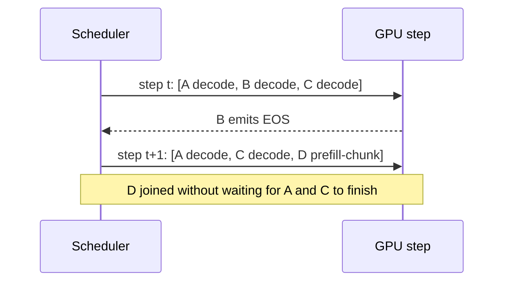

# LLM Inference and Serving

Hub: [[AI-Engineering-Index]]

## Core Idea

A decoder-only LLM generates one token at a time; each new token attends to all previous tokens. Serving is about keeping expensive GPUs busy while meeting latency targets. Two phases behave very differently:

- **Prefill:** process the whole prompt in parallel. Compute-bound. Determines time to first token (TTFT).
- **Decode:** generate tokens one per step. Each step reads all model weights and the KV cache for little compute. Memory-bandwidth-bound. Determines time per output token (TPOT).

## KV cache

In attention, each token's keys and values for every layer are needed by all later tokens. Recomputing them every step would be wasteful, so they are cached.

KV cache size per sequence:
$\text{bytes} = 2 \times n_{layers} \times n_{kv\_heads} \times d_{head} \times \text{seq\_len} \times \text{bytes\_per\_elem}$

(The 2 is for K and V.) It grows linearly with sequence length and batch size, and often limits how many concurrent requests fit on a GPU. Grouped-query attention (GQA) and multi-query attention reduce $n_{kv\_heads}$ to shrink it.

```python
def kv_cache_bytes(layers, kv_heads, head_dim, seq_len, batch=1, bytes_per_elem=2):
    return 2 * layers * kv_heads * head_dim * seq_len * batch * bytes_per_elem

# hypothetical config, fp16:
gib = kv_cache_bytes(layers=32, kv_heads=8, head_dim=128, seq_len=8192, batch=16) / 2**30
print(f"{gib:.1f} GiB")   # 16.0 GiB for this made-up configuration
```

## Batching

- **Static batching:** wait for a batch, run until the longest sequence finishes. Short requests wait for long ones; GPU slots idle.
- **Continuous (in-flight / iteration-level) batching:** the scheduler makes decisions every decode step. Finished sequences leave, new requests join immediately. Improves utilization under variable output lengths.
- **Chunked prefill:** split long prompts into chunks interleaved with decode steps so a big prefill does not stall everyone else's decoding.



## Paged attention

Naively, each request reserves one contiguous KV buffer sized for the maximum length, wasting memory through fragmentation (reserved but unused space). **PagedAttention** (introduced with the vLLM project) borrows the idea of virtual memory paging:

- The KV cache is split into fixed-size **blocks**, each holding keys/values for a fixed number of tokens.
- Each sequence has a **block table** mapping logical token positions to physical blocks, which need not be contiguous.
- Blocks are allocated on demand as the sequence grows, so waste is limited to the last partially filled block.
- Blocks can be **shared** across sequences (a common prefix, or parallel samples) with copy-on-write, which enables prefix caching.
- The attention kernel gathers K/V through the block table.

Result: more sequences fit in memory, so larger effective batch sizes and higher throughput. It does not make a single request's math faster.

## Other serving techniques

| Technique | What it does |
|---|---|
| Prefix caching | Reuse KV blocks for identical prompt prefixes (system prompts, few-shot) |
| Speculative decoding | Small draft model proposes tokens; big model verifies several in one pass; with the standard acceptance rule the output distribution is preserved |
| Tensor parallelism | Split each layer's matrices across GPUs (needs fast interconnect) |
| Pipeline parallelism | Split layers across GPUs/nodes |
| [[Quantization]] | Smaller weights/KV cache -> less memory traffic |
| FlashAttention-style kernels | IO-aware exact attention that avoids materializing the full attention matrix |

## Tradeoffs

- Bigger batches raise throughput but raise per-request latency. Choose by SLO.
- Longer max context reduces how many concurrent requests fit.
- Self-hosting gives control and data locality, but you own capacity planning, upgrades, and on-call.

## Failure modes

- KV cache exhaustion -> preemption (swap or recompute), latency spikes.
- One very long prompt without chunked prefill stalls decode for others.
- Tokenizer/model version mismatch between client and server.
- Autoscaling on CPU metrics while the bottleneck is GPU memory.

## Security implications

- Prefix/KV cache sharing across tenants can create timing side channels; scope caches per tenant where it matters.
- Serving endpoints must enforce auth, per-tenant rate limits, and max token limits to prevent resource exhaustion.

## Interview questions

1. **Prefill vs decode?** Prefill processes the prompt in parallel (compute-bound, drives TTFT); decode generates tokens sequentially (memory-bandwidth-bound, drives TPOT).
2. **Why a KV cache?** To avoid recomputing keys/values for all previous tokens at every step.
3. **What limits concurrency?** Mostly KV cache memory, which scales with batch x sequence length.
4. **Continuous batching?** Scheduling at each decode iteration so requests join/leave independently.
5. **PagedAttention?** KV cache stored in fixed-size non-contiguous blocks via a block table, reducing fragmentation and enabling sharing.
6. **Speculative decoding?** Draft model proposes, target model verifies multiple tokens per forward pass; speeds decode when acceptance is high.
7. **How does GQA help?** Fewer KV heads -> smaller KV cache -> more concurrent sequences.

## Related

[[Quantization]] · [[LLM-Latency-Optimization]] · [[LLM-Cost-Optimization]] · [[Transformer-Architecture]] · [[Context-Windows]]
