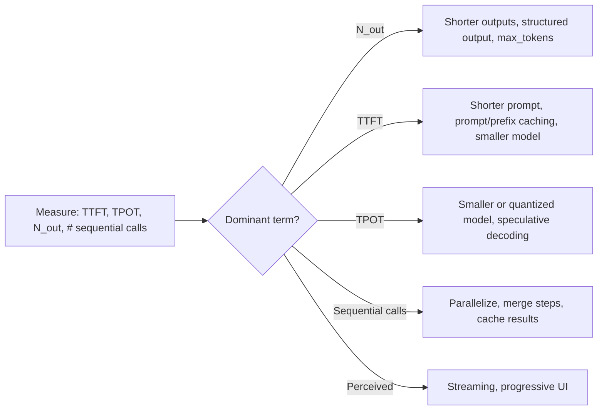

# LLM Latency Optimization

Hub: [[AI-Engineering-Index]]

> Scope: wall-clock and perceived time per request. Cost levers live in [[LLM-Cost-Optimization]]; serving internals (batching, KV cache, PagedAttention) in [[LLM-Inference-and-Serving]]. Timeouts and fallback ordering: [[Pattern-Model-Fallback-Chain]].

## Core Idea

End-to-end latency for a single LLM call is approximately:

$T \approx T_{network} + T_{queue} + \text{TTFT} + N_{out}\times \text{TPOT}$

where TTFT (time to first token) grows with prompt length and queueing, and TPOT (time per output token) is set by model size, hardware and batch load. **For typical chat/generation workloads, output tokens usually dominate** (for long-prompt, short-answer workloads such as classification over large documents, prefill/TTFT can dominate instead), so the biggest lever is often generating fewer of them. For multi-step apps (RAG, agents), sequential calls add up; parallelizing them matters as much as speeding each one.

## Levers



| Lever | Affects | Notes |
|---|---|---|
| Fewer output tokens | total | Ask for concise/structured answers; set `max_tokens` |
| Streaming | perceived | Users see output at TTFT instead of at completion |
| Prompt/prefix caching | TTFT, cost | Keep static content (system prompt, docs) at the start, stable across calls |
| Smaller/distilled model | TTFT, TPOT | Validate quality with evals; route hard queries to larger model |
| [[Quantization]] | TPOT, memory | Self-hosted |
| Speculative decoding | TPOT | Self-hosted or provider feature |
| Parallel calls | total | Independent retrievals, tool calls, guardrail checks |
| Semantic/exact response cache | total | Only for repeatable queries; watch staleness |
| Region/co-location | network | Put app near the model endpoint |
| Reduce reasoning budget | total | If the model supports configurable thinking, tune to the task |

## Python code: parallelize independent steps + measure TTFT

```python
import asyncio, time

async def timed_stream(stream):
    """stream: async iterator of text chunks. Returns (text, ttft_s, total_s)."""
    start = time.perf_counter()
    ttft, parts = None, []
    async for chunk in stream:
        if ttft is None:
            ttft = time.perf_counter() - start
        parts.append(chunk)
    return "".join(parts), ttft, time.perf_counter() - start

async def answer(query, retrieve_docs, fetch_profile, moderate, generate_stream):
    # independent steps run concurrently instead of sequentially
    docs, profile, verdict = await asyncio.gather(
        retrieve_docs(query), fetch_profile(), moderate(query))
    if not verdict["allowed"]:
        return "Request blocked."
    text, ttft, total = await timed_stream(generate_stream(query, docs, profile))
    print(f"ttft={ttft:.3f}s total={total:.3f}s")
    return text
```

## Tradeoffs

- Smaller models are faster but may need retries or fallbacks, which erase the gain; measure end-to-end.
- Aggressive caching risks stale or cross-user answers.
- Streaming complicates output guardrails ([[Guardrails]]).
- Throughput-optimized serving (big batches) raises per-request latency.

## Failure modes

- Optimizing average latency while p95/p99 is the user-visible problem (long tails from long outputs, retries, cold starts).
- Cache hit rate near zero because prompts include timestamps or request IDs at the start.
- Adding an "LLM check" step for every request, doubling latency.
- Rate-limit retries with no jitter causing synchronized bursts.

## Security implications

Response caches must key on everything that affects authorization (tenant, user role, document ACL version). A shared cache keyed only on query text can leak one user's answer to another ([[AI-Data-Leakage-and-Privacy]]).

## Production notes

- Record TTFT, TPOT, output tokens, and number of sequential calls per request in traces ([[LLM-Observability]]).
- Set timeouts per step and a total deadline; degrade gracefully (fallback model, partial answer).

## Interview questions

1. **Break down LLM latency.** Network + queue + TTFT + output tokens x TPOT, summed over sequential calls.
2. **Single biggest lever?** Usually fewer output tokens and fewer sequential calls.
3. **Does streaming reduce latency?** It reduces perceived latency (time to first visible output), not total time.
4. **How does prompt caching help?** Reuses computed prefix state for repeated prefixes, reducing TTFT and cost; requires a stable prefix.
5. **Why look at p99?** Tail latency drives user experience and timeouts; averages hide it.
6. **When not to use a smaller model?** When quality drops cause retries or escalations that cost more than the saved time.

## Related

[[LLM-Inference-and-Serving]] · [[Quantization]] · [[LLM-Cost-Optimization]] · [[LLM-Observability]]
