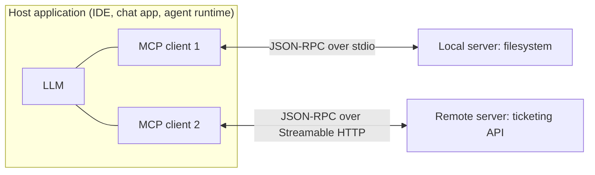

# MCP Tool Integration

Hub: [[AI-Engineering-Index]]

## Core Idea

The Model Context Protocol (MCP) is an open protocol that standardizes how LLM applications connect to external tools and data. Instead of writing a custom integration per app per tool (N x M), a tool provider writes one MCP server and any MCP-capable application can use it. It sits on top of the model's native tool calling: MCP defines discovery and invocation; the model still decides which tool to call.

## Architecture



- **Host:** the user-facing application. Owns the LLM, user consent, and security policy.
- **Client:** a connector inside the host; one client per server connection (1:1).
- **Server:** a program exposing capabilities. Can be local (subprocess) or remote.

Messages are **JSON-RPC 2.0** (requests, responses, notifications). A session begins with an `initialize` handshake where both sides negotiate protocol version and capabilities.

## Primitives

| Primitive | Controlled by | Purpose | Methods (examples) |
|---|---|---|---|
| Tools | Model | Actions with side effects or computation; JSON Schema input | `tools/list`, `tools/call` |
| Resources | Application | Read-only context identified by URI (files, records) | `resources/list`, `resources/read` |
| Prompts | User | Reusable templates the user selects (e.g. slash commands) | `prompts/list`, `prompts/get` |

Client-side features a server may request: **sampling** (ask the host's LLM for a completion), **roots** (which directories/URIs the server may operate in), and **elicitation** (ask the user for input). Servers can notify clients when lists change.

## Transports

- **stdio:** host launches the server as a subprocess; messages over stdin/stdout. Simple, local, inherits the user's OS permissions.
- **Streamable HTTP:** server is an HTTP endpoint; client POSTs JSON-RPC, server can respond with JSON or stream via Server-Sent Events. Replaced the earlier separate HTTP+SSE transport. Remote servers use OAuth-based authorization per the spec.

> TODO: pin the spec revision your implementation targets; details (auth, transports) have changed between revisions.

## Python code: a minimal server (official Python SDK)

```python
# pip install mcp
from mcp.server.fastmcp import FastMCP

mcp = FastMCP("tickets")

TICKETS = {"T-1": {"title": "Login fails", "status": "open"}}

@mcp.tool()
def get_ticket(ticket_id: str) -> dict:
    """Return a ticket by id. Read-only."""
    if ticket_id not in TICKETS:
        raise ValueError("ticket not found")
    return TICKETS[ticket_id]

@mcp.resource("tickets://open")
def open_tickets() -> str:
    """List of open ticket ids."""
    return "\n".join(k for k, v in TICKETS.items() if v["status"] == "open")

@mcp.prompt()
def triage(ticket_id: str) -> str:
    return f"Triage ticket {ticket_id}: classify severity and suggest an owner."

if __name__ == "__main__":
    mcp.run()          # stdio transport by default
```

Type hints and docstrings become the tool's JSON Schema and description, which the model reads when deciding what to call.

## Tradeoffs

- Pro: reuse integrations across hosts, dynamic discovery, clear separation between app and tool code.
- Con: extra process/network hop, versioning across spec revisions, and tool descriptions consume context tokens (many servers = large tool lists that can degrade tool selection).

## Failure modes

- Too many tools exposed; model picks wrong tool. Scope servers per task.
- Vague descriptions/schemas lead to bad arguments.
- Server returns huge payloads that flood context.
- Unhandled server crash on stdio kills the session silently.

## Security implications

- **Tool descriptions are untrusted input.** A malicious server can embed instructions in descriptions ("tool poisoning") or change them after approval. Pin versions and review descriptions.
- **Tool results are untrusted** and a channel for indirect [[Prompt-Injection]].
- **Local stdio servers run with your OS permissions.** Install only from trusted sources; sandbox where possible.
- **Remote servers:** use proper authorization, do not pass through the user's token to downstream APIs unvalidated (confused deputy), validate `Origin` and bind local HTTP servers to localhost.
- Apply [[Least-Privilege]]: read-only tools by default, human confirmation for destructive tools, restrict roots.
- Combining servers can create exfiltration paths (one reads private data, another can send it out).

## Interview questions

1. **Host vs client vs server?** Host is the app with the LLM and policy; a client is its per-server connector; a server exposes tools/resources/prompts.
2. **Tools vs resources vs prompts?** Tools are model-invoked actions, resources are app-controlled read-only context, prompts are user-selected templates.
3. **What wire format?** JSON-RPC 2.0 over stdio or Streamable HTTP.
4. **Does MCP replace function calling?** No; it standardizes how tools are discovered and invoked. The model still uses its tool-calling ability.
5. **What is tool poisoning?** Malicious instructions hidden in tool metadata that the model reads as guidance.
6. **Why is stdio risky?** The server runs locally with the user's privileges.

## Related

[[Tool-Calling-and-Function-Calling]] · [[AI-Agents]] · [[Prompt-Injection]] · [[Agent-Design-Checklist]] · [[AI-Security-Checklist]]
