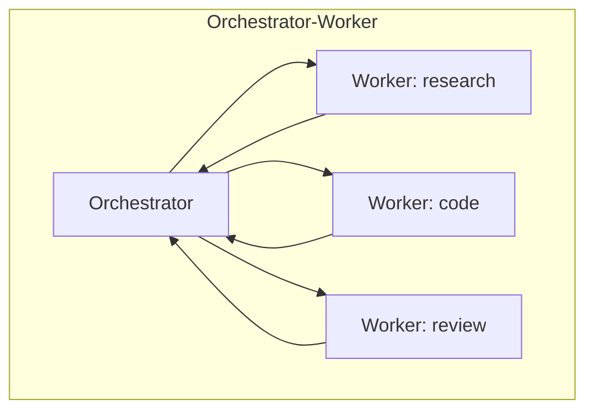

# Multi-Agent Systems

Hub: [[AI-Engineering-Index]]

## Core Idea

A multi-agent system splits work across several LLM instances, each with its own prompt, tools, and context window. The main real benefits are **context isolation** (each worker sees only what it needs), **parallelism**, and **specialized tool sets**. The costs are more tokens, coordination bugs, and harder debugging. Start with one agent; split only when a single context is overloaded or tasks are naturally parallel.

## Topologies



| Topology | Description | Good for | Risk |
|---|---|---|---|
| Orchestrator-worker | Lead agent decomposes, delegates, synthesizes | Broad research, parallel subtasks | Orchestrator bottleneck, lossy summaries |
| Pipeline | Fixed sequence of specialized agents | Draft -> critique -> edit | Errors propagate forward |
| Debate / critic | Agents argue or one critiques another | Catching errors | Can converge on shared wrong answer |
| Peer handoff | Agent transfers conversation to another | Customer-support routing | Lost context at handoff |
| Blackboard | Agents read/write shared state | Loosely coupled tasks | Race conditions, conflicting writes |

## How it works

- **Task spec:** delegation messages must be self-contained: goal, constraints, output format, and what "done" means. Workers do not see the orchestrator's context.
- **Result contract:** workers return structured output ([[Structured-Output]]) so the orchestrator can merge deterministically.
- **Budgets:** each worker has its own step/token budget; the orchestrator has a global budget.

## Python code: parallel orchestrator-worker

```python
import asyncio, json

async def worker(llm, role: str, task: str) -> dict:
    prompt = (f"You are the {role} worker. Complete ONLY this task and return JSON "
              f'{{"summary": str, "evidence": [str], "confidence": "low|medium|high"}}.\nTask: {task}')
    raw = await llm(prompt)
    try:
        return {"role": role, **json.loads(raw)}
    except json.JSONDecodeError:
        return {"role": role, "summary": "", "evidence": [], "confidence": "low", "error": "bad json"}

async def orchestrate(llm, goal: str) -> str:
    plan_raw = await llm(f'Split into at most 4 independent subtasks as JSON list of '
                         f'{{"role": str, "task": str}}. Goal: {goal}')
    subtasks = json.loads(plan_raw)[:4]                      # hard cap fan-out
    results = await asyncio.gather(*(worker(llm, s["role"], s["task"]) for s in subtasks),
                                   return_exceptions=True)
    ok = [r for r in results if isinstance(r, dict) and not r.get("error")]
    return await llm(f"Synthesize an answer to: {goal}\nFindings: {json.dumps(ok)}")
```

## Tradeoffs

- Token cost multiplies with the number of agents; parallelism reduces wall time, not spend.
- Isolation improves focus but loses shared nuance; summaries are lossy.
- More agents means more nondeterminism and more places for injection to enter.

## Failure modes

- Vague delegation -> duplicate or overlapping work.
- Workers report success without evidence; orchestrator trusts it.
- Deadlock or ping-pong handoffs between peers.
- Echo chamber: critics built on the same model share the same blind spots.

## Security implications

A worker that reads untrusted content can pass injected instructions upstream in its "summary". Treat inter-agent messages as untrusted data, give each agent the minimum tools ([[Least-Privilege]]), and keep high-privilege actions in an agent that never reads raw untrusted content. See [[Prompt-Injection]].

## Production notes

- Propagate a single trace ID across all agents ([[LLM-Observability]]).
- Evaluate end-to-end and per role; a regression may hide in one worker.
- Use cheaper models for narrow workers where evals allow ([[LLM-Cost-Optimization]]).

## Interview questions

1. **When is multi-agent worth it?** When subtasks are parallelizable or a single context cannot hold all relevant information; otherwise a single agent is simpler.
2. **Main cost?** Token multiplication and coordination complexity.
3. **How do agents communicate reliably?** Self-contained task specs and structured result schemas.
4. **Why can critic agents fail?** Same model, same biases; they may agree on wrong answers. Use tools/tests as ground truth where possible.
5. **How does injection spread?** Through worker outputs consumed as instructions by the orchestrator.

## Related

[[AI-Agents]] · [[Agent-Memory]] · [[MCP-Tool-Integration]] · [[Agent-Design-Checklist]]
