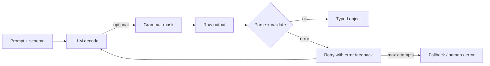

# Structured Output

Hub: [[AI-Engineering-Index]]

## Core Idea

When LLM output feeds code, "mostly JSON" is a bug. Structured output means guaranteeing (or at least verifying) that the response matches a schema. There are three layers, and production systems usually combine them:

1. **Prompting**: describe the schema and show examples. Cheap, not guaranteed.
2. **Constrained decoding**: the decoder is only allowed to emit tokens that keep the output valid under a grammar/JSON schema. Guarantees syntax.
3. **Validation**: parse and validate against a schema (types, enums, ranges, cross-field rules), then repair or retry. Guarantees your contract, including semantics that grammars cannot express.

Syntax validity is not correctness: a perfectly valid JSON object can contain hallucinated values.

## How it works

**Constrained decoding.** At each step, the model produces logits over the vocabulary. A grammar engine (finite-state machine or pushdown automaton compiled from a JSON schema or regex/CFG) computes the set of tokens that keep the prefix valid, and all other logits are masked to $-\infty$ before sampling. Complications: tokens span multiple characters, so the engine must match token strings against grammar states; this is why implementations precompute token-to-state indexes.

**Provider "JSON mode" vs "schema mode".** Some APIs guarantee only valid JSON; others accept a JSON Schema and enforce it (often with a restricted schema subset). Check your provider's documentation for supported keywords.



## Python code: Pydantic validation with retry

```python
import json
from typing import Literal
from pydantic import BaseModel, Field, ValidationError, field_validator

class Ticket(BaseModel):
    category: Literal["billing", "bug", "feature", "other"]
    priority: int = Field(ge=1, le=4)
    summary: str = Field(min_length=5, max_length=200)
    customer_email: str | None = None

    @field_validator("customer_email")
    @classmethod
    def email_shape(cls, v):
        if v is not None and "@" not in v:
            raise ValueError("not an email")
        return v

SCHEMA = json.dumps(Ticket.model_json_schema())

def extract_ticket(text: str, llm, max_attempts: int = 3) -> Ticket:
    """llm: callable(messages) -> str. Provider-agnostic."""
    messages = [
        {"role": "system", "content":
            "Extract a support ticket. Respond with ONLY a JSON object matching this schema:\n" + SCHEMA},
        {"role": "user", "content": text},
    ]
    last_err = None
    for _ in range(max_attempts):
        raw = llm(messages)
        try:
            return Ticket.model_validate_json(strip_fences(raw))
        except ValidationError as e:
            last_err = e
            messages += [
                {"role": "assistant", "content": raw},
                {"role": "user", "content":
                    f"Your output failed validation:\n{e}\nReturn corrected JSON only."},
            ]
    raise RuntimeError(f"structured output failed after {max_attempts} attempts: {last_err}")

def strip_fences(s: str) -> str:
    s = s.strip()
    if s.startswith("```"):
        s = s.split("\n", 1)[1] if "\n" in s else ""
        s = s.rsplit("```", 1)[0]
    return s.strip()
```

`model_validate_json` raises `ValidationError` for malformed JSON as well as schema errors, so one except branch covers both.

## Schema design tips

- Keep schemas flat and small; deep nesting and many optional fields increase errors.
- Use enums (`Literal`) for categorical fields instead of free text.
- Add a `reasoning` or `evidence` field *before* the answer field if you want the model to think first (fields are generated in order).
- Allow explicit "unknown": nullable fields or an `"other"` enum reduce fabricated values.
- Put descriptions on fields; they are part of the prompt.
- Version the schema; downstream consumers depend on it.

## Tradeoffs

| Approach | Syntax guarantee | Semantic checks | Cost | Notes |
|---|---|---|---|---|
| Prompt only | no | via validator | lowest | retries add latency |
| JSON mode | valid JSON | via validator | low | schema may still be wrong |
| Schema-constrained decoding | yes (schema subset) | via validator | low to medium | may slightly change model behavior |
| Tool/function calling | provider-dependent | via validator | low | natural for actions, see [[Tool-Calling-and-Function-Calling]] |

Heavily constrained formats can reduce answer quality on reasoning tasks; a common pattern is to let the model reason in free text, then produce the structured result in a second step or a final field.

## Failure modes

- Markdown fences or preamble around the JSON.
- Truncated output due to `max_tokens` (unclosed braces). Reserve enough output tokens.
- Valid JSON with invented values (IDs, emails, dates). Cross-check against source data.
- Infinite retry loops or retry cost explosions. Cap attempts and log failures.
- Schema drift between prompt and validator. Generate the prompt schema from the same Pydantic model.
- Untrusted output used directly in SQL/shell/HTML. Treat model output as user input ([[SQL-Injection]], [[OWASP-Top-10]]).

## Production notes

- Track validation failure rate, retry rate, and per-field error counts ([[LLM-Observability]]).
- Include schema-conformance checks in regression suites ([[LLM-Evaluation-Pipelines]]).
- For streaming UIs, use incremental/partial JSON parsing and only act on the final validated object.

## Interview questions

1. **How does constrained decoding work?** A grammar/FSM from the schema masks invalid next tokens at every decoding step.
2. **Why still validate if decoding is constrained?** Grammars do not capture business rules or factual correctness; also provider schema support is partial.
3. **How do you design a retry loop?** Feed the validation error back, cap attempts, log, and fall back gracefully.
4. **Why put a reasoning field first?** Generation is left-to-right; the answer can condition on prior reasoning.
5. **How do you prevent fabricated values?** Nullable/unknown options, evidence fields, cross-check against sources.
6. **JSON mode vs schema mode?** Valid JSON only vs conformance to a specific schema.
7. **Is LLM JSON output safe to use in a SQL query?** No; it is untrusted input: parameterize and validate.

## Related

[[Tool-Calling-and-Function-Calling]] - [[Prompt-Engineering-Guide]] - [[Guardrails]] - [[Hallucination-Mitigation]] - [[LLM-Evaluation-Pipelines]]
