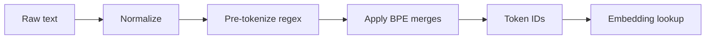

# Tokenization

Hub: [[AI-Engineering-Index]]

## Core Idea

LLMs do not see characters or words; they see integer token IDs from a fixed vocabulary. A tokenizer maps text to a sequence of subword units that balances vocabulary size (embedding table size, softmax cost) against sequence length (attention cost, context usage). Everything you pay for and every context limit you hit is measured in tokens, so tokenization is an engineering concern, not just a preprocessing detail.

## How it works

**Byte Pair Encoding (BPE)** training:

1. Start with a base vocabulary (characters, or all 256 bytes for byte-level BPE).
2. Count adjacent symbol pairs in the corpus.
3. Merge the most frequent pair into a new symbol; record the merge.
4. Repeat until the target vocabulary size is reached.

Encoding applies learned merges in order. Frequent words become single tokens; rare words split into pieces.

**Byte-level BPE** operates on UTF-8 bytes, so any string is encodable (no unknown token). Most tokenizers also apply a **pre-tokenization** regex (split on whitespace, punctuation, digits) before merging so merges do not cross word boundaries.

**Other schemes**: WordPiece (merge chosen by likelihood gain, used in BERT-style models), Unigram LM (start large, prune tokens that least reduce likelihood; SentencePiece supports both Unigram and BPE and treats whitespace as a symbol).



## Python code: minimal BPE

```python
from collections import Counter

def get_pairs(words):
    pairs = Counter()
    for word, freq in words.items():
        for a, b in zip(word, word[1:]):
            pairs[(a, b)] += freq
    return pairs

def merge(words, pair):
    out = {}
    for word, freq in words.items():
        new, i = [], 0
        while i < len(word):
            if i < len(word) - 1 and (word[i], word[i + 1]) == pair:
                new.append(word[i] + word[i + 1]); i += 2
            else:
                new.append(word[i]); i += 1
        out[tuple(new)] = freq
    return out

def train_bpe(corpus, num_merges):
    words = Counter(tuple(w) + ("</w>",) for w in corpus.split())
    merges = []
    for _ in range(num_merges):
        pairs = get_pairs(words)
        if not pairs:
            break
        best = max(pairs, key=pairs.get)
        words = merge(words, best)
        merges.append(best)
    return merges

print(train_bpe("low lower lowest newer wider new", 8))
```

Counting tokens with a real tokenizer (Hugging Face; the model name is a placeholder):

```python
from transformers import AutoTokenizer
tok = AutoTokenizer.from_pretrained("your-model-name")
ids = tok.encode("Tokenization affects cost.")
print(len(ids), tok.convert_ids_to_tokens(ids))
```

Always count with the tokenizer of the model you actually call; different model families produce different counts for the same text.

## Consequences engineers must know

| Effect | Why | What to do |
|---|---|---|
| Cost and latency scale with tokens | APIs bill per input/output token | measure tokens, not characters; see [[LLM-Cost-Optimization]] |
| Non-English text often costs more tokens | vocab trained on corpus dominated by some languages/scripts | budget per language; test with real samples |
| Code, JSON, whitespace are token-heavy | indentation, braces, long identifiers | minify structured payloads where safe |
| Arithmetic and character tasks are weak | numbers split inconsistently; model does not see letters | use tools/code for math, spelling, counting |
| Leading space changes the token | `"hello"` and `" hello"` are different IDs | be careful with stop sequences and prompt concatenation |
| Glitch/rare tokens | under-trained vocabulary entries | sanitize odd inputs; avoid relying on exotic strings |
| Context limits are token limits | see [[Context-Windows]] | chunk by tokens, see [[Chunking-Strategies]] |

## Tradeoffs

- Larger vocabulary: shorter sequences, better multilingual coverage, but bigger embedding/output matrices.
- Smaller vocabulary: smaller model head, longer sequences, more attention compute.
- Byte-level: no unknown tokens, but unfamiliar scripts fall back to many byte tokens.

## Failure modes

- Estimating cost with `len(text)/4` style heuristics on non-English or code-heavy data.
- Truncating by characters and splitting a multi-byte character or a structured field.
- Mismatched tokenizer between training and serving (fine-tunes with added special tokens).
- Special-token injection: user text containing strings that the tokenizer maps to control tokens. Encode user text with special-token parsing disabled. See [[Prompt-Injection]].

## Production notes

- Log input/output token counts per request; they are the core cost and latency metric ([[LLM-Observability]]).
- Cache tokenizer instances; tokenization of long documents can be a measurable CPU cost.
- For RAG, measure chunk sizes in tokens of the embedding model, which may differ from the generator's tokenizer.

## Interview questions

1. **Why subword tokenization instead of words or characters?** Words: huge vocab and OOV; characters: very long sequences. Subwords balance both.
2. **Explain BPE training.** Repeatedly merge the most frequent adjacent pair until vocab size is reached; encoding replays merges.
3. **What does byte-level BPE guarantee?** Every string is encodable; no unknown token.
4. **Why can the same sentence cost more in another language?** Tokenizer merges favor frequent training-corpus patterns, so underrepresented scripts split into more tokens.
5. **Why are LLMs bad at counting letters?** They operate on tokens, not characters.
6. **How would you estimate monthly API cost?** Sample real traffic, tokenize with the target model tokenizer, multiply input and output tokens by prices and volume.
7. **What is the risk of special tokens in user input?** They could be parsed as control tokens; disable special-token parsing for untrusted text.

## Related

[[Context-Windows]] - [[Chunking-Strategies]] - [[Embeddings]] - [[LLM-Cost-Optimization]] - [[Transformer-Architecture]]
