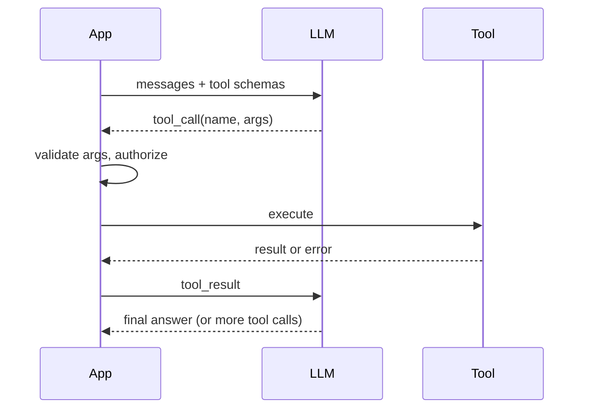

# Tool Calling and Function Calling

Hub: [[AI-Engineering-Index]]

## Core Idea

Tool calling lets a model request that *your code* run a function. You describe tools (name, description, JSON Schema for arguments); the model returns a structured call instead of (or alongside) text; your application executes it, sends the result back, and the model continues. The model never executes anything itself. This is the foundation of [[AI-Agents]] and protocols like [[MCP-Tool-Integration]].

## How it works



The loop repeats until the model returns a final answer or a limit is hit. Providers differ in message format (e.g. `tool_calls` with IDs on the assistant message, and a matching tool-result message referencing that ID), but the pattern is the same.

**Parallel calls**: a model may return several independent tool calls in one turn. Execute them concurrently and return every result, each tied to its call ID.

## Python code: provider-agnostic tool loop

```python
import json
import concurrent.futures as cf
from pydantic import BaseModel, ValidationError

class GetWeather(BaseModel):
    city: str
    unit: str = "celsius"

def get_weather(city: str, unit: str) -> dict:
    return {"city": city, "temp": 21, "unit": unit}   # stub

TOOLS = {
    "get_weather": {
        "fn": get_weather,
        "args": GetWeather,
        "description": "Get current weather for a city. Use only when the user asks about weather.",
        "side_effects": False,
    },
}

def tool_schemas():
    return [{"name": n, "description": t["description"],
             "parameters": t["args"].model_json_schema()} for n, t in TOOLS.items()]

def run_one(call):
    """call: {'id', 'name', 'arguments' (json string)} -> tool result message."""
    spec = TOOLS.get(call["name"])
    if spec is None:
        content = {"error": f"unknown tool {call['name']}"}
    else:
        try:
            args = spec["args"].model_validate_json(call["arguments"])
            content = spec["fn"](**args.model_dump())
        except ValidationError as e:
            content = {"error": "invalid arguments", "details": e.errors(include_url=False)}
        except Exception as e:                       # tool failure, not a crash
            content = {"error": type(e).__name__, "message": str(e)[:500]}
    return {"role": "tool", "tool_call_id": call["id"], "content": json.dumps(content, default=str)}

def agent_loop(llm, messages, max_steps=6):
    """llm(messages, tools) -> {'content': str|None, 'tool_calls': [..]}"""
    for _ in range(max_steps):
        reply = llm(messages, tool_schemas())
        messages.append({"role": "assistant", "content": reply.get("content"),
                         "tool_calls": reply.get("tool_calls") or []})
        calls = reply.get("tool_calls") or []
        if not calls:
            return reply["content"]
        with cf.ThreadPoolExecutor(max_workers=4) as pool:   # parallel calls
            results = list(pool.map(run_one, calls))
        messages.extend(results)
    return "Stopped: step limit reached."
```

Key points: validate arguments before executing, return errors to the model as data (it can often self-correct), cap steps, preserve call IDs.

## Schema and tool design

- Few, well-named tools with clear, distinct descriptions beat many overlapping ones.
- Describe *when* to use a tool and when not to.
- Use enums and required fields; avoid free-form "query" strings when structured params are possible.
- Return concise, relevant results; huge tool outputs eat context ([[Context-Windows]]).
- Make tools idempotent where possible; include idempotency keys for writes.
- Separate read tools from write/side-effect tools; gate the latter.

## Error handling

| Error | Handling |
|---|---|
| Unknown tool / bad args | return structured error; model retries |
| Transient failure (timeout, 5xx) | retry with backoff inside the tool, then report |
| Permanent failure | return clear error; model explains to user |
| Loop / repeated identical calls | detect duplicates, stop after N |
| Result too large | truncate/summarize, paginate |
| Step or cost budget exceeded | stop and return partial result |

## Security

Tool calling turns text into actions, so model output must be treated as untrusted.

- **Least privilege**: each tool gets minimal scopes and credentials; no generic "run SQL" or "run shell" in user-facing apps ([[Least-Privilege]]).
- **Authorization in code, not prompt**: check the *end user's* permissions on every call; the model's decision is not authorization.
- **Prompt injection**: tool results (web pages, emails, documents) can contain instructions. Treat them as data, label them, and never let them expand permissions ([[Prompt-Injection]]).
- **Human confirmation** for irreversible or high-impact actions (payments, deletes, sending messages).
- **Input validation**: parameterize queries ([[SQL-Injection]]), validate paths/URLs, block SSRF to internal addresses.
- **Data exfiltration**: restrict outbound tools (URL fetch, email) when sensitive data is in context ([[AI-Data-Leakage-and-Privacy]]).
- **Audit logging** of every call with args, caller, and result status.
- Threat-model the tool surface with [[Threat-Modeling-STRIDE]].

## Tradeoffs

- More tools increase capability but also selection errors and context size.
- Parallel calls reduce latency but complicate ordering and partial failure.
- Autonomy vs control: more steps without confirmation means faster tasks and larger blast radius.

## Failure modes

- Model hallucinates tool names or argument fields.
- Model calls a tool when it should answer directly, or answers from memory when it should call.
- Infinite loops of the same call.
- Tool result containing injected instructions that hijack the next step.
- Missing tool result for a call ID, causing provider API errors.

## Production notes

- Trace each loop iteration: prompt tokens, tool, latency, error ([[LLM-Observability]]).
- Evaluate tool selection accuracy and argument correctness on a golden set ([[LLM-Evaluation-Pipelines]]).
- Use timeouts per tool and an overall deadline.
- See [[Agent-Design-Checklist]] and [[AI-Security-Checklist]].

## Interview questions

1. **Does the model execute the function?** No; it emits a structured request; the application executes it.
2. **How do you handle invalid arguments?** Validate with a schema; return the error as a tool result so the model can correct.
3. **How do parallel tool calls work?** Multiple calls in one turn, executed concurrently, each result tied to its call ID.
4. **How do you stop runaway loops?** Step/cost/time caps and duplicate-call detection.
5. **Biggest security risk?** Indirect prompt injection via tool results leading to unauthorized actions or exfiltration; mitigate with least privilege, authorization in code, and confirmation for sensitive actions.
6. **Where should authorization happen?** In the tool implementation, against the end user's identity.
7. **What makes a good tool description?** Specific purpose, when to use/not use, typed constrained params.

## Related

[[AI-Agents]] - [[MCP-Tool-Integration]] - [[Structured-Output]] - [[Prompt-Injection]] - [[Least-Privilege]] - [[Guardrails]] - [[Agent-Design-Checklist]]
